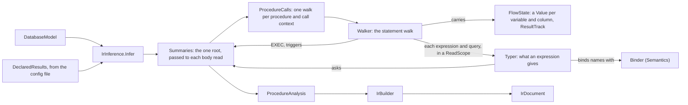

# Haruspex.SqlServer.Inference

Infers what each procedure returns, from its bound body, into the IR: every result set, every column and JSON key, its
type, whether it may be null or absent, its facets, and how many rows it has. It is a dataflow analysis by abstract
interpretation: each body is walked as SQL Server would run it, over descriptions of values rather than values, and
anything not modelled is unknown, with a reason. The guide explains the ideas:
[the shape of the problem](../../docs/internals/01-the-shape-of-the-problem.md),
[abstract interpretation (the typer and the walker)](../../docs/internals/04-abstract-interpretation.md),
[values as a lattice](../../docs/internals/05-values-as-a-lattice.md),
[flow, joins and fixed points](../../docs/internals/06-flow-joins-and-fixed-points.md),
[summaries and recursion](../../docs/internals/07-summaries-and-recursion.md) and
[the SQL Server type system, as data](../../docs/internals/08-the-sql-server-type-system-as-data.md).

This README explains the rules construct by construct. [What haruspex models](../../docs/coverage.md) is the list beside it:
every built-in function and every construct ScriptDom parses, each with what haruspex does with it and a link to its section
here, written by a test from the code.

## How data flows through it



## Example

```csharp
var model = SqlScriptFolder.Read("path/to/database").Model;
var inferred = IrInference.Infer(model, [new ObjectName("shop", "get_category")]);
foreach (var warning in inferred.Diagnostics)
    Console.Error.WriteLine(warning);   // what could not be checked, such as a write to a table the project doesn't define
var document = inferred.Value;
```

The guide's [first chapter](../../docs/internals/01-the-shape-of-the-problem.md) shows a procedure and what this gives for
it, claim by claim.

## What it guarantees

- **Every claim holds for every execution**, under the rules below, each observed on SQL Server and named by its test, and
  given the assumptions and except in the known gaps that
  [the project's README](../../README.md#what-it-guarantees-and-what-it-cant-see) lists.
  What isn't proved is unknown, with a reason from `IrUnknownReason`, never guessed
  ([decision 0002](../../docs/decisions/0002-unknown-with-a-reason-never-a-guess.md)).
- **Unknowns stay local.** An unmodelled expression makes its column unknown, not its row; only what can't be placed (a
  result set of unknown shape) makes a procedure's results unknown.
- **Anything new is unknown until modelled**, so teaching it a construct turns unknowns into claims and never makes an
  existing claim wrong. That holds of a new clause on a construct already modelled too: every property of every node the
  typer accepts is listed with how it is read, and a test holds the list to ScriptDom ("Clauses", below).
- **The same model gives the same document.**

## What it deliberately doesn't do

- **No files, zips or XML.** It reads a model already built ([docs/architecture.md](../../docs/architecture.md)).
- **No name resolution.** What a name in a body means is Semantics' answer; this layer decides what it holds.
- **No names, no config file, no emitters.** Generated names are settled by Config, which also applies overrides to the
  finished document; declared results are handed in as IR results; emitters read the IR.

## The rules, construct by construct

The rest of this page is the reference: how a procedure's statements are read in order, and what each construct inside
them gives: calls ("Calls" below), what filters and single-row queries prove ("Refinement"), writes, triggers and cursors ("DML", "Triggers", "Cursors"), `APPLY`,
`VALUES` lists and views ("APPLY", "Views"), `SELECT *` ("`SELECT *`"), expressions ("Expressions", "Precision lost", "CASE, IIF, CHOOSE and NULLIF",
"Built-in functions", "Window functions"), table-valued functions, full-text table functions, set operations and the other joins, `OPENJSON`, `FOR JSON AUTO` and `ROOT`, JSON built in
the project and traced to where it is read, and JSON assembled as text. The walk is `Walker.cs`, with `FlowState.cs` (the state and
its join); what an expression or a query gives is `Typer.cs` and its parts, read in a `ReadScope.cs` (what each source a
query binds holds, the state it is read in, what the conditions around it prove and the construct it is inside), and never
in anything the walk holds (the guide's [chapter 4](../../docs/internals/04-abstract-interpretation.md)) and `Lattice/` (the knowledge join of values, one lattice per fact, composed in `Value.Join`). Every engine rule it leans on is
observed on SQL Server 2025 RTM-CU10 and kept as a test in
`tests/Haruspex.DifferentialTests/StatementFlowObservationTests.cs`; the test names are given below. Each later section
names its own code and its own test class. A construct's unit tests are in the class of the same family, in
`tests/Haruspex.Tests/Inference` ([CONTRIBUTING](../../CONTRIBUTING.md#where-a-constructs-tests-are) lists the families).
The last section, "What each construct gives in the IR", says what each construct writes in the IR's own terms: its null
reasons, facets, unknown reasons and nodes.

## What the IR describes: calls that succeed

A path that raises an error to the caller describes no call that returns, so it is dropped. That is what makes
`IF @x IS NULL THROW …` a guard rather than a branch:

- `THROW` ends the procedure (`Throw_ends_the_procedure_and_the_call_fails`).
- `RAISERROR` of severity 11 or more goes on running, and later result sets are sent, but the client is handed the
  error, so the call fails (`Raiserror_of_severity_11_or_more_carries_on_but_the_call_fails`). So it ends the path. A
  severity of 10 or less is a message, and a severity that is not a literal may be either, so the path goes on.
- An error inside `TRY` goes to `CATCH` instead (`An_error_in_try_goes_to_catch_and_the_results_before_it_still_arrive`).
- A missing table is not caught by a `CATCH` in the same procedure (`A_missing_table_is_not_caught_by_catch_in_the_same_procedure`):
  it fails the call. Treating it as reaching `CATCH` anyway only adds states to the join, which claims less.

**The return code.** A call that succeeds ends with 0 unless a `RETURN` with another value runs: no `RETURN`, a bare one,
`RETURN 0` and `RETURN NULL` all give 0 (observed in `MssqlDriverObservationTests`). So an object's `returnsCode` is true exactly
when its body has a `RETURN` whose value isn't the constant 0 or NULL, at any depth and whether or not it is reached, or when the
body can't be read (`ReturnCodes`); a query file's is false, since the server refuses `RETURN` with a value in its batch. A
procedure's function hands the code back only when it is true
([decision 0060](../../docs/decisions/0060-a-call-returns-its-one-result-itself.md)).

## Parameters

A procedure's parameter is its declared type with that type's facts (`SqlTypes.ToParameterShape`): a length, a decimal's
digits and range, an integer's range, in the database's default collation, which a parameter takes as a column without
`COLLATE` does. SQL Server converts what a caller sends to the declared type, so the facts hold inside the body; and since
the conversion cuts a string short or rounds a decimal without an error, they are the rule a client checks a value against
before sending it ([decision 0054](../../docs/decisions/0054-a-parameter-is-checked-against-its-declared-type.md)). What the
server and the mssql driver do with a value outside them is observed, type by type, in `ParameterObservationTests`; the
fixture is `tests/fixtures/till`. A `json` parameter is JSON text whose shape isn't typed yet. Nothing a body proves narrows a
parameter: a guard says what the procedure does with a value, not what a caller may send.

### Table-valued parameters

A `READONLY` parameter of a table type the project defines (`CREATE TYPE … AS TABLE`) is an array of the type's rows, and
names the type's definition, which the IR carries (`TableTypes`;
[decision 0076](../../docs/decisions/0076-a-table-valued-parameter-is-an-array-of-strict-rows-of-its-type.md),
[decision 0077](../../docs/decisions/0077-the-ir-carries-a-table-type-s-definition.md)). A row has every column, in the type's
order, each with its type's facts and those the type's CHECK constraints prove, and NULL only where the column takes it. What the
server does with a row was observed through the mssql driver (`ParameterObservationTests`):

- the columns are matched by place, not name (`Columns_are_matched_by_place_not_by_name`), and every one must be sent
  (`A_column_left_out_fails_the_call`, 500);
- a default never applies to a row sent (`A_default_never_applies_to_a_row_a_table_valued_parameter_is_sent`), so a column with
  one is sent like any other;
- a key refuses a row that shares it (`A_table_valued_parameter_s_key_refuses_a_duplicate_row`, 2627), but one declared
  `IGNORE_DUP_KEY = ON` drops it (`A_key_that_ignores_duplicates_drops_a_duplicate_row_a_table_valued_parameter_is_sent`); a
  CHECK refuses a row that breaks it (`A_check_on_a_table_type_refuses_a_row_that_breaks_it`, 547), and a string longer than its
  column is refused (`A_value_longer_than_its_column_fails_the_call_with_8037`);
- the parameter may be left out, and is then an empty table, or sent with no rows, but not as NULL
  (`A_table_valued_parameter_can_be_left_out_or_empty_but_not_null`, 206);
- a type with an identity, computed or `rowversion` column can't be sent at all, not even with no rows
  (`A_type_with_a_column_the_server_fills_can_t_be_sent_even_with_no_rows`: 1077, 271, 273), so its parameter is unknown
  (`unsupported-sql-type`) and can only be left out; so is one with a column of a type not modelled, or of a type the project
  doesn't define.

Inside the body the parameter, and a variable declared with a table type (`DECLARE @t sales.line_list`), is a table variable of
the type's columns, keys and CHECK constraints (`BodyDeclarations`, `TableType.As`): a query that reads it is typed as a query
over a table, its columns' nullability and value sets from the declaration, and one that fixes a key reads one row at most,
since SQL Server enforces the type's keys on every row sent or written. A table type's column takes the database's collation
(`A_table_type_s_column_takes_the_database_s_collation`). The unit tests are `ParameterTests.TableTypes.cs`.

## Query files

A query file is a batch of the application's, sent through `sp_executesql` rather than called by name, and inferred as a
procedure's body is (`QueryFiles`), against the same model, beside the procedures. Its parameters are the variables it uses
without declaring (`BatchVariables.Undeclared`, in Syntax), in the order it first uses them; each takes the type its file
declares (`-- @param @order_id int`, read by `QueryFileReader` in Sources), or else the type its uses decide, or else is unknown
with the reason `undecided-parameter` ([decision 0059](../../docs/decisions/0059-a-query-file-s-parameters-are-typed-from-their-uses.md)).
Two walks make it: one with every such variable undeclared, in which the walker hands each statement, and the typer each query
it reads, to `ParameterUses` in the scope it is read in, so a column is typed where it is bound (a CTE, a derived table, a
temporary table); and the walk of what runs, with the parameters typed, which gives the results. A parameter accepts NULL, as a
procedure's does.

A use decides a type only with the parameter itself as an operand, by the rule SQL Server's `sp_describe_undeclared_parameters`
applies there (`ParameterRules`), each observed in `QueryParameterObservationTests` against the server's own answer:

| Use | Type |
|---|---|
| `=`, `<>`, `!=`, an `IN` list, with a column or a literal | the operand's, facets and all: `nvarchar(80)`, `decimal(10,2)`, `datetime2(3)` |
| `<`, `>`, their kin and `BETWEEN`, with a column or a literal | an integer, bit, money, float, `date`, `datetime` the operand's; a decimal `decimal(38,19)`; a string `varchar(8000)` or `nvarchar(4000)`, max staying max; a `time`, `datetime2` or `datetimeoffset` with 7 places |
| `LIKE`, either side | `varchar(8000)` or `nvarchar(4000)`, by the other side's kind |
| arithmetic that is a whole select-list column or `ORDER BY` key, with a column or a literal | an integer, money or float the operand's (an integer under `&`, `\|`, `^` too); a decimal `decimal(38,19)`; a string under `+` `varchar(8000)` or `nvarchar(4000)`; a `datetime` or `smalldatetime` under `+` its own |
| the count of `TOP`, `OFFSET` or `FETCH` | `bigint`; `TOP … PERCENT` `float` |
| a value of `INSERT … VALUES` with its columns listed, or of `UPDATE … SET` | the column's |
| an argument of a procedure (by name or place), a scalar function or a table-valued function of the project | the parameter's declared type |

Each operand of a use is a use of its own, so `@p IN ('a', 'bb')` or `@p BETWEEN 1 AND 2.5` decides nothing unless its operands
give one type: the server combines them by rules not observed here (`varchar(8000)`, `decimal(38,19)`). Every other use decides
nothing: a use inside a larger expression, which the server types from the expression's context
(`o.total = @x * 2` is `decimal(38,19)` there, from `total`); a `bit` in arithmetic, which the server makes `datetime`; `LIKE`
over a binary value; a test of NULL, where the server falls back on `int`; and a use in a query the walk doesn't read,
such as a subquery under `EXISTS`. Uses that decide one type decide it even where the server refuses to answer, as it does for a
parameter used twice (error 11508): each alone has the server's answer, and the type is what the call declares, so the walk of
what runs is true of every call. Uses that decide two types leave the parameter unknown, naming each.

## The callers' session

Some values are NULL or an error depending on `SET` options of the session that calls the procedure, which it runs under
whoever created it (`A_procedure_runs_under_its_callers_options_not_those_of_whoever_created_it`). `IrInference.Infer` takes
what the config file declares the callers set (`SessionOptions`), and every body reads it through `Summaries.Session`: a
procedure, the procedures it calls, and the functions, views and triggers they reach all run in the caller's session. An
option not declared is not known, and each rule then claims what holds whatever it is
([decision 0038](../../docs/decisions/0038-the-callers-session-is-declared.md)).

- **`ANSI_WARNINGS` or `ARITHABORT` on** (`SessionOptions.OverflowIsAnError`): an overflow, a division by zero, a `COUNT`
  past `int` and a value outside a math function's domain are errors, which fail the call, so `arithmetic-overflow`,
  `count-overflow` and `domain-error` are not given; NULL comes only from both off
  (`An_overflow_is_null_only_when_ansi_warnings_and_arithabort_are_both_off`). The typer makes each of those reasons in one
  place (`Typer.Overflow`, `Typer.CountPastInt`, `Typer.Domain`), so the rule is read once for each, and a rule that asks
  whether a value can be null asks its reasons: `ISNULL` of a second argument never null is never null when its overflow is
  an error.
- **`CONCAT_NULL_YIELDS_NULL` off** (`SessionOptions.ConcatenatingNullKeepsTheString`): string `+` is null only when both
  sides may be ("Strings" below).
- **`NUMERIC_ROUNDABORT` off, or `ANSI_WARNINGS` or `ARITHABORT` on** (`SessionOptions.RoundingMayBeNull`): a decimal rounded
  to fewer places ("Precision lost" below) is rounded silently, or is an error, so `precision-loss` is not given. Under
  `TRY_CAST` and `TRY_CONVERT` only `NUMERIC_ROUNDABORT` off removes it, since `TRY_` turns the error into NULL. The typer
  makes the reason in one place, `Typer.PrecisionLoss`, as it does the overflow's.
- A `SET` of one of these in a body overrides the caller's for its duration. `ON` for `ANSI_WARNINGS` or `ARITHABORT`, and `OFF`
  for `NUMERIC_ROUNDABORT`, are passed over, since each can only make a value NULL less often; anything else stops the walk
  with an unknown (`Walker.IsHarmless`), so a declaration never holds past it.

## Masked columns

A column declared `MASKED WITH (FUNCTION = '…')` (`Column.Mask`) gives a caller without the `UNMASK` permission its mask in
place of each value, and the mask of any expression whose value comes from it in place of the result. Every mask is a value of
the type no longer than it, but not padded to a `char(n)`'s or `binary(n)`'s length and as short as the mask whatever the value,
and NULL exactly when the value is: `default()` gives `0`, `'xxxx'` cut to the type, `0x30`, `1900-01-01` and `false`, and the
other functions what they write (`Each_mask_is_a_value_of_its_column_s_type_no_longer_than_it_and_null_only_for_null`). So of a
masked value inference claims only its type, its reasons to be null and its greatest length (`Value.Masked`,
`ScalarFacets.Masked`): the type's own range and digits stay, and a CHECK's range or set, a fixed length and a minimum length
go. A `random()` range the type can't hold is refused when the column is declared
(`A_random_mask_draws_from_its_range_which_must_lie_in_the_column_s_type`), so the type's range holds. The masks apply unless
the config file declares that the callers hold `UNMASK` (`SessionOptions.MasksAreLifted`) and no module runs as another
user, by `WITH EXECUTE AS` or an `EXECUTE AS` statement in its body (`Summaries.MasksApply`, [HAR2103](../../docs/diagnostics/HAR2103.md)). The tests' reader holds no `UNMASK`, so
the differential tests hold every fixture's IR to the masks (`tests/fixtures/fittings`).

- **A column read** (`Typer.FromColumn`) is masked when its table's column is. A body's own temporary table is never masked to the
  session that made it (`A_masked_column_of_a_temporary_table_is_not_masked_to_the_session_that_made_it`).
- **Every expression** counts the masked values its operands gave (`MaskTally`) and is masked as a whole when any did
  (`Typer.MaskedIfFrom`), whatever rule typed it: `rating + 1`, `CAST(code AS char(6))`, `COUNT(rating)`, and a `CASE` that may
  give a masked value, in every branch (`An_expression_computed_from_a_masked_column_is_masked_as_a_whole`). A condition is read
  as a proof, not typed as a value, so what it chooses is not masked
  (`A_condition_on_a_masked_column_leaves_the_value_it_chooses_unmasked`).
- **A set operation's column** is masked in every row when one query's is (`A_set_operation_s_column_is_masked_when_one_query_s_is`).
- **A view, a derived table, a CTE and a procedure's caller** pass a mask on, since the value carries it
  (`A_view_a_procedure_and_their_callers_pass_the_mask_on`).
- **A scalar function's call** is masked when its body may read a masked column, found by name (`MaskedReaders`), since the server
  masks its result whatever the body does with the value
  (`A_scalar_function_that_reads_a_masked_column_returns_its_mask`).
- **A rowset function given a masked argument**, built-in (`STRING_SPLIT`, `OPENJSON`, `GENERATE_SERIES`) or multi-statement,
  returns every column of every row as its mask, a literal of its body and `STRING_SPLIT`'s ordinal included, so each is masked
  (`Typer.MaskedByArguments`; `A_rowset_function_given_a_masked_argument_returns_every_column_as_its_mask`). An inline function
  is inlined, so only what its query computes from the argument is masked, which the parameter's value carries.
- **JSON computed from a masked column** is its mask, which is not JSON, so it is unknown, and a rowset's column of it claims no
  text of JSON. A top-level `FOR JSON` that nests it, or any masked value of unknown shape (`json_query` of a masked string is
  one), is written with the mask in place, unquoted, so its text is not JSON and the procedure's results can't be listed
  (`ResultShape.ResultsUnknown`; `Json_computed_from_a_masked_column_is_its_mask_and_not_json`,
  `Json_query_of_a_masked_column_in_a_for_json_is_its_mask_unquoted`). A masked column's own value inside `FOR JSON` is masked as a
  value, and the JSON keeps its shape.
- **A value kept** in a variable or a body's table stays masked. The server computes on a kept mask as on any value
  (`A_value_kept_in_a_variable_or_temporary_table_is_computed_on_as_any_value`), so this claims less than it could.

## The state

`FlowState` is immutable, so a branch starts from the state before it and both ends can be joined. It holds:

| Part | What it is | Starts as |
|---|---|---|
| Temporary tables, by name | `KnownTable` (columns, what each may hold, and its keys), `AbsentTable` (dropped here), `UnknownTable` (with a reason); a name not there is the caller's | empty: every `#t` is the caller's |
| Variables and parameters, by name | a `Value`: the declared type (with the type's facets, since every assignment converts to it), and why it may be null | a parameter may be null (`parameter`); a variable is NULL (`variable`) |
| Result sets | `ResultTrack`: for each position, what each path returned there; and how many results the paths have returned | none, one path at 0 |

Declarations are compiled, not run (`A_variable_or_table_variable_declared_in_a_branch_not_taken_still_exists`), so
variables' types and table variables are collected from the whole body before the walk, and a table variable is
always its declaration: nothing a statement does changes what its columns may hold, or its keys. One declared with a table type,
a table-valued parameter among them, has the type's keys ("Table-valued parameters"); one declared with its own columns has the
primary key, unique constraints and unfiltered unique indexes it declares (`A_table_variable_enforces_the_keys_it_declares`).

### A temporary table's columns

- **Declared** (`CREATE TABLE #t`, `ALTER TABLE #t ADD`): the declaration is the guarantee. `NOT NULL`, the primary
  key and `IDENTITY` make a column never null; its `CHECK` constraints give facets, until `NOCHECK` or a dropped
  constraint withdraws them. A write never changes a declared column: the engine refuses a null where `NOT NULL` is
  declared, and converts every value to the declared type. A column of an alias type is unknown, because tempdb does
  not have the database's alias types (`A_temporary_table_cannot_use_the_databases_alias_types_but_a_table_variable_can`).
- **Made by `SELECT … INTO`**, or by `CREATE TABLE #t WITH (DISTRIBUTION = …) AS SELECT`, which SQL Server 2025 takes with a
  `WITH` naming a distribution (`ROUND_ROBIN` or `HASH`; without one it is a syntax error) and which makes the same columns from
  the same query, types, nullability and `IDENTITY` (`A_temporary_table_made_from_a_query_has_the_columns_select_into_makes`;
  `Walker.MadeFrom` reads both): each column holds what the select gave it, with its facets and origins (a column read
  unchanged keeps `nullable-column` at its base column, and its CHECK's facets). SQL Server decides such a column's
  nullability by its own reading of the select, which haruspex does not reproduce
  (`Select_into_a_column_from_a_not_null_column_refuses_null_but_others_take_it`; a column from a variable takes null
  whatever the variable holds, `Select_into_a_column_from_a_variable_takes_null`), so every later write is joined in:
  `Value.JoinConverted` keeps the column's SQL type (the write converts to it), keeps the facets both sides prove and
  at least the type's own, and unions the reasons to be null. A column an `INSERT` leaves out gets null.
- **JSON** stored in a column is text once stored (`Json_stored_in_a_temporary_table_is_text_but_json_through_a_cte_stays_json`).
  `SELECT … INTO` makes `nvarchar(max)` of a `FOR JSON` subquery or a constructor, so the column is JSON text of its content
  ("JSON built here, traced", below), but `json` of one `RETURNING json`, which is not tracked, so other live JSON selected into a table is unknown. A
  declared `nvarchar(max)` column holds the JSON its writes put in it ("JSON built here, traced", below).
- `DELETE` and `TRUNCATE` remove rows, which changes nothing a column may hold. `MERGE` writes as the statements its actions
  hold do ("DML" below). A write through a CTE over it, or an `ALTER TABLE` form not listed, makes it unknown.
- `CREATE TABLE #t` always makes a new table, hiding a caller's of that name
  (`A_temporary_table_a_procedure_creates_hides_the_callers_of_the_same_name`). A procedure that creates one name
  twice, even after a drop or in two branches, is refused when it is created (error 2714,
  `A_procedure_cannot_create_a_temporary_table_twice_even_after_dropping_it`), so re-creation never runs; it is
  modelled as the new table all the same. One made from a query (`AS SELECT`) is read as `SELECT … INTO` above; `AS EDGE`,
  which lists no columns either, fails when it runs (`A_temporary_table_cannot_be_a_graph_table`), and is unknown
  (`unsupported-source`).
- `ROLLBACK` undoes what was done to temporary tables in the transaction (`A_rollback_undoes_a_temporary_tables_creation`),
  which the caller may have begun, so after one every temporary table the procedure touched is unknown.
- Writes to permanent tables, `OUTPUT`, `WITH` before a write, and cursors are read too (below, "DML", "Triggers" and
  "Cursors"). `EXEC` and `INSERT … EXEC` are followed (below, "Calls"). Any other statement makes the results unknown
  (`unsupported-statement`).

### A temporary table's keys

A temporary table has the keys SQL Server enforces on it at that point, and a query over it uses them as it uses a table's
("How many rows" below; [decision 0083](../../docs/decisions/0083-a-body-s-own-table-has-the-keys-sql-server-enforces-at-each-statement.md)). `KnownTable.Keys` holds them, by name and columns:

| Statement | Its keys after it |
|---|---|
| `CREATE TABLE #t` | the primary key, unique constraints and unique indexes without a filter it declares, on a column or the table (`A_temporary_table_enforces_the_keys_its_create_table_declares`); an identity column is none |
| `SELECT … INTO`, `CREATE TABLE … AS SELECT` | none, even with an identity column (`A_table_select_into_makes_has_no_key_even_with_an_identity`) |
| `ALTER TABLE #t ADD` a key, `CREATE UNIQUE INDEX` without a filter | that key as well (`A_key_added_to_a_temporary_table_holds_from_that_statement_on`); a primary key's columns refuse NULL from then on (`A_primary_key_added_to_a_temporary_table_makes_its_column_refuse_null`) |
| `ALTER TABLE #t DROP CONSTRAINT`, `DROP INDEX`, `CREATE INDEX … WITH (DROP_EXISTING = ON)` | not the key of that name (`A_temporary_table_s_key_holds_until_it_is_dropped_or_disabled`) |
| `ALTER INDEX … DISABLE`, of a name or `ALL` | the key kept, but enforcing nothing until `ALTER INDEX … REBUILD` of its name or `ALL` enables it again |
| `ALTER TABLE #t ALTER COLUMN`, `DROP COLUMN` | not the keys over that column (SQL Server refuses to change one, 5074, which only claims less) |
| `DROP TABLE #t` | none: a table created again starts from its own declaration |

- **A key that can't be added fails.** Rows that already share a key, or NULL in a primary key's column (8111), refuse the
  `ALTER TABLE` or `CREATE UNIQUE INDEX`, and the error fails the call, or reaches `CATCH` from the state before the statement,
  so on every path that goes on past it the key holds (`A_key_that_fails_to_be_added_fails_the_call_or_reaches_catch_without_it`).
  A write that would break a key fails the whole statement, `INSERT … EXEC` and `MERGE` included
  (`A_write_that_would_break_a_temporary_table_s_key_fails`).
- **A name the body doesn't know may be a key's.** SQL Server names a key declared without a name, so a drop or a disable of a
  name the table's keys don't have removes or disables every key whose name isn't known. Where paths meet, a key both have is
  kept, disabled if either disabled it, and its name kept only when both name it alike.
- **Collation.** A string column of a temporary table takes `tempdb`'s collation, the server's, not the database's; a table
  variable's takes the database's (`A_temporary_table_s_string_column_takes_tempdb_s_collation_and_a_table_variable_s_the_database_s`).
  The project doesn't say what the server's is, but a key doesn't need it: a comparison with a variable or a literal is made
  under the column's own collation, which is the key's equality, and one with a column of another collation is refused (468)
  (`A_temporary_table_s_string_key_compares_under_its_own_collation`). So the rule of "How many rows" holds as for a table. A
  string column of a CTE or a derived table fixes no key, though: a `COLLATE` inside it stays explicit outside it, and the
  comparison is made under that collation, not the key's (`A_derived_table_s_explicit_collation_compares_a_key_under_it`).
- **A trigger** that a write to a permanent table may fire, and that may change the procedure's `#t`, makes it unknown after the
  write ("Triggers" below), keys included. A key rests, as results do, on a table the project doesn't define having no
  trigger the project can't show: such a trigger could drop it.
- **A global temporary table** (`##t`) claims nothing, its keys included: another session may drop it and create another of
  that name between two statements (`A_global_temporary_table_may_be_replaced_by_another_session`).
- **Across calls** a key goes where the table's columns go ("Calls"): a callee reads its caller's table with the caller's keys at
  the call, and a key it adds or drops is the caller's when it returns
  (`A_callee_s_key_on_its_caller_s_temporary_table_stays_when_it_returns`). Read alone, the callee knows nothing of the table.

## Joins, where paths meet

After `IF … ELSE`, at a loop's head, at `CATCH` and at the end of the procedure, the states of the paths that reach
the point are joined. Each join claims only what holds on every path:

| What | Join |
|---|---|
| A temporary table's column's declaration | kept only when it is the same on both paths; a column declared on some paths only, or differently, joins later writes like a `SELECT … INTO` column and is never read again from one path's declaration |
| A value (variable, column) | null if null on any path (the reasons of both); a scalar of the same SQL type keeps the facets both prove, each the looser of the two (longer maximum, lower minimum, the union of two sets); other shapes stay only when both are the same, or are unknown |
| A temporary table | the same table on both: column by column, and the keys both have. Created on one path only: unknown, the caller's on the other (`caller-temp-table`). Dropped on one path only: unknown (`unresolved-table`) |
| Result sets | per position, everything either path returned there; the numbers of results so far, both |
| No path (every one ended) | the other side, unchanged |

- **`IF`** joins its two branches (no `ELSE` is a branch that does nothing). Each branch starts knowing what its condition
  proves there ("Guards", below).
- **`WHILE`** walks its body from the state at its head, which joins the state before the loop with the end of every
  pass and every `CONTINUE`, until a pass changes nothing (at most 20; each join only goes up). It ends at its head or
  at a `BREAK`. A body that returns a result set makes the results unknown (`varying-results`): how many it returns
  is not known.
- **`TRY … CATCH`**: `CATCH` starts from the join of the state before each statement inside `TRY`, at any depth, and
  the state after the last, since a result set cut short by an error still arrives with the rows sent before it
  (`A_result_cut_short_by_an_error_in_try_still_arrives_with_the_rows_sent_before_it`).
- **`RETURN`** ends a path successfully; its state joins the end of the procedure.

## Guards

An `IF` whose condition is TRUE takes its first branch, and otherwise (FALSE or UNKNOWN) its `ELSE`, or nothing. So each
branch starts from the state before the `IF` narrowed by what its condition proves there (`Walker.Narrowed`): a variable or
parameter the condition could not take that truth value with, were it NULL, is not NULL on that branch. The proof is a
`CASE` branch's ("CASE, IIF, CHOOSE and NULLIF"), by the three-valued logic of "Refinement", read in a statement's scope, so
only variables and parameters are proved (`Typer.Proves`). When one branch ends the path, as a **guard** does, the other's
state is what the rest of the body starts from:

```sql
if @order_id is null return;        -- or THROW, RAISERROR of severity 11 or more, BEGIN … RETURN END
select @order_id as order_id;       -- never NULL
```

`RAISERROR` of severity 10 or below is a message, and the path goes on; one of 11 or more lets the procedure carry on but the
call fails, so it describes no call that succeeds (`A_null_test_that_returns_or_throws_lets_only_a_value_past_it`). A severity
in a variable may be 10, so it proves nothing.

The fact lives in the value, so it lasts exactly as long as the value does, with nothing to undo it: an assignment replaces
the value (`A_guard_proves_nothing_of_another_variable_or_past_a_later_assignment`), and where paths meet it is joined with
what the other paths hold. So a guard inside a loop holds on its pass only, since the loop's head joins the value the body
assigns after it (`A_guard_inside_a_loop_holds_only_on_that_pass`), and a `THROW` that a `CATCH` in the procedure swallows
proves nothing after the `TRY`, since `CATCH` starts from the state before the guard
(`A_throw_caught_in_the_same_procedure_lets_the_null_past`). `SET @p = COALESCE(@p, 0)` needs no guard: it assigns a value
never NULL (`A_parameter_set_to_coalesce_with_a_value_last_is_never_null_after_it`).

**A SELECT that may assign nothing.** `SELECT @a = …, @b = … FROM …` over a query that may read no row joins each variable
with what it held. What it assigns when it reads a row is kept beside the state (`PossibleAssignment`), and a guard that
proves it read one puts those values back ([decision 0053](../../docs/decisions/0053-a-guard-narrows-the-state-and-a-select-that-may-assign-nothing-is-kept-for-one.md)):

- **`@@ROWCOUNT` tested straight after it**: `if @@rowcount = 0 return` (or `< 1`, `NOT (… > 0)`, an `ELSE` that returns),
  since every row read assigns every variable listed (`Rowcount_right_after_a_select_that_assigns_counts_its_rows`). Any
  statement between, an `IF`'s own test included, resets `@@ROWCOUNT`, so then it proves nothing
  (`Any_statement_between_resets_rowcount_so_the_test_proves_nothing`; `FlowState.Uncounted`).
- **A variable it assigns that was NULL on every path before it** (`FlowState.Unassigned`: declared, and assigned on no path
  since), proved not NULL: only the SELECT can have put a value there. A variable that may have held a value proves nothing
  (`A_variable_null_before_a_select_and_not_after_it_proves_the_select_assigned_them_all`).

Each value put back is the SELECT's, so a column that may be NULL still may be. What the SELECT may have assigned ends when any
of its variables is assigned again, and where paths meet unless every path keeps it, so a loop's later passes never use what an
earlier pass knew.

**A row an existence guard found.** `IF NOT EXISTS (SELECT … FROM shop.orders WHERE order_id = @order_id) RETURN` proves
the row was there when the guard ran (`Typer.Finds`; `IF EXISTS (…)` proves it on its first branch). Whether a later read
still finds it depends on what holds it, all observed with a second session deleting the row between the two statements
(`StatementFlowObservationTests.ExistenceGuards.cs`, each test in a database of its own, `SqlServerFixture.ScratchAsync`):

| Between the guard and the read | The read |
|---|---|
| nothing: read committed, read committed snapshot, a locking hint or `SERIALIZABLE` without a transaction, a transaction without a hint, snapshot isolation without a transaction | may find nothing: another session's delete lands in between (`A_row_an_existence_guard_saw_may_be_gone_when_a_later_statement_reads_it`) |
| a transaction the body began, still open, and the guard read with `UPDLOCK`, `HOLDLOCK`, `SERIALIZABLE`, `REPEATABLEREAD` or `XLOCK`, or at `SERIALIZABLE` or `REPEATABLE READ` with no hint but those and `READPAST`; a hint that lowers the level (`NOLOCK`, `READCOMMITTED`) gives up the lock (`A_hint_on_the_guard_that_lowers_the_level_holds_no_lock_for_the_read`) | finds the row, read at a level that isn't `SNAPSHOT`: the guard's lock lasts until the outermost transaction ends, so the delete waits (`A_lock_the_guard_holds_to_the_end_of_an_open_transaction_keeps_the_row_for_the_read`) |
| the same lock, and the read at `SNAPSHOT` with no hint, in a snapshot transaction the body began, or its caller began, even one that read nothing before the call | may find nothing: the guard's lock finds the row as committed now, and the read reads the snapshot, which may predate it (`A_lock_the_guard_holds_keeps_the_row_only_for_a_read_of_what_is_committed_now`, `A_callers_snapshot_transaction_that_has_read_nothing_still_misses_the_row_the_guard_waited_for`); a read with `READCOMMITTEDLOCK`, `HOLDLOCK`, `SERIALIZABLE` or `REPEATABLEREAD`, or after the level is set to read committed, finds it, one with `UPDLOCK` or `XLOCK` fails the call (3960), and one with any other hint (`ROWLOCK`, `TABLOCK`, `PAGLOCK`, `NOWAIT`) still reads the snapshot (`A_read_at_snapshot_isolation_reads_what_is_committed_now_only_with_a_hint_that_takes_a_lock`) |
| a transaction the body began at `SNAPSHOT`, still open, the guard and the read at `SNAPSHOT` with no table hint; a guard read with `READCOMMITTEDLOCK` can see a row committed after the snapshot began, which the read then doesn't (`A_guard_that_reads_past_the_snapshot_can_see_a_row_the_snapshot_read_does_not`) | finds the row: both read the transaction's one snapshot (`Snapshot_isolation_in_an_open_transaction_reads_the_row_the_guard_saw`); with `READCOMMITTEDLOCK`, or the level set back first, it may not |

A lock is trusted only for a read of what is committed now: one at a level the body set that isn't `SNAPSHOT`, or one with a
hint of its own that reads past the snapshot (`READCOMMITTEDLOCK`, or one that takes a lock; not `ROWLOCK` or `TABLOCK`, which
read the snapshot). Where the body sets no level the
caller's may be `SNAPSHOT`, which isn't seen, so a read with no hint there is not held (decision 0053, provisional).

So the walk keeps each row a guard found (`FoundRow`, in `FlowState.Found`), with whether it is held, and the body's own
transactions and isolation level beside it (`FlowState.Transactions`, `FlowState.Isolation`). A read of the guard's table
whose WHERE is only equalities the guard also tested (`Cardinality.Guard`) is then:

- **held**: a keyed read returns exactly one row, so a scalar subquery of it is never empty, a `SELECT @v = …` always assigns,
  and a result set has one row (`A_keyed_read_of_a_row_an_open_transaction_holds_for_it_finds_it`);
- **not held**: no claim, but the reason a subquery of it may be NULL is the race, `read-twice` at the guard, as for
  `COALESCE`'s second read, rather than `empty-subquery`
  (`A_read_of_a_row_an_existence_guard_found_states_the_race_where_nothing_holds_the_row`).

A `COMMIT` that ends the body's outermost transaction makes a held row raced, and where paths meet a row held on one only is
raced; an inner `COMMIT` of nested transactions keeps it. A `CATCH` starts with every row raced and no transaction of the
body's known to be open: whether every error that reaches one leaves the transaction open with its locks is not observed
(a deadlock victim's was seen to), so it claims less (`A_catch_may_follow_an_error_that_rolled_the_transaction_back_so_its_reads_are_raced`). A write that may reach a permanent table, a call, a `TRUNCATE` or a
`ROLLBACK` ends the fact altogether, since then the body itself may have removed the row, which is not a race; so does an
assignment to a variable the guard compared with.

## Flow statements

The statements that return nothing but change which statements run, or how the ones after them run: their cases in
`Walker.Statement`, and `Walker.Jumps.cs`. Each is observed in `StatementFlowObservationTests.Statements.cs`.

- **`GOTO` and labels.** A `GOTO` ends its path, and the state it jumps with joins the paths at its label: a label holds what
  reaches it from the statement before, if anything does, joined with what each `GOTO` to it jumped with (`Walker.Landed`).
  The server matches a label ignoring case, and refuses a `GOTO` to a label the body lacks, or a second label of one name,
  when the procedure is created (`A_goto_jumps_forward_or_back_out_of_blocks_and_into_them_but_not_into_try`). Only a jump
  forward to a label in the `GOTO`'s own statement list, or in one around it, is followed (`BodyLabels`): the walk reaches
  such a label after the `GOTO` on every path and on every pass of a loop, so the jumps of every pass are joined there. That
  takes in a jump forward out of a block, a loop, a `TRY` or a `CATCH`. A jump back makes a loop, and a jump into a block (an
  `IF`'s arm or a loop's body, which the server allows) starts the block partway; the walk follows neither, and the results
  are unknown. A jump into `TRY` or `CATCH` the server refuses (1026), but only when the procedure runs.
- **`SET ROWCOUNT n`** caps the rows of each query after it, of a `FOR JSON` query's rows before its text is made (the text
  itself is not cut), of `SELECT … INTO` and of the writes, but not an aggregate over every row or a subquery's rows. It
  lasts until another `SET ROWCOUNT` or until the procedure returns: a callee's ends when it returns, and a caller's holds
  in its callees (`Set_rowcount_caps_the_rows_of_a_query_and_lasts_until_the_procedure_returns`). A cap never adds a row,
  so a claim of many rows or of exactly one stands under any limit, and only a known limit of 1 adds a claim: a query of
  many rows returns at most one (`FlowState.RowLimit`). A limit a variable gives, the caller's, and one that differs
  between paths are not known; a callee's queries under its caller's limit are not capped, which only claims less.
- **`WAITFOR DELAY` and `WAITFOR TIME`** return nothing. `WAITFOR (RECEIVE …)` returns a result set of the queue's columns,
  even when no message arrives, and `WAITFOR (GET CONVERSATION GROUP …)` sets a variable: Service Broker's reads, which
  are not modelled, so either makes the results unknown
  (`Waitfor_delay_and_time_return_nothing_and_waitfor_receive_returns_a_result_set`).
- **`EXECUTE AS` and `REVERT`** change whose permissions the statements between them run with, until `REVERT` or until the
  procedure returns. In a module an unqualified name still binds in the module's schema, not in the user's default schema;
  in a query file, outside a module, it binds in the impersonated user's default schema
  (`Execute_as_changes_permissions_and_masks_and_names_only_outside_a_module_and_ends_when_the_procedure_returns`). That changes no claim: a
  query file's one-part name binds only when one schema of the project has an object of that name. Of what haruspex claims,
  only what a masked column gives rests on the permissions, so a module whose body impersonates anyone but its caller
  keeps every mask, as `WITH EXECUTE AS` does ("Masked columns"). A query file is not a module, so an `EXECUTE AS` in one,
  where the callers are declared to hold `UNMASK`, makes its results unknown. `WITH COOKIE INTO`, which the server allows
  only outside a module (15590), sets a variable, which is not modelled.
- **`SET LANGUAGE`, `SET DATEFIRST` and `SET DATEFORMAT`** change values: the names `DATENAME` writes, the weekday
  `DATEPART` counts, and how a string reads as a date. In every language the server has, they change no type and nothing
  claimed of a value: a date or a time converted to text, in every style, needs no escape inside a JSON string; a number
  converts to the same text; and `DATENAME` of a date that isn't NULL is never NULL and never longer than 30 characters
  (`The_language_changes_values_but_no_type_or_claimed_fact_and_lasts_until_the_procedure_returns`). So each is passed
  over. No value of `DATENAME` is claimed, before one or after it, and `FORMAT` is not typed.

## Result sets are positional

A branch that is not taken returns no result set at all, so a result after it arrives at its position
(`A_branch_not_taken_returns_no_result_set_at_all_so_later_ones_move_up`). So the k-th result a client receives is
the k-th of its path, and `results[k]` is the union of every result some path returns k-th: one shape when they
agree, a `union` of the whole results when they differ (for a rowset a union of arrays, since every row of one result
set comes from one statement). A position some
successful path does not reach may be missing: its `absentBecause` has `not-run` at each statement that returns it
there. Only trailing positions can be, so the sets that arrive are the first ones listed. Results of different
encodings at one position, or a result inside a loop, make the results unknown (`varying-results`).

## Descriptions

A field takes the database's description of a column (IR 0.33, `description`) only when it is that column, unchanged: a bare
reference without `COLLATE` to a table's column, or the column through `*`, or a column of a view, derived table or CTE that is
itself one, where a view's own description of its column replaces the table's (`Typer.Descriptions.cs`). `from` is not enough:
it lists every column a value is read from, through `UPPER` or `+`, and `UPPER(name)` isn't the name. A field computed from a
column, or read from several (`COALESCE`, `CASE`), has none. A column of a set operation or a recursive CTE keeps one only
where every query's column gives the same, and so does a field where equal shapes merge (`CommonDescriptions`), since it
may hold any of their values; and a union
that joining makes, of two paths' rows or two JSON objects, keeps none in any variant, since a value of one may match another
(an owner's short name passes as a dog's). A procedure and its parameters take their own. Why:
[decision 0128](../../docs/decisions/0128-a-column-s-description-reaches-the-fields-that-are-that-column.md).

## CTEs

A CTE is part of its statement's query: its columns' values pass through unchanged, live JSON included
(`Json_stored_in_a_temporary_table_is_text_but_json_through_a_cte_stays_json`). The CTEs of one `WITH` are defined in
order, each seeing the ones before it; a CTE hides a table of its name read without a schema.

A **recursive CTE** is one anchor member and recursive members joined by `UNION ALL`. Its columns have exactly the
anchor's types: a recursive member of any other type, length included, is refused (error 240,
`A_recursive_member_of_another_type_than_the_anchor_is_an_error`), while nullability may differ
(`A_recursive_member_may_differ_from_the_anchor_in_nullability`). So the column keeps the anchor's SQL type, and only
nullability and the facets the members share need a fixed point: the recursive members are read with the CTE as it
stands, joined in by `Value.JoinConverted`, and read again until nothing changes (at most 20 passes). A recursive
member's column that is not modelled (`depth + 1`) is still of the anchor's type; only its nullability is unknown.

A CTE whose query is a set operation is read as any set operation is (below, "Set operations"). Not modelled
yet: a recursive CTE with several anchor members, and `WITH XMLNAMESPACES`. Before a write, `WITH XMLNAMESPACES` changes
nothing it writes (`An_update_under_with_xmlnamespaces_sets_its_variables`), but what the write's values are isn't read: the
temporary table it writes is unknown, and a variable its `SET` sets may be set to a value not known, as one an assignment
`SELECT` under it sets is.

## Calls

`EXEC` of a procedure of the project is followed: `Walker.Calls.cs` does a call, `ProcedureCalls.cs`
walks the callee and solves recursion. Every engine rule here is observed and kept as a test in
`tests/Haruspex.DifferentialTests/ExecObservationTests.cs`; the test names are given below.

### What a call does

- **Its result sets arrive where it is called**, in order, and a callee that returns none adds none
  (`A_callees_result_sets_arrive_in_the_callers_stream_where_it_is_called`). So the callee's results are placed in the
  caller's track at every position the caller's paths are at (`ResultTrack.Then`), exactly as a `SELECT` would be, and a
  call inside a branch or after a `RETURN` gets `not-run` like any result. `EXEC`, `EXECUTE`, `EXEC @rc = …`, named and
  positional arguments are all the same.
- **`WITH RESULT SETS` replaces them** with the sets it declares, whatever runs (below, "Result sets a call declares");
  `UNDEFINED` is as no clause.
- **The callee is walked again at each call**, from the caller's temporary tables at that point (`CallContext`), so what it
  reads of them is the caller's (a callee read alone gives `caller-temp-table`), and its writes stay: `INSERT` and `UPDATE`
  widen a column as in the caller, `ALTER TABLE … ADD` adds one, a key it adds or drops is added or dropped, `DROP TABLE` drops it
  (`A_callee_writes_its_callers_temporary_table_and_the_rows_stay`, `A_callee_can_alter_and_drop_its_callers_temporary_table`).
  A table the callee creates is gone when it returns (`A_temporary_table_a_callee_creates_is_gone_when_it_returns`); a callee
  that creates one of a name its caller has may have written the caller's before, which is not followed, so the caller's
  is unknown. A callee that creates one whose name differs only in case from the caller's (`#T` and `#t`) is not followed at
  all: under a case-insensitive server collation its `#t` is its own `#T`
  (`A_callee_s_temporary_table_hides_its_caller_s_of_a_name_that_differs_only_in_case`), under a case-sensitive one the
  caller's, and two bodies' names prove nothing of which, so the call's results and what follows are unknown
  ([decision 0119](https://github.com/haruspex-tools/haruspex/blob/main/docs/decisions/0119-names-that-differ-only-in-case-are-an-error.md)).
- **Its parameters are its declared types, nullable** (`parameter`), so its shape holds for every call; arguments are not
  used to specialise it.
- **The return code** (`EXEC @rc = …`) is never null after a call that succeeds: `RETURN NULL` gives 0
  (`The_return_code_is_never_null`). **An `OUTPUT` argument** holds what the callee set, or what was passed in when it set
  nothing (`An_output_parameter_the_callee_does_not_set_keeps_the_value_passed_in`), so it is its declared type and
  nullable (`parameter`). Neither changes result sets. The IR already marks output parameters; the return code is not
  recorded yet.
- **Errors.** A path of the callee that fails is a failed call, as in the caller. Inside a caller's `TRY`, an error anywhere
  in the callee (at any depth of calls) reaches the caller's `CATCH`: the callee is walked keeping each state an error may
  leave it from (`CallContext.Escapes`), and each becomes a state `CATCH` can start from, with the result sets sent so far.

### Result sets a call declares

`EXEC … WITH RESULT SETS` declares the result sets a call returns, and the server holds the call to it: a call that succeeds
returned exactly the sets declared, each column of the type declared. So the declaration types the call, whatever it runs,
and the declared sets replace the callee's (`Walker.ResultSets.cs`, the columns typed in `Typer.ResultSets.cs`). Every rule
is observed in `tests/Haruspex.DifferentialTests/ExecObservationTests.ResultSets.cs`:

- **The number of sets is exact.** One set more than declared fails the call as the callee sends it (11535), one fewer once
  the callee ends (11536), whatever path the callee took, an early `RETURN` included
  (`With_result_sets_fixes_how_many_result_sets_arrive_and_any_other_number_fails_the_call`). So every declared set is
  present, though a callee's own set may not run. `NONE` is a count of 0: on a path where the callee sends a set the call
  fails, and on the others nothing arrives.
- **So is each set's width**, and a type the callee's value can't convert to fails it too, both before any row (11537,
  11538: `A_set_of_another_width_or_of_a_type_with_no_conversion_fails_the_call_even_with_no_rows`).
- **Each value is converted to its declared column as `CAST` converts it**: a string or binary value cut short and a `char`
  padded, a `tinyint`, `smallint` or `int` too long for a `char` or `varchar` written `*`, and anything else that doesn't fit
  an error (8114), a `bigint` or a decimal too long for a string and any number too long for an `nchar` or `nvarchar` among
  them, even under the caller's `ANSI_WARNINGS` and `ARITHABORT` off (`A_declared_column_holds_each_value_converted_to_its_type`,
  `Only_tinyint_smallint_and_int_too_long_for_char_or_varchar_are_written_as_a_star`,
  `A_binary_value_longer_than_its_declared_column_is_cut_short`). So a column claims its type's facets, as
  a value converted to it does (`SqlTypes.ToConvertedShape`), and nothing of the callee's value: not its value set, its
  bounds or its length.
- **A `FOR JSON` result declared as a column arrives in pieces**, a row of at most 2,033 characters each, since a client joins
  them only under the column name SQL Server gives that output
  (`A_for_json_result_declared_as_a_column_arrives_as_its_pieces_one_row_each`). Typed by the declaration, each row is a
  string of the declared type, which is what arrives; none is traced as JSON.
- **Only `NOT NULL` makes a column non-null.** A NULL in one fails the call, after the rows before it
  (`A_column_declared_not_null_fails_the_call_on_a_null_after_the_rows_before_it`). A column declared neither `NULL` nor
  `NOT NULL` follows the caller's `ANSI_NULL_DFLT`, read when the batch is compiled, and an alias type's `NOT NULL` adds
  nothing (`A_column_declared_neither_null_nor_not_null_follows_the_sessions_null_default`), so both are nullable, with
  the reason `nullable-column`. The callee's own column proves nothing of the declared one: a conversion is between them.
- **A string column takes the database's collation**, or its own `COLLATE`
  (`A_declared_string_column_takes_the_databases_collation_unless_it_says_another`). It changes no value's type, so the IR
  doesn't record it.
- **`AS OBJECT` and `AS TYPE`** declare a table's or a table type's columns: their names, types and `NOT NULL`, as the
  server's metadata gives them; a CHECK constraint is not enforced on what arrives, so it gives no facet
  (`As_object_and_as_type_take_the_columns_of_a_table_or_a_table_type_and_as_for_xml_one_ntext_column`). A view's or a
  function's columns are as the server describes them, which may claim more than inference proves, and a computed or hidden
  column's nullability is the server's, so those sets are unknown (`unsupported-query`), and so is a name without its
  schema. `AS FOR XML` is one `ntext` column named as `FOR XML` output is, whose rows the mssql driver joins, so it is unknown
  too. An unknown set leaves the others typed: the count is still exact.
- **Dynamic SQL is typed by it**, as any callee is: `sp_executesql` and `EXEC` of a string take the clause and convert alike
  (`With_result_sets_types_dynamic_sql_as_it_types_a_procedure`). So is a procedure the project doesn't have, or one whose
  results can't be known. What such a call does to the caller's temporary tables is still not known, so they are forgotten,
  as without the clause. A declaration of the callee's results in the config file gives way to the call's own, which the
  server enforces.
- **Errors.** The declaration's errors are raised at the set or the row, after the sets before it have reached the client,
  and a caller's `CATCH` catches them
  (`An_error_with_result_sets_raises_is_caught_by_the_callers_catch_after_the_sets_already_sent`). So each state the callee
  leaves or returns from reaches a `CATCH` with any number of the declared sets (`ResultTrack.Prefixes`).
- **`INSERT … EXEC … WITH RESULT SETS` is a syntax error** (102), which the parser reports too; a procedure that declares its
  call's sets inserts the converted rows when it is itself called by `INSERT … EXEC`
  (`Insert_exec_refuses_with_result_sets_but_a_callee_may_use_it`).

**When the callee is known**, its results are checked against the declaration. A call that can never match it, because no
path of the callee returns as many sets, or every set it may return at a position is of another width, fails every time: no
path continues past it, and it is reported (`HAR2105`, a warning). A declared column narrower than the callee's is a lint
(`HAR2104`, a warning; the declaration still types the call): a string or binary value cut short, a number that may not fit
(written `*` where the rule above says so, otherwise an error), a type the callee's never converts to, and `NOT NULL` over a column that may be
null. A decimal rounded to fewer places, a date or time to fewer fractional digits, and national text into a code page that
lacks some of its characters are not reported: each value still arrives, close to the callee's.

### `INSERT … EXEC`

The rows of every result set the callee returns go into the table, and none reaches the client
(`Insert_exec_inserts_the_rows_of_every_result_set_and_returns_none_to_the_client`). A declared column is unchanged: each
value is converted to its type, a null fails a `NOT NULL` column and a longer string fails
(`Insert_exec_converts_each_value_to_the_columns_type_or_fails`). A column `SELECT … INTO` made joins with each value written
to it, as with `INSERT`. What a successful one never received is left out:

- a result set of another width than the insert's columns fails it, even with no rows (213,
  `Insert_exec_fails_on_a_result_set_with_the_wrong_number_of_columns_even_with_no_rows`);
- a FOR JSON query fails when it runs under `INSERT … EXEC` (13602), and one in a branch not taken does not
  (`Insert_exec_of_a_procedure_that_runs_for_json_fails`), so the callee is walked with `CallContext.Inserting`, under which
  that statement ends its path;
- `INSERT … EXEC` cannot be nested (8164, `Insert_exec_cannot_be_nested`), so under `CallContext.Inserting` it ends its path too.

Without a column list, the rows go into every column but an identity column, which takes its next value. `SELECT … INTO`
copies a column's IDENTITY when it reads it unchanged from one table, and not through an expression
(`Select_into_copies_identity_and_insert_exec_without_a_column_list_skips_it`), so each column of a temporary table knows
whether it is one (`TempColumn.Identity`): a declared column from its declaration; a `SELECT … INTO` column is not one when
it isn't a plain column reference or reads a column that isn't, is one when it reads an identity column of the one table
in FROM, listed once, and may be one otherwise (a join, a CTE, a column listed twice). When a column may be one, which
columns an insert without a column list fills is not known, and the table becomes unknown.

`INSERT … EXEC` into a table variable works (`Insert_exec_into_a_table_variable_works`). Its columns are their declarations,
as for any write, and what its traced columns hold as JSON (below, "JSON built here, traced") is what the callee's columns
hold, joined over every rowset it may return:

- **By position.** The callee's columns go into the target's in order, or into the column list's, never by name; columns the
  list leaves out take their default, and without a list an identity or computed column is skipped, in a temporary table too
  (`Insert_exec_maps_the_callees_columns_to_the_targets_by_position`).
- **Text in, text out.** A column of JSON text keeps its content in an `nvarchar(max)` column, which holds it unchanged; a
  shorter one refuses longer text (8152), and `varchar` changes what its code page lacks: not only a string's content, since
  best fit can turn a character into JSON's own punctuation (`＂` becomes `"`), giving another structure, a key the callee
  never wrote or text that is not JSON (`Insert_exec_converts_json_to_the_columns_type_as_insert_does`). So neither is traced. Stored, the JSON is text: JSON
  again only under `json_query` (`Json_inserted_by_insert_exec_is_text_until_json_query_reads_it`). A callee of no rows
  inserts none, and a null stays null (`Insert_exec_of_no_rows_inserts_none_and_a_null_json_column_stays_null`).
- **No JSON result is ever inserted.** A FOR JSON result is not cut into rows, however long: it fails the insert (13602), from
  a procedure, a string or `sp_executesql` alike (`Insert_exec_never_cuts_a_for_json_result_into_rows_it_fails`).
- **Errors.** Under a caller's `CATCH`, an error in the callee fails the whole statement and keeps none of its rows;
  uncaught, a `RAISERROR` or `1 / 0` lets the callee go on and its rows are inserted, but the client is handed the error and
  the call fails; a callee's own `CATCH` keeps the rows sent before the error beside its own
  (`Insert_exec_whose_callee_fails_inserts_nothing_unless_the_error_lets_it_go_on`). The walk follows each: a failing path is
  no successful call, and the callee's `CATCH` adds its rows to the results it was entered with.
- **What isn't followed.** A call whose results are not known (dynamic SQL, another database, no such procedure, an
  unknown result) makes every traced column's JSON unknown, naming the call; a callee column that is not JSON text names
  its column and result set.

Into a permanent table the callee is followed the same way, and the insert is a write like any other (below, "DML").

### What stays unknown

`Binder.BindCall` (Semantics) says what an `EXEC` runs. Results that cannot be known make the caller's unknown, each with a
reason of its own, unless the call declares them (`WITH RESULT SETS`, above) or the config file does (below):

| Call | Reason |
|---|---|
| `EXEC (@sql)`, `EXEC (N'…')`, `sp_executesql` | `dynamic-sql` |
| `EXEC @name` | `procedure-variable` |
| A name starting `sp_` or `xp_` | `system-procedure`. SQL Server runs its own procedure of that name if it has one, whatever schema is written and whatever the database defines (`A_system_procedures_name_runs_the_system_procedure_whatever_the_project_defines`), and which it has is not known here, so even a procedure of the project named so is not followed. One the catalogue lists is followed instead (below) |
| Another database, a linked server (`AT`), `OPENDATASOURCE`, a synonym, or no such procedure | `missing-procedure` |
| An unqualified name that more than one schema has | `ambiguous-procedure` |
| A CLR procedure | `external-code` |
| A procedure created `WITH ENCRYPTION` whose text the source lacks, as in a DACPAC extracted from a database | `encrypted-definition`. The placeholder such a package holds would claim the procedure returns nothing, so its body is never read (`An_encrypted_procedure_whose_text_the_source_lacks_has_unknown_results_with_their_own_reason`) |
| A procedure changed after its definition by another script, whose order the source doesn't give (within one script, the definition that stands is read: [decision 0080](../../docs/decisions/0080-the-last-definition-in-a-script-stands.md)) | `redefined` |

**The catalogue of system procedures** (Semantics' `SystemProcedures`, data with an observation test per entry in
`ExecObservationTests`) lists those whose calls are followed, by name whatever the schema written: what each returns, its
return code and its parameters, which `Each_system_procedure_of_the_catalogue_has_the_parameters_it_lists` checks against
`sys.all_parameters`. `sp_getapplock` and `sp_releaseapplock` return no result set and an `int`
(`Sp_getapplock_and_sp_releaseapplock_return_no_result_set_and_an_int`), so a call of either adds nothing to the caller's results
and changes none of its tables; its return code is never null, as any procedure's. `sp_invoke_external_rest_endpoint` (SQL
Server 2025) is off by default (`Sp_invoke_external_rest_endpoint_is_disabled_by_default`), so it is observed on a server of
its own that calls an HTTPS endpoint of the tests' own (`RestEndpointObservationTests`): it returns no result set, and its return
code is 0 for a 2xx status and the status otherwise. An argument passed `OUTPUT` holds its variable's declared type, as for any
callee.

Under `INSERT … EXEC` such a call's result sets go into the table, so only the temporary tables become unknown: dynamic SQL
can create, write, alter or drop any of them (`Dynamic_sql_can_change_its_callers_temporary_tables`), and so can anything
else not followed. A callee's own reason reaches its caller, with the call named in the detail.

### Declared results

`IrInference.Infer` takes the results the config file declares for procedures (`DeclaredResults`, in the IR's terms;
Haruspex.Config reads them). A call whose results cannot be known, of a procedure that has a declaration, contributes the
declared result sets instead (`IrShapes` turns them back into shapes); what the callee does to temporary tables is still
not known, so they become unknown. The caller's IR lists the claim it now rests on, an override with `via`. A procedure's own
declaration is never applied here: the config layer applies it, and checks it against what is inferred.

### Recursion

A call of a procedure that is already being walked does not walk it again: it gives what is assumed of it, at first that
it never returns, then the result sets its last walk returned, until a walk returns what was assumed (at most 20 walks,
`FixedPoint.MostPasses`, the one cap every solver has). The assumption must hold for the temporary tables the recursive call starts from, which the
procedure may have written before calling itself; so the walk starts from the join of the tables it was called with and
those of every recursive call met, and when a call widens them, it starts over from the wider tables. A recursive call both
under `INSERT … EXEC` and outside it is `unresolved-recursion`. A walk that returns what was assumed is a fixed
point, which describes every call that returns, by induction on its depth, however it was reached; with monotone steps
result sets only grow between walks, so it is also the least. The bound on walks is what makes it end
([the guide, chapter 7](../../docs/internals/07-summaries-and-recursion.md)). A procedure that returns more result sets at each depth never settles and is
`unresolved-recursion`. Every temporary table that the procedures the recursive call can reach write is unknown after it:
that part is not iterated. Calls nest at most 32 deep (error 217, `Calls_nest_at_most_32_deep`), which fails the call, so it
is a call the IR does not describe; the IR does not express the bound.

### Cost

A callee is walked at each call, and a call inside a loop at each of the loop's passes. The walk of a procedure from the
same temporary tables, with the same flags, is cached, unless it rested on an assumption about a recursive procedure below
it on the stack of calls.

## DML

`Walker.Writes.cs` reads writes. Every engine rule here is observed and kept as a test in
`tests/Haruspex.DifferentialTests/DmlObservationTests.cs`; the test names are given below.

- **A write returns no result set**, on any table: `INSERT` (`VALUES`, `SELECT`, `EXEC`, `DEFAULT VALUES`), `UPDATE` (with
  `FROM` and joins), `DELETE` (with `FROM`), `MERGE` and `TRUNCATE TABLE`, each also behind a `WITH`
  (`Dml_on_a_permanent_table_returns_no_result_set`). A row count is not a result set: a client sees no columns. So a
  procedure's results are whatever the rest of it returns, and a shared logger that inserts, called from every `CATCH`,
  no longer hides them. Two things change this: an `OUTPUT` without `INTO`, and a trigger that returns results (below).
- **What a write does to the body's own tables** is as before for a temporary table or table variable it writes directly.
  A write through a CTE (`WITH c AS (SELECT … FROM #t) UPDATE c …`) or a derived table changes the table underneath
  (`Dml_through_a_view_or_a_cte_fires_the_triggers_of_the_table_underneath` shows it for a permanent one), which is not
  followed: every temporary table the CTE's query names becomes unknown.
- **The target** is resolved as written, by Semantics (`DmlTarget`): an alias of a source in `FROM` (`UPDATE x … FROM t AS x`), a CTE of
  the statement's `WITH`, whose query's tables are all taken as possibly written (more than are, which only claims less),
  a temporary table, a table variable, or a permanent object, resolved by the binder's rule for table names
  (`Binder.ResolveWritten`). A target of another form (`OPENROWSET`, `OPENQUERY`) is not modelled and makes the results
  unknown.
- **`SET c.WRITE(…)`** changes part of a value in place (`Write_changes_part_of_a_value_in_place_keeping_its_type_and_fails_on_null`):
  the column keeps its type, which must be a max type (258), and is null exactly where it was, since a NULL is an error
  (5302). So of the body's own tables (`Walker.Rewritten`), a declared column is unchanged, a column `SELECT … INTO` made keeps
  its type and nulls but only its type's facets (text that held JSON built here becomes `nvarchar(max)`), and JSON a column
  held is no longer known. On any table, every other `SET` clause of the statement is read, so a variable set beside it may be set.
- **`MERGE`** writes as the statements its actions hold do: a `WHEN … THEN INSERT` its row, a `THEN UPDATE` its `SET`
  clauses, a `THEN DELETE` nothing a column may hold. Each action writes rows of its own and every write only joins into what
  a column may hold, so the order they are read in doesn't matter. Their values are read over the target and the source, each
  row as it is, the target by its alias if it has one (`A_merge_action_reads_the_target_through_its_alias`): an action reads
  only the rows it has, since a column of the target in `WHEN NOT MATCHED [BY TARGET]`, or of
  the source in `WHEN NOT MATCHED BY SOURCE`, is refused (`A_merge_action_reads_only_the_rows_it_has`, Msg 4104); what `ON`
  and each `WHEN … AND` prove isn't read, which only claims less. So into a temporary table or a table variable, as into a
  permanent one, and a variable an `UPDATE` action sets (`SET @v = s.n`) may be set, whatever the target
  (`Merge_into_a_temporary_table_writes_each_actions_rows_and_may_set_a_variable`).
- **A write nested in an `INSERT`** (`INSERT … SELECT … FROM (DELETE … OUTPUT …) AS d`) is a write of its own, whose table's
  triggers fire as for the write alone (`A_write_nested_in_an_insert_fires_its_tables_triggers`). Only the outer write is
  walked, so such an `INSERT` makes the results after it unknown (`unsupported-statement`).

### OUTPUT

- **Without `INTO`** a write returns one result set of the rows it wrote, many of them, and there even when it wrote none
  (`Output_without_into_returns_a_result_set_even_when_no_row_is_affected`). Its columns are named as a select list's.
  At most one row when the write has its own `TOP (1)`, or when an `UPDATE` or `DELETE` writes through a CTE or derived
  table whose `TOP (1)` or `FETCH NEXT 1` (at any depth) limits it, even joined to several rows in `FROM`; an `INSERT` or a
  `MERGE` through such a source writes past it, so stays many
  (`Top_1_caps_the_output_of_a_write_and_of_an_update_or_delete_through_a_cte_but_not_an_insert_or_merge_through_it`).
- It is read as a select list over the write's `FROM` sources (`MERGE`'s `USING` source), filtered by its `WHERE`, with two
  relations added: `inserted`, the target after the write, and `deleted`, before it. For a permanent table they are its
  declared columns: every value is converted to the column, and a NOT NULL column is never null
  (`Output_columns_are_the_values_converted_to_the_target_columns`); that holds also when the target is an alias of a
  table in `FROM` (`UPDATE o … FROM t AS o JOIN …`), and not through a view or a synonym, whose `inserted` and `deleted`
  are unknown. For a temporary table, the table as tracked after and
  before the write; for a table variable, its declaration. `inserted.*` and `deleted.*` are stars over the target, so they leave out what a star over it leaves out ("`SELECT *`"). `INSERT`
  has no `deleted`, `DELETE` no `inserted`. Refinement works as for any query: a `WHERE` on a `FROM` source proves its
  columns, and a `DELETE`'s `WHERE` proves `deleted`'s. An `UPDATE`'s `WHERE` without a qualifier names the target's columns
  as they were before, which is `deleted`; in the query read they are ambiguous between `inserted` and `deleted`, so
  `deleted` is not refined by it, which only claims less (refining it would mean binding the `WHERE` to `deleted` alone,
  and `inserted`'s values may differ).
- **Through a CTE or a derived table** (the queue-claim idiom, `WITH next AS (SELECT TOP (1) … ORDER BY …) UPDATE next … OUTPUT
  inserted.…`), `inserted` and `deleted` are rows of the source: named as it names its columns, a column list or an alias
  included, with a star listing only those, and each the table's column as declared, after or before the write, not as the
  source's `WHERE` found it
  (`Output_through_a_cte_or_derived_table_is_the_columns_it_names_typed_as_the_table_declares_them`). Semantics follows
  the source down to its table (`Binder.WriteThrough`), through CTEs of CTEs and derived tables of derived tables, only
  while each is one query of one source, a table of the project or another such source, whose every column is a column of
  that source unchanged (by name, through parentheses, or a star). Anything else leaves `inserted` and `deleted` unknown,
  with the reason: a join or `APPLY`, which may write another table and whose star reaches it (404); an aggregate,
  `DISTINCT` or a set operation, which the server refuses (4403, 4406); a `VALUES` list (4421); a view, a synonym, a
  temporary table or a table variable underneath; and a computed column, a column with `COLLATE` among them, which the
  server refuses to write (4406) but allows in `OUTPUT`, evaluated over the row, and which isn't modelled
  (`Writes_through_a_cte_of_a_join_an_aggregate_distinct_or_a_set_operation_are_refused_or_reach_another_table`).
- **`MERGE`** (`Merge_output_has_null_deleted_columns_for_inserted_rows_null_inserted_columns_for_deleted_rows_and_null_source_columns_when_not_matched_by_source`):
  `deleted` is null for the rows it inserts, `inserted` for the rows it deletes, and the source's columns for the rows it
  changes under `WHEN NOT MATCHED BY SOURCE`. Each such column has the null rule `missing-for-action`, when the statement has that
  action. `$action` is an `nvarchar(10)` (`Merge_action_is_an_nvarchar_10`), never null, whose values are the actions the
  statement has: an exact set, from `engine`.
- A column read through the target's own alias in `FROM` (`UPDATE i … OUTPUT i.label FROM t AS i`) is unknown: whether it
  is the row before or after the write is not observed, and a filter about it may not hold after it. `inserted` and
  `deleted` say which.
- **`OUTPUT … INTO`** returns nothing and writes its rows into the table (`Output_into_returns_nothing_and_writes_its_rows`):
  a temporary table takes them as an `INSERT` would, a table variable is its declaration, and a permanent table is not
  tracked. The `INTO` table's triggers are not consulted: `OUTPUT … INTO` a table with an enabled trigger fails, 331
  (`Output_into_a_table_with_an_enabled_trigger_fails`).
- `OUTPUT` without `INTO` on a table with an enabled trigger fails, 334, and works when the trigger is disabled
  (`Output_without_into_fails_on_a_table_with_an_enabled_trigger_and_works_when_it_is_disabled`), which a folder of scripts
  cannot tell. So it is typed as the `OUTPUT` result whatever triggers the table has: the call either returns it or fails,
  and a call that fails is not described. A trigger that may return results makes the results unknown first (below).
- `INSERT … EXEC` with `OUTPUT` into a temporary table or table variable is not modelled.

## Triggers

`DmlTriggers.cs`. An `AFTER` trigger fires once per statement, rows or not, and its result sets arrive among the caller's
where the statement is (`A_triggers_select_reaches_the_client_even_when_no_row_is_affected`). SQL Server allows this unless
the server's `disallow results from triggers` option is on, and it is off by default
(`Results_from_triggers_are_allowed_by_default`). The feature is deprecated, but not removed, and the option is the server
administrator's, which a database project does not record. So a write that fires a trigger of the project that may return
result sets makes the procedure's results unknown, `trigger-results`, naming the trigger and its statement; and a trigger
that returns nothing adds nothing.

Which triggers a write may fire is followed transitively, each step observed:

| Step | Triggers |
|---|---|
| `INSERT`, `UPDATE`, `DELETE` of a table | those on it for that statement, `AFTER` or `INSTEAD OF` |
| `MERGE` | those for each action it has (`Merge_fires_the_trigger_of_each_action_it_has`) |
| `TRUNCATE TABLE` | none (`Truncate_does_not_fire_a_delete_trigger`) |
| a view | its `INSTEAD OF` triggers (`An_instead_of_trigger_on_a_view_returns_its_result_set`), and for the statements none covers, the triggers of every table its definition reads (`Dml_through_a_view_or_a_cte_fires_the_triggers_of_the_table_underneath`); a view defined more than once is not known, and counts |
| a CTE or derived table | the triggers of every table its query reads |
| a synonym | those of its object, followed like a write to it (`A_write_through_a_synonym_fires_the_triggers_of_its_table`); an object outside the project is warned of, naming both |
| a `DELETE` or `UPDATE` of a table that foreign keys reference with an action (`ON DELETE CASCADE`, `SET NULL`, `SET DEFAULT`, or `ON UPDATE` ones) | the `DELETE` and `UPDATE` triggers of the referencing table (`A_cascading_delete_fires_the_triggers_of_the_referencing_table`), from `CREATE TABLE` or `ALTER TABLE … ADD` |
| inside a trigger, its own writes and calls | followed the same way (`A_triggers_own_dml_fires_other_triggers_whose_results_reach_the_client`): nested triggers are on by default |

Every trigger reachable is checked, which is more than fire; that only claims less. A trigger runs in the session of the
statement that fired it, so a temporary table it changes is the procedure's
(`A_trigger_changes_the_temporary_table_of_the_procedure_whose_write_fires_it`): after the write, each temporary table a
reachable trigger, or a procedure it calls, may write, alter or drop is unknown (`Walker.Triggered`). A trigger **may return results**
unless every statement in it, at any depth, is one known to return none: control flow, declarations and assignments
(`SELECT @v = …` included), `PRINT`, `RAISERROR`, `THROW`, transactions, `SET` options, temporary tables and indexes,
`TRUNCATE`, cursor statements with `FETCH … INTO`, writes (each followed as above, with no `OUTPUT` without `INTO`), and
calls of the project's procedures, read the same way. A `SELECT` that returns rows, a `FETCH` without `INTO`, dynamic SQL, a
system procedure, a CLR trigger or procedure, and any other statement (`WAITFOR`, `DBCC`, …) count. A trigger's `SELECT`
that defines a cursor returns nothing.

**A table the project does not define** may have a trigger the project cannot show. Its results are not withdrawn for that,
which would make every procedure that writes a table of another database unknown, but haruspex warns, once per table: the
CLI writes `file:line:column: warning HAR2101: … is written here but is not defined in the project, …`. The same goes for a table
of another database, a synonym for an object outside the project, and a table a view reads that the project does not
define. DDL triggers are not read: no
write fires them. A trigger disabled by `DISABLE TRIGGER` is still counted, which only claims less.

## Cursors

- `DECLARE … CURSOR` (local or global, with any options), `SET @c = CURSOR …`, `OPEN`, `CLOSE`, `DEALLOCATE` and `FETCH …
  INTO` return nothing (`Cursor_statements_and_fetch_into_return_nothing_and_fetch_without_into_returns_one_row`).
- **`FETCH` without `INTO`** returns the row as a result set of one row at most, none past the end; but each carries
  `ROWSTAT`, a column the server marks hidden, which SqlClient lists among the columns and a driver that honours the flag
  leaves out. Which keys the row has depends on the client, so the results are unknown, `hidden-column`
  ([decision 0015](../../docs/decisions/0015-fetch-without-into-is-unknown.md)). Inside a loop it
  would be `varying-results` anyway.
- **`FETCH … INTO`** assigns each variable, or leaves it as it was past the end
  (`Fetch_into_leaves_the_variables_as_they_were_past_the_end`), so each joins its value before with the cursor's column,
  converted to the variable's declared type. A keyset cursor's row deleted after `OPEN` (`@@FETCH_STATUS` -2) is assigned
  too: NULL for a nullable column, and zero, blanks, `0001-01-01` or the empty GUID for a NOT NULL one, whatever its CHECK
  says (`Fetch_into_from_a_keyset_cursor_whose_row_was_deleted_assigns_null_or_zeros_whatever_the_checks_say`). That is
  within the column's type and nullability, and a variable keeps only its declared type and why it may be null, never a
  column's CHECK facets, so the join above still holds. A later change that carries facets into variables must not carry
  a cursor column's CHECK. The cursor is the one declaration of its name in the procedure (`FETCH
  GLOBAL c` only one declared `GLOBAL`, since a declaration without the option takes the database's default); its query is
  read where the `FETCH` is, with no filter proving anything: a keyset cursor fetches a row changed after `OPEN` that its
  `WHERE` no longer keeps (`A_keyset_cursor_fetches_a_row_changed_after_open_that_its_where_no_longer_keeps`), and a
  dynamic one reads a temporary table as it is when fetched
  (`A_dynamic_cursor_fetches_a_temporary_tables_rows_as_they_are_when_fetched`). A static cursor's rows are those of `OPEN`,
  which writes since then only widened; unless the table was altered, dropped or created again after the declaration, by
  the procedure or one it calls, when the row is unknown. A cursor variable, one declared elsewhere, or one declared more
  than once reads unknown values. A variable in a cursor's query takes its value when the `DECLARE` runs, not at `OPEN` or
  `FETCH` (`A_cursors_query_takes_its_variables_as_they_are_when_it_is_declared`), so there it is read as any value of its
  declared type, or null. A cursor is declared when its `DECLARE` runs, not at compile time
  (`A_cursor_is_declared_when_its_declare_runs_not_when_the_procedure_is_compiled`): a `FETCH` where none ran fails the call.
- `@@FETCH_STATUS` loops are ordinary `WHILE` loops: conditions are not read, and the loop's fixed point joins the
  variables.

## Expressions

`Typer.Expressions.cs` reads them, `ScalarType.cs` computes their types. Every rule is observed in
`ExpressionObservationTests`, mostly as SQL Server describes a query's columns (`sys.dm_exec_describe_first_result_set`), and
`DescribedTypeTests` compares the type of every rowset column of every fixture with the server's description. A value
computed by an expression is any value of its type: it has the type's facets, not the CHECK set or bounds of a column it
read, except where it is that value unchanged (a conversion to its own type, `ISNULL` of a value never null).

### Computed columns

A computed column of a table, `is_valid AS (CASE WHEN … THEN 1 ELSE 0 END)`, `PERSISTED` or not, is read as its expression is
(`Typer.ComputedColumn`): its type, its facets (a CASE's value set included) and its reasons to be null, read over the same row
in the table's own file, where its unknowns and reasons point. A folder's script and a DACPAC both carry the expression, parsed
by ScriptDom. It is null as its expression is, unless it is declared `PERSISTED NOT NULL` or is in the primary key: a row whose
value would be NULL there is refused when it is written (515), though the server describes it by its expression. Read from the
optional side of a join or `OUTER APPLY` it may be NULL there too, and a filter on the column itself proves it as it proves any
column (`A_computed_column_is_of_its_expressions_type_and_null_as_its_expression_is_persisted_or_not`).

A computed column that isn't persisted is computed under the reader's options, and a persisted one can only be written under
`ANSI_WARNINGS` on (1934), so typing it under the callers' options claims no more than its value can be. Its expression compares with NULL by the
table's `ANSI_NULLS` when it was created, whatever the reader's
(`A_computed_column_compares_with_null_by_its_tables_ansi_nulls_whatever_the_readers`): the setting in force at `CREATE TABLE`
in a folder's script or a project's item, and a package's `IsAnsiNullsOn`. It stays unknown when its expression is (with the
expression's reason), when it holds JSON, which `FOR JSON` nests as JSON (`A_computed_column_of_json_nests_as_json_in_for_json`)
and which isn't modelled for a column, and when it reads another computed column, which SQL Server refuses (1759,
`A_persisted_computed_column_is_written_only_with_ansi_warnings_on_and_a_computed_column_reads_no_other`). A temporary table's
or a table variable's computed column is still unknown.

### Literals

`'abc'` is `varchar(3)`, `N'ab'` `nvarchar(2)`, `''` `varchar(1)`; an integer within `int` is `int`, a larger one
`numeric(digits,0)`, except that `-2147483648` (int's least value, through parentheses too) is `int`; a literal signed twice
(`-(-2147483648)`, `numeric(38,0)` on the server) is not modelled; `2.50` is `numeric(3,2)`: the scale counts the digits after the point, trailing zeros too, and the
precision adds those before it, less leading zeros (`A_literals_type_is_its_own_digits_or_characters`). `0x0A1B` is
`varbinary(2)`, two hex digits a byte, an odd one padded with a leading zero; `0x`, which holds no byte, is `varbinary(1)`, and
one past 8000 bytes `varbinary(max)` (`A_binary_literal_is_varbinary_of_its_bytes`), a binary value ("Binary values" below). None
is ever null. A
`varchar` literal beyond ASCII, or one with `COLLATE`, is not typed: its length in bytes depends on the code page.

### SQLCMD variables

A string literal holding a SQLCMD variable, `'$(Region)'`, is unknown with the reason `sqlcmd-variable`: a deployment puts the
variable's value in its place as text before the server parses it, so the value may be empty, of any length, or not a string at all
([decision 0046](https://github.com/haruspex-tools/haruspex/blob/main/docs/decisions/0046-a-sqlcmd-variable-in-a-body-is-unknown.md)).
`Typer.LiteralOf`, through which every rule that reads a literal's text finds it (a value set from a CASE, a UNION or VALUES, a JSON
document, a conversion that fits, a number's digits), doesn't return one, and the few that read a literal directly check for one:
`json_object`'s keys, `JSON_VALUE`'s refusal of a document that isn't JSON, a VALUES column of literals, and a key compared with a
constant (`Cardinality`). A result column whose name holds one, an alias `[$(Label)]`, leaves the result's keys unknown
(`Typer.ReplacedKey`); Semantics' `CheckReader` builds no set or bound from one in a CHECK. A JSON path holding one needs no check: a
document traced here holds no key spelt with a variable, so the path finds nothing and the value is read as absent. The unit
tests are `SqlcmdVariableTests`; `SqlcmdVariableObservationTests` deploys such text with values of each kind and holds the claims
to them; the fixture is `kiosk`.

### What may make an expression NULL besides its operands

- **Overflow** (`arithmetic-overflow`). Integer arithmetic past its type, a conversion that does not fit (a decimal into
  fewer integer digits, an int into `tinyint`, a number into a string too short, a `datetime2` before 1753 into `datetime`),
  a `SUM` past its type and a division by zero are errors by default, which fail the call, and NULL when the caller's session
  has `ANSI_WARNINGS` and `ARITHABORT` off
  (`An_overflow_is_an_error_by_default_and_null_under_the_callers_ansi_warnings_and_arithabort_off`). A procedure cannot stop
  a caller doing that, so, as for `COUNT` ("Aggregates and scalar subqueries" below, and
[decision 0014](../../docs/decisions/0014-count-is-nullable.md)), each is nullable for it, unless the
  type rules below prove it cannot happen, or the callers' sessions are declared to make it an error ("The callers'
  session" above). `SET ANSI_WARNINGS ON` inside the procedure would make it an error again; that is not read, which only
  claims less. A conversion that **fails** for a value (`'abc'` as `int`, a string that names no date, a date that does not exist into
  `date`, `datetime2` or `time`, a GUID into a short string) is an error even then
  (`A_failed_conversion_is_an_error_even_under_ansi_warnings_and_arithabort_off`), so it never makes NULL. Into `datetime` and
  `smalldatetime`, a date that does not exist or is out of their range is an overflow (242), NULL under both options off
  (`A_string_that_names_no_date_or_a_date_out_of_range_fails_or_overflows_by_the_target_type`); a string converted to any
  date type is typed `arithmetic-overflow` unless a declared session makes it an error, which for `date` claims less than holds.
- **Precision lost** (`precision-loss`). A decimal rounded to fewer places than it has is rounded silently by default, but is
  an error under the caller's `NUMERIC_ROUNDABORT` on, and NULL when the caller also has `ANSI_WARNINGS` and `ARITHABORT`
  off. Which expressions round is a rule of its own ("Precision lost" below).
- **`TRY_CAST` and `TRY_CONVERT`** (`failed-conversion`) are NULL whenever the conversion may fail or overflow
  (`Try_cast_and_try_convert_are_null_when_the_conversion_fails`); one that cannot (the table below) is null only as its
  operand is, or for `precision-loss` when it rounds, which `TRY_` makes NULL whatever `ANSI_WARNINGS` and `ARITHABORT` are.

### Conversions: `CAST`, `CONVERT`, assignments and arguments

Of the target type, whatever the style (`Cast_and_convert_are_of_the_target_type_whatever_the_style`); a string type without
a length is 30 long in `CAST` and `CONVERT`, 1 in a declaration
(`A_string_type_without_a_length_is_30_long_in_a_cast_and_1_in_a_declaration`); `numeric` alone is `numeric(18,0)`. The characters a style
writes are not claimed. Null when the operand is, or the style: a NULL style gives NULL whatever is converted, even an
`int` into an `int`, where the style means nothing, so `CONVERT(varchar(30), d, @style)` is nullable for `@style`'s reasons, and
for `null-literal` with the style `NULL` (`A_null_style_makes_convert_and_try_convert_null_whatever_they_convert`). And null for `arithmetic-overflow` unless every value of the operand's type fits
(`Conversions.Converts`). The rule is a table, `Conversions.Table`, a row for each set of pairs and a condition on their
arguments (`ConversionCondition`), each row naming the observation tests it rests on, among them
`Each_conversion_the_table_lists_keeps_every_value_at_the_edges_of_its_types`, which converts every pair a row allows at
its types' edges. In words:

| From | To | Fits when |
|---|---|---|
| a string, a date or a time | a string | always: a string is cut short, and so is a date or time written as one, with or without a style |
| an integer, `bit`, `decimal(p,s)`, `uniqueidentifier` | a string | it is long enough for the longest: `tinyint` 3, `smallint` 6, `int` 11, `bigint` 20, `bit` 1, a GUID 36, a decimal p + 1 for the sign, + 1 for a point when s > 0, + 1 for a leading 0 when p = s; never with a style |
| an integer | an integer | the target is as wide |
| `decimal(p,s)` | an integer | p − s is less than the target's digits (`int` 10, `bigint` 19, `smallint` 5); never `tinyint`, which has no sign |
| an exact number (an integer as its digits, `money` as `decimal(19,4)`) | `decimal(p2,s2)` | p2 − s2 > p − s, or p2 − s2 = p − s and s2 ≥ s (rounding to fewer places can carry: `99.999` as `decimal(4,2)` overflows) |
| `date`, `datetime`, `smalldatetime`, `datetime2(n)`, `time(n)` | `date`, `datetime2(m)` | always: rounded to fewer fractional digits, a value rounds to the nearest, and the greatest is kept, not overflowed (`A_date_or_time_rounded_to_fewer_fractional_digits_never_overflows_since_the_greatest_is_kept`) |
| `date`, `datetime`, `smalldatetime`, `datetime2(n)`, `time(n)`, `datetimeoffset(n)` | `datetimeoffset(m)`; `time(m)` from `time(n)` | always, likewise (offset +00:00) |
| `time`, `tinyint`, `bit`; `smallint` | `datetime`; `smalldatetime` | a time is that time on 1 January 1900 (rounding into the 2nd at most); a `tinyint` or `bit` that many days from 1900; a `smallint` only into `datetime` (1810 to 1989), not `smalldatetime`, which starts in 1900 |
| anything else | | not proved: `arithmetic-overflow` |

A conversion the server refuses (`CAST` of a `date` to `int`, error 529; `ConversionChart`, Microsoft's chart as the server
has it, observed in `The_conversion_chart_is_what_the_server_allows_implicitly_explicitly_or_not_at_all`) is unknown: a
procedure with it can't be created. A literal is checked by its value instead (`ISNULL(@d, 0)` into `decimal(10,2)` fits). An assignment to a variable converts
the same way, so a value assigned to a narrower variable has `arithmetic-overflow` too; so does a table-valued function's
argument ("Table-valued functions" below). A conversion to a type that is not modelled (`xml`, `sql_variant`) is not modelled. A
binary type without a length is 30 bytes long here too, and a binary value converted to another binary type is cut short or
padded with zeros, never NULL ("Binary values" below).

**JSON built here** converts by rules of its own (`Typer.JsonCast`, `Typer.FromLiveJson`), observed in
`Converted_json_stays_json_only_as_its_own_type_or_json` and
`A_conversion_cuts_or_pads_json_as_any_string_and_varchar_replaces_what_its_code_page_lacks`. The server marks live JSON by its
type: converted to that same type, or to `json`, it is still JSON, which `FOR JSON` and the constructors nest unescaped;
converted to any other type, or with any style (even 0), it is text, which they escape. Built JSON (a `FOR JSON` subquery, a
constructor) is `nvarchar(max)`, a constructor `RETURNING json` is `json`, and `json_query` follows its argument
(`nvarchar(4000)` over a literal). So:

| Converted to | Gives |
|---|---|
| `json` | live JSON of the same shape; JSON text with known content (`WITHOUT_ARRAY_WRAPPER`) made live, as `json_query` makes it. The `json` type parses the text again and writes a float as a number of 10 places (`1.5e-11` as `0.0000000000`, and one of `1e38` or more is refused, 1007), as a constructor `RETURNING json` does (`Json_converted_to_json_rewrites_a_float_as_a_decimal_of_ten_places`); the shape holds because a float in JSON claims no facets |
| its own type, no style | the same live JSON (`CAST((SELECT … FOR JSON PATH) AS nvarchar(max))`) |
| `nvarchar(max)` from another type, or with a style | `json-text` with its content, which holds any JSON unchanged |
| any other string type | a string of that type: cut short past its length without an error, `nchar` padded, `varchar` writing `?` for a character its code page lacks |
| a type that is not a string | not modelled |

Each is null when the JSON is. When live JSON's own type isn't known (`json_query`, a `CASE`), a conversion to `nvarchar(max)`
or `nvarchar(4000)`, which it may be, is unknown; to any other string type it is a string of that type. **`varchar(max)` holds
any JSON whose characters its code page has**, but its content isn't claimed: JSON text here is `nvarchar(max)` throughout
(`Typer.TypeOf`, the joins), so a `varchar(max)` JSON text would need its type carried beside its content; and which
characters the code page has depends on the database's collation. It is a string of `varchar(max)`.

### `COALESCE` and `ISNULL`

- **`COALESCE(a, b, …)`** is of the type of highest precedence, by the rule set operations and `CASE` share ("Combining types"
  below;
  `Coalesce_takes_the_type_of_highest_precedence_and_isnull_the_first_arguments`): strings give `nvarchar` if any is national,
  `varchar` if any varies, of the longest length, max if any is; exact numbers with a decimal give a decimal with every
  argument's integer digits and the largest scale (an `int` column or variable counts as `decimal(10,0)`, an integer literal
  as its own digits, `money` as `decimal(19,4)`, `smallmoney` as `decimal(10,4)`), named `decimal` or `numeric` as its first
  decimal argument is; integers give the widest (`Coalesce_over_float_money_and_dates_follows_data_type_precedence`):
  any `float` gives `float`, else any `real` `real`; `money` or `smallmoney` with integers gives `money` if any is, else
  `smallmoney`; among `date`, `smalldatetime`, `datetime` and `datetime2(n)`, any `datetime2` gives `datetime2` of the largest
  n, counting a `datetime` as 3 (`datetime2(1)` with `datetime` is `datetime2(3)`), else `datetime`, `smalldatetime`, `date` in
  that order. An argument that may not convert without overflow (`date` into `datetime` or `smalldatetime`, `bigint` into
  `money`, `int` into `smallmoney`) may make it NULL under the caller's options
  (`Coalesce_converting_to_a_narrower_range_overflows_to_null_under_the_callers_ansi_warnings_and_arithabort_off`), so it
  is typed with `arithmetic-overflow` at the COALESCE ("Combining types"). It is never null
  when an argument is never null and no argument may overflow, except: it is
  `CASE WHEN a IS NOT NULL THEN a …`, which reads an argument twice, so a subquery or a call before the never-null argument may
  be NULL the second time (`Coalesce_reads_a_subquery_twice_so_it_can_be_null_where_isnull_cannot`: NULL a quarter of the time
  over a subquery NULL half the time). That is the rule `read-twice`, at the argument, in place of the argument's own
  reasons: an argument found NULL is passed over, so only its second read can make the COALESCE NULL. No seed reaches it
  (another statement must change the rows between the two reads), so the differential coverage does not ask to see it, as for
  the overflows. An aggregate is computed once for its group and is safe to read twice (the same test). A `NULL` literal adds
  nothing but its place.
- **`ISNULL(a, b)`** is `a`'s type (`b`'s when `a` is the `NULL` literal), to which `b` is converted, a longer string cut short
  (`Isnull_converts_its_second_argument_to_the_firsts_type_cutting_a_string_short`). It reads `a` once: never null when `a` is
  never null (then it is `a`, with its facets), or when `b` is never null and converts to `a`'s type without overflow
  (`ISNULL(@tinyint, 1000)` is NULL under the caller's options, observed). A value that may be `b` has only the type's facets.
  When `b`'s type doesn't convert implicitly to `a`'s (`ConversionChart`: a `date` beside an `int`, error 206), the server
  refuses it, so it is unknown, never null or not.

### Strings

- **`CONCAT(a, b, …)`** and **`CONCAT_WS(sep, a, b, …)`** are never null, whatever is null (NULL counts as empty); `nvarchar`
  if any argument or the separator is; as long as their arguments together plus the separator between each two, NULL
  counting nothing; max if any is, otherwise cut at 8000 bytes (4000 characters for `nvarchar`), which the value is too
  (`Concat_is_as_long_as_its_arguments_together_up_to_8000_bytes_and_never_null`). A string argument counts its length, an
  `int` 12 and a `bit` 1; an argument of another type is not modelled, and one already unknown makes the call unknown for
  its own reason (`Concat_of_an_unknown_argument_is_unknown_for_that_argument_s_reason`).
- **String `+`** is described the same way, except that two fixed-length operands give a fixed-length string, `nchar` if
  either is (`Fixed_length_strings_plus_is_fixed_length`), and is null when an operand is. A `+` with the `NULL` literal is
  always NULL under the default setting and is not modelled. With
  `CONCAT_NULL_YIELDS_NULL` off, `NULL + 'x'` is `'x'` (`With_concat_null_yields_null_off_a_string_plus_null_is_the_string`):
  less often null, so the claim holds under either setting. When the callers' sessions are declared to set it off, `+` is
  null only when both sides may be, and never null when either side is never null. On is SQL Server's default, tedious's
  documented one and SqlClient's (observed), and off is deprecated; a procedure that sets it, either way, is unknown, as before (`Walker.IsHarmless`). `+` of a string and a number is
  arithmetic, which may fail, and is not modelled.

### Bitwise operators, shifts and the concatenation operator

`Typing/Bitwise.cs` holds the rules, `Typer.Bitwise.cs` applies them. Each type was observed with
`sp_describe_first_result_set` over every pair of 25 types (`BitwiseGridTests`, which checks haruspex against the server's
description, or its refusal, through the whole pipeline), and the values in
`Bitwise_operators_shifts_and_concatenation_are_null_when_an_operand_is_and_never_overflow`.

| Operator | Operands | Type |
|---|---|---|
| `&`, `\|`, `^` | two integers; a `bit` beside an integer or a `bit`; a string beside either | the wider integer; the integer; the integer or `bit` |
| `<<`, `>>` (SQL Server 2022) | two integers | the left one's |
| `~` | an integer or a `bit` | its own |
| `\|\|` (SQL Server 2025) | a string beside a string, a number, a date or time, or a GUID | a varying string, national when either is, max when either is, else as long as both up to 8000 bytes (4000 characters) |

Every other pair the server refuses (402, 8117): a decimal, money, a float, a date or a GUID beside a bitwise operator, two
strings, a `bit` beside `||`, two values that are not strings beside `||`. So it is unknown, naming the pair. For `||` a value
that is not a string counts the length of its longest text: `tinyint` 4, `smallint` 6, `int` 12, `bigint` 24, `decimal` and
`numeric` 41, `money` 40, `float` and `real` 23, a date, a time or a GUID 40, whatever its precision or fractional digits
(where `CONCAT` counts its own, which isn't modelled beyond `int` and `bit`).

Each is null when an operand is, `||` too with `CONCAT_NULL_YIELDS_NULL` off, where `+` keeps the string. None overflows: a
shift past the type's width gives 0, a negative one shifts the other way, `>>` fills with zeros, and `||` cuts at 8000 bytes
without an error. A string beside an integer is converted to the integer's type, which may overflow as a `CAST` may (NULL
under the caller's options, `arithmetic-overflow`; 244 by default), or fail if it isn't a number (245, an error either way).

### Decimal arithmetic

Decimal arithmetic is read in full, `%` and the cap at 38 digits included. The rules are Microsoft's, from
[Precision, scale, and length (Transact-SQL)](https://learn.microsoft.com/en-us/sql/t-sql/data-types/precision-scale-and-length-transact-sql),
each checked on the server (`NumericObservationTests`), and the precision rules over a grid of operand types that reaches
every threshold (`ArithmeticGridTests`: 3,560 binary expressions and the functions below, each column's type compared with
the server's description of it). When the rules were written they were also checked over 144,500 pairs of decimal types under all five
operators, with no difference; that took 14 minutes, so the grid kept as a test is smaller.

- **Operands** (`Arithmetic.TypeOf`). An integer column or variable is a decimal of its type's digits (`int` (10,0),
  `bigint` (19,0)), an integer literal one of its own digits (`2` is (1,0), `00012` (2,0)), but a negative one of five
  digits one of six (`-70000` is (6,0), `-9999` (4,0) and `-100000` (6,0) as their own, `IntDigits.CountOf`; observed in every
  operator and at every compatibility level, `A_negative_int_literal_counts_its_own_digits_but_six_when_it_has_five`),
  `money` (19,4), `smallmoney` (10,4); a decimal literal is `numeric` of its own digits (`1.0` is `numeric(2,1)`, `-1.0` and
  `-70000.0` too: the sign is not a digit). A sign binds more loosely than `*`, `/` and `%`, so `-70000 * d` is
  `-(70000 * d)` on the server, counting five, where the parser gives `(-70000) * d`; `Typer.SignedProduct` types the product
  and negates it, and a sign inside a chain, `d * -7 * 1`, which the server reads as `d * -(7 * 1)`, is unknown
  (`A_sign_before_a_product_negates_the_product`).
  A `bit` beside another number is converted to that number's own type, a decimal's precision and scale too (`bit * decimal(10,2)`
  is `decimal(21,4)`, that is `decimal(10,2) * decimal(10,2)`); two bits are an error (402), and so is negating one (8117)
  (`A_bit_beside_a_number_takes_the_numbers_type_and_two_bits_are_an_error`; it does not count as `decimal(1,0)`). The result is `numeric` when either operand is.
- **Within 38 digits** (`Decimal_arithmetic_has_the_documented_precision_and_scale`,
  `Modulo_has_the_documented_precision_and_scale_and_integers_and_money_keep_their_type`):

  | Operation | Precision | Scale |
  |---|---|---|
  | `e1 + e2`, `e1 - e2` | max(s1, s2) + max(p1 − s1, p2 − s2) + 1 | max(s1, s2) |
  | `e1 * e2` | p1 + p2 + 1 | s1 + s2 |
  | `e1 / e2` | p1 − s1 + s2 + max(6, s1 + p2 + 1) | max(6, s1 + p2 + 1) |
  | `e1 % e2` | min(p1 − s1, p2 − s2) + max(s1, s2) | max(s1, s2) |

- **Past 38 digits** (`Decimal_arithmetic_beyond_38_digits_caps_the_precision_and_cuts_the_scale`): the precision is 38 and
  the scale is cut to keep the integer digits. For `+` and `-`, to 38 − max(p1 − s1, p2 − s2), with no floor
  (`decimal(38,10) + decimal(38,0)` is `decimal(38,0)`); this is the page's own wording, and the grid confirms it. For `*` and
  `/`, Microsoft gives three cases (integer part under 32: scale min(s, 38 − (p − s)); 32 or more with a scale under 6: kept;
  32 or more with a scale over 6: 6), which together are min(s, max(6, 38 − (p − s))), p and s being the uncapped result's.
  So `decimal(19,2) * decimal(19,6)` is `decimal(38,7)`, `decimal(38,0) * decimal(38,0)` `decimal(38,0)`,
  `decimal(38,38) * decimal(38,38)` `decimal(38,37)`, `-1.0 * decimal(19,2)` `numeric(22,3)` (within 38) and
  `-1.0 * decimal(38,0)` `numeric(38,1)`. `%` never passes 38.
- **Overflow and division by zero** (`Arithmetic.MayOverflow`;
  `Decimal_overflow_and_division_by_zero_are_errors_by_default_and_null_under_the_callers_options`,
  `Decimal_arithmetic_whose_integer_digits_fit_cannot_overflow_at_its_operands_extremes`,
  `Integer_and_money_division_overflow_only_at_the_least_value_divided_by_minus_one`). Each is an error by default (8115,
  8134) and NULL under the caller's `ANSI_WARNINGS` and `ARITHABORT` off, so `arithmetic-overflow`, the rule
  that covers a division too. A decimal result within 38 digits cannot overflow, with two exceptions: a `bit` beside
  `decimal(p,p)` becomes that type, which cannot hold 1
  (`A_bit_converted_to_a_decimal_of_places_only_overflows_when_it_is_1`); and `%` first brings each operand to its scale
  max(s1, s2), keeping its integer digits, which overflows when max(p1 − s1, p2 − s2) + max(s1, s2) passes 38
  (`Modulo_brings_both_operands_to_its_scale_first_which_can_overflow`: `decimal(38,0) % 1.0`, `decimal(38,38) % 1`), though
  its result, smaller than either operand, cannot. A capped one
  overflows when the integer digits it may need exceed the 38 − scale it keeps: max(p1 − s1, p2 − s2) + 1 for `+` and `-`,
  (p1 − s1) + (p2 − s2) for `*`, p1 − s1 + s2 for `/` (p1 − s1 when dividing by a literal of at least 1); for `*` and `/` also
  when they are equal and the scale was cut, since rounding can carry into one more digit (`decimal(38,38)` squared rounds
  up to 1, which its one integer digit holds). So `decimal(19,2) * decimal(19,6)` cannot (31 digits kept, 30 needed), and
  `-1.0 * decimal(38,0)` or `decimal(38,4) * decimal(19,4)` (a `SUM` times a price) can. A `/` or `%` divides by zero unless
  its divisor is a number literal other than 0. Integers, `money`, `float` and `real` can always overflow (the least `int`
  divided by -1 does), except that a `/` or `%` by a literal of at least 1 neither divides by zero nor grows: `x / 100` is
  never NULL for an `int`, `money` or `float` `x` that is not.
- **Over `float`, `real`, `money` and dates** (`Arithmetic_over_float_real_money_and_dates_follows_data_type_precedence`):
  `float` with any number is `float`, `real` with any but `float` `real`, and neither takes `%` (an error, 402); `money` or
  `smallmoney` with an integer, a `bit` or each other is `money` if either is, else `smallmoney` (even beside `bigint`), `%`
  too; `money` with a decimal is decimal arithmetic on `decimal(19,4)` (`smallmoney` `decimal(10,4)`), exactly as above
  (`money + 1.5` is `numeric(20,4)`). `datetime` and `smalldatetime` take `+` and `-` with a number or each other: `datetime`
  if either is, else `smalldatetime`; `datetime2`, `date`, `time` and `datetimeoffset` take no arithmetic (a compile error),
  and `*`, `/` and `%` on dates are errors too: not modelled. Each may overflow (or divide by zero), an error by default and
  NULL under the caller's options
  (`Arithmetic_over_float_money_and_dates_overflows_to_an_error_or_to_null_under_the_callers_ansi_warnings_and_arithabort_off`).
- **Unary `-`** keeps the type, except that a `tinyint` becomes a `smallint` (it has no sign; observed). An `int`, `smallint`, `bigint`, `money` or `smallmoney` can overflow at its least value; a decimal, a
  `float`, a `real` and a `tinyint` cannot. A `float` literal (`1.5e0`) is `float`, a money literal (`$2.50`) `money`, never
  null.
- **The `NULL` literal** on its own is `int` (`A_bare_null_is_an_int`), nullable for `null-literal`; converted (`CAST(NULL AS
  date)`) it is of the target type and NULL, with no `arithmetic-overflow` though `int` would not convert. It is in fact always
  NULL, which the IR cannot say yet.
- A string with a number is not modelled.

### Precision lost

With `NUMERIC_ROUNDABORT` on, SQL Server raises an error (8115) where it would round a decimal to fewer places than the value
has, which `ANSI_WARNINGS` and `ARITHABORT` both off turn into NULL; `TRY_CAST` and `TRY_CONVERT` turn it into NULL whatever
those two are. With it off, the default for tedious and SqlClient (observed), the value is rounded silently. Every case below
was observed under all eight combinations of the three options (`PrecisionLossObservationTests`), and the arithmetic and the
conversions are held to the server over a grid of operand types and values through the whole pipeline
(`PrecisionLossGridTests`), so each `precision-loss` is a value the server can round to NULL, and each value without it one
it cannot. Which expressions round is decided by the types, not the values, except where the table says otherwise:
`CAST(1.2300 AS decimal(10,2))` rounds, though the places it drops are zeros.

| Expression | Rounds when | Code |
|---|---|---|
| a conversion to a decimal (`CAST`, `CONVERT`, their `TRY_` forms) | from a decimal of more places; from `money` or `smallmoney`, which keep four, into fewer than four; from a string by the places it is written with: a literal its own (`'1.20'` has two), any other into fewer places than its length less one | `Conversions.Rounds` |
| an assignment (`SET`, `SELECT @v =`, a declaration's value, `FETCH INTO`, `UPDATE … SET @v =`), an inline function's argument | as a conversion to the variable's or the parameter's type | `Typer.Converting` |
| a value brought to a common type (`ISNULL`'s second argument, `COALESCE`, `CASE`, `IIF`, `CHOOSE`, a set operation's column, `LAG`'s and `LEAD`'s default) | as a conversion to that type: `decimal(10,4)` beside `decimal(38,0)` is `decimal(38,0)` | `Typer.Chained`, `Typer.IsNull`, `Typer.Offset` |
| `*`, and `+` and `-` | the result's scale is cut past 38 digits ("Decimal arithmetic" above); for `+` and `-` only a result whose digits at the full scale pass 38 rounds, which no type rules out once it is cut (`decimal(38,10) + decimal(38,20)` drops its last places silently for 1 + 10⁻²⁰, while `decimal(38,0)` 10³⁷ + 1.5 is NULL) | `Arithmetic.Rounds` |
| `/` | the result's scale is below s1 + (p2 − s2) + 1, the dividend's places, the divisor's integer digits and one more, whatever the values: never when the scale is not cut, though 1 / 3 is inexact, nor when it is cut by less (`decimal(10,0) / decimal(20,10)` keeps 18 places of 21) | `Arithmetic.Rounds` |
| a column of `OPENJSON … WITH` of a decimal type | always: a document's numbers and strings may have any number of places (into `money`, never) | `Typer.OpenJsonColumn` |
| `AVG` of a decimal, grouped or over a window | always, whatever its places, one value or many, exact or not | `Typer.AverageRounds` |
| a call of a function declared `RETURNS NULL ON NULL INPUT` | an argument rounds into its parameter, which makes the call NULL without running it (`null-input`) | `Typer.MayBeNullInput` |

What never rounds so, under any of the options: a conversion to an integer (it truncates), to `money` or `smallmoney`, to
`float` or `real`, or from them to a decimal; `ROUND`, `FLOOR`, `CEILING`, `SIGN` and `POWER` of a decimal, which compute their
own result; `%`; `SUM`; `AVG` of `money` or an integer; `money`'s own arithmetic; `PARSE` and `TRY_PARSE`; `NULLIF`, which
returns its first argument. Where the server refuses rather than rounds, nothing is claimed either: a procedure's argument of
more places, or an `OUTPUT` parameter copied back to fewer, fails (8114) whatever the options, and a column declared
`NOT NULL` refuses the NULL (515), so a column read later is as its declaration says; one declared `NULL` is nullable already.

A body's `SET NUMERIC_ROUNDABORT OFF` is passed over, so the reason stays where the rounding is in fact silent, which claims
less; `SET NUMERIC_ROUNDABORT ON` stops the walk, as `SET ANSI_WARNINGS OFF` does ("The callers' session" above).

### `SUM`, `AVG` and the statistical aggregates

- **`SUM(x)`** (`Sum_widens_its_argument`) is `int` for an integer narrower than `bigint`, `bigint`, `decimal(38, s)`,
  `money`, `float`; NULL over no rows without `GROUP BY` (`empty-aggregate`) and when every value is NULL; and it may overflow,
  except a decimal of at most 19 digits: fewer than 2^63 values below 10^(p − s) each sum to less than 10^(38 − s), and no
  query reads 2^63 rows (at a billion a second, 292 years), an assumption written here rather than observed. So
  `COALESCE(SUM(x), 0)` is never null, and `CONVERT(decimal(19,2), COALESCE(SUM(x), 0))` may overflow.
- **`AVG(x)`** (`Avg_is_typed_by_its_argument_with_or_without_a_window`, `Avg_is_null_over_no_rows_and_overflows_as_sum_does`)
  is `int` for `tinyint`, `smallint` and `int` (cut toward zero), `bigint`, `decimal(38, max(s, 6))` of the argument's own
  name, `money` for `money` and `smallmoney`, `float` for `float` and `real`; a `bit` is an error. It is NULL as `SUM` is, and
  overflows as `SUM` does, since it sums in the same type (two `int`s overflow it): a decimal of at most 19 digits cannot, by
  `SUM`'s argument, and its 32 integer digits hold the average; a `decimal(38,0)` at its greatest overflows a scale of 6.
- **`STDEV`, `STDEVP`, `VAR`, `VARP`**
  (`The_statistical_aggregates_are_float_and_the_sample_forms_null_over_fewer_than_two_values`,
  `The_statistical_aggregates_overflow_only_over_float`) are `float` over any number (a `bit` is an error). They are NULL as
  `SUM` is, and the sample forms, `STDEV` and `VAR`, also over a single value, with `GROUP BY` too: **`too-few-values`** (IR
  0.15). The population forms are 0 there. They overflow only over a `float`, whose squares can pass its range; an exact
  type's squares (10^76 at most) or a `real`'s (10^77) cannot. HAVING comparing any of them proves it, as for every aggregate.
- **Over a window** each is typed as without one; a partition is never empty, but a `ROWS` frame may be (`empty-frame`), and
  a sample statistic over a frame or partition of one value is NULL (`too-few-values`).

### Numeric functions

`Typer.Numeric.cs` reads them. Each is NULL when its first argument is, and when any other is, except `ROUND`'s
third (a NULL third argument rounds); each reads only its arguments, so a `COALESCE` reads it once. Observed in
`NumericObservationTests`; the types also over the grid (`ArithmeticGridTests`).

- **The type.** `ROUND`, `ABS`, `SIGN`, `FLOOR`, `CEILING` and `POWER` give `int` for `tinyint`, `smallint` and `int`,
  `bigint` for `bigint`, `money` for `money` and `smallmoney`, `float` for `float`, `real` and `bit`; a decimal keeps its own
  type through `ROUND` and `ABS`, is `decimal(p, 0)` through `FLOOR` and `CEILING`, `decimal(38, s)` through `POWER`, and
  through `SIGN` keeps it unless every digit is a place, when it gains an integer digit to hold 1 (`decimal(5,5)` gives
  `decimal(6,5)`, `decimal(38,38)` `decimal(38,37)`). `POWER`'s exponent does not count. `SQRT`, `SQUARE`, `LOG` (both forms),
  `LOG10` and `EXP` are `float`.
- **`ROUND(x, n [, f])`** may carry into a digit x's type lacks: `ROUND(9.5, 0)` is 10.0, which `numeric(2,1)` cannot hold
  (8115, NULL under the caller's options), and so for an `int` rounded to tens at its greatest, or `money` at its ends rounded
  to 3, 1 or 0 places. It cannot when f is a literal other than 0 (it truncates), when n is a literal keeping every place x
  has (a decimal's scale, 4 for `money`, 0 for an integer or a `float`), when x becomes a wider type (`tinyint`, `smallint`,
  `real`, `bit`, `smallmoney`), or for `money` rounded to 2 places: its ends are .5807 and −.5808, which round down there,
  and no value can round up past them (observed at both ends). Otherwise `arithmetic-overflow`.
- **`FLOOR` and `CEILING`** of a decimal always fit `decimal(p, 0)` (`CEILING` of `decimal(2,2)` is 1); of `money` at its ends
  they overflow. **`ABS`** overflows `int`, `bigint` and `money` at their least value, not `smallint` (an `int`), a decimal or
  `smallmoney`. **`SIGN`** never overflows.
- **`POWER(x, y)`** is computed in `float` and converted to x's type: it may overflow it, divide by zero (0 to a negative
  power, 8134), or be outside its domain (a negative to a fractional power, 3623). With a whole literal exponent n of at least
  0 only the overflow is left, and that cannot happen when x's integer digits n times over stay strictly below what the type
  holds (38 less the scale for a decimal, 10 digits for `int`, 19 for `bigint`; strictly, because `float` rounds): so
  `POWER(decimal(4,2), 17)` is never NULL, `POWER(decimal(4,2), 18)` may be. A `bit` to such a power never overflows.
- **`SQUARE`** overflows only over a `float`; **`EXP`** past e^709, so not over a `tinyint`, a `bit` or a decimal of at most
  two integer digits.
- **Outside the domain** (`A_math_function_outside_its_domain_is_an_error_by_default_and_null_under_the_callers_options`):
  `SQRT` of a negative, `LOG` of 0 or less or to a base of 0 or 1, `LOG10` of 0 or less, `POWER` as above, are error 3623 by
  default and NULL under the caller's `ANSI_WARNINGS` and `ARITHABORT` off. An error under any options was expected;
  the server says otherwise, so these are nullable for **`domain-error`** (IR 0.15), a rule of its own because the cause is
  not an overflow. `SQRT` of a `tinyint` or a `bit` cannot be. No bound proves an argument positive yet (a `CHECK (x > 0)`
  would), which is left for a corpus that needs it.
- **`SIN`**, **`COS`**, **`TAN`**, **`ATAN`**, **`ASIN`**, **`ACOS`**, **`COT`**, **`ATN2`** of a number or a `bit`: `float`. `ASIN`
  and `ACOS` outside -1 to 1, `COT` of 0 (a `bit` too) and `ATN2` of 0 and 0 are error 3623, NULL under the caller's options
  (`domain-error`); `COT` of a `float` near 0 may pass float's range. **`PI()`**: `float`, never null
  (`The_trigonometric_functions_and_pi_are_float_and_null_only_outside_their_domain_under_the_callers_options`).
- **`DEGREES`** and **`RADIANS`**: an integer's type, `int` below `bigint`; `float` of a `float`, a `real` or a `bit`.
  `DEGREES` of an `int`, a `bigint` or a `float` may overflow (8115); `RADIANS` of an integer truncates (`RADIANS(100)` is 1).
  (`Degrees_and_radians_keep_an_integers_type_or_a_floats_and_degrees_may_overflow`). Of a `decimal` or `numeric` of scale s,
  its own type of precision 38 and scale s or 18, whichever is more (`decimal(5,2)` gives `decimal(38,18)`, `decimal(38,20)`
  gives `decimal(38,20)`); of `money` or `smallmoney`, `money`. The value is computed through `float` and rounded to the
  result's places, which no option makes an error, `NUMERIC_ROUNDABORT` included, so the widening is never `precision-loss`.
  A decimal result keeps 38 less its scale integer digits, so `DEGREES`, which multiplies by about 57.3, overflows where those
  are fewer than the argument's and two more (`decimal(19,0)`, not `decimal(18,0)`), and `RADIANS`, which divides, where
  they are fewer than the argument's less one (`decimal(22,0)`, not `decimal(21,0)`); `DEGREES` of `money` may overflow, of
  `smallmoney` not (`Degrees_and_radians_of_a_decimal_widen_it_to_38_digits_and_of_money_give_money_and_either_may_overflow`).

## CASE, IIF, CHOOSE and NULLIF

`Typer.Case.cs` reads them. Every rule is observed in `CaseObservationTests`.

- **Type.** A `CASE` (searched or simple), `IIF` or `CHOOSE` is of the type of highest precedence over its *results*, by the
  same rule as `COALESCE` and set operations ("Combining types" below): `CASE … THEN 'a' ELSE 'longer' END` is `varchar(6)`, a `char(4)`
  beside a varchar literal is `varchar(4)`, only `char` results give `char`
  (`Case_iif_and_choose_take_the_type_of_highest_precedence_over_their_results`). Conditions, a simple CASE's input and
  CHOOSE's index do not count; `IIF(c, a, b)` is `CASE WHEN c THEN a ELSE b END`. A `NULL` result adds nothing to the type;
  a CASE or IIF of `NULL` results only is error 8133 and CHOOSE of them an `int` NULL, neither modelled
  (`A_case_whose_results_are_all_null_is_an_error_but_choose_of_nulls_is_null`). A result that may overflow the type when
  converted to it gives `arithmetic-overflow`. Types SQL Server refuses to
  combine are unknown, the reason naming them.
- **What makes it NULL.** A result that may be (with that result's reasons), a `NULL` result (`null-literal`, at it), no
  `ELSE` (`no-branch-matched`: NULL when no `WHEN` holds), and for `CHOOSE` an index that is NULL (its reasons) or below 1 or above the
  count (`out-of-range`; a decimal index is truncated, a string one converted)
  (`Case_without_else_choose_out_of_range_and_nullif_of_equal_values_are_null`). `CHOOSE` is not `out-of-range` when its
  index is an integer literal in range, or an integer whose bounds (a `CHECK … BETWEEN 1 AND n`) keep it in range.
- **Branches refine** (`A_case_branch_runs_only_when_its_condition_is_true_and_later_ones_only_when_earlier_were_not`). A
  `THEN` is read knowing its `WHEN` was TRUE, and every branch after it, `ELSE` included, knowing each earlier `WHEN` was FALSE
  or UNKNOWN. A value is proved non-null where, were it NULL, the condition could not have taken that truth value, decided by
  refinement's three-valued logic (`Typer.Possible` in `Typer.Refinement.cs`, the same as for WHERE). So `CASE WHEN x IS NULL THEN 0
  ELSE x END` is never NULL, but `CASE WHEN x = 1 THEN 0 ELSE x END` may be: `x = 1` is UNKNOWN for a NULL `x`, which is not
  TRUE either. A simple CASE's `WHEN v` is read as `input = v`; `WHEN NULL` never matches. What is proved is the value itself
  in the row being read, after grouping, so it removes every reason the value had, not only `nullable-column`: an outer
  join's (and that source's row is proved there, as by WHERE), and a ROLLUP's `subtotal-row`. Only values that are the same
  wherever they are read in a row are proved: a column, a variable or parameter (one value throughout an expression), and an
  aggregate of the query being read (computed once per group, so `CASE WHEN SUM(x) IS NULL THEN 0 ELSE SUM(x) END` is never
  NULL). A subquery or a call may give another value when read again, so testing one proves nothing about it. A window
  function that reads another row (`LAG`, `LEAD`, `FIRST_VALUE`, `LAST_VALUE`) reads its value without the branch's proofs of
  columns, rows and aggregates, which hold only in the current row ("Window functions"). CHOOSE's
  values are not refined: which one is taken is a number, not a condition.
- **Closed sets.** When every result other than `NULL` is a string literal, or every one a number, the value is one of them,
  exactly: a `values` facet with `match` `exact` and `from` `{ "expression": <location> }`. A literal is `varchar` or
  `nvarchar`, never padded, so `'a '` keeps its space (`A_literal_result_keeps_its_trailing_spaces_and_a_fixed_length_result_pads`);
  only `char` results pad, and those are columns, not literals. These are output values, so no collation applies. Literals in
  conditions do not count; a value written twice is one item; numbers are converted to the type exactly, which is wide enough
  for each.
- **JSON.** Over JSON a CASE, IIF or CHOOSE is text, escaped where it nests, unless the server folds it to the one result a
  constant condition picks, when it keeps that result's JSON
  (`Case_iif_choose_and_coalesce_over_json_are_text_unless_the_server_folds_them_to_one_branch`). Which is up to the plan:
  `OPTION (RECOMPILE)` folds a parameter's value too. And in `json_object` a CASE that is never folded still nests as JSON
  when its last result is JSON built here. So a CASE or IIF with a live JSON result is typed only where it is text in every
  context ("What the server folds", below): every condition compares a table's stored column with a literal other than NULL,
  or tests one for NULL, and the last result is absent, NULL, a string literal or `json_query` of one. It is then JSON text
  of what its results hold. Every other CASE, IIF or CHOOSE over live JSON is unknown. One whose results are all JSON text (or
  JSON literals) is JSON text of their join, and under `json_query`, where folding no longer matters, any is ("JSON built here,
  traced").
- **`NULLIF(a, b)`** is `a`, unchanged, or NULL when `a` and `b` compare equal (`null-when-equal`): `a`'s type and facets, a CHECK set
  included. `a`'s type, except that an integer literal `a` is the smallest integer type that holds it, `tinyint` for `1`,
  `smallint` for `-1` or `1000` (`Nullif_is_its_first_arguments_type_but_an_integer_literal_is_the_smallest_integer_holding_it`;
  everywhere else such a literal is `int`). With the `NULL` literal as `b` nothing is equal, and it is `a`. Of the `NULL`
  literal it is error 4151, which is not modelled. Over JSON text it is that text or NULL, text wherever it nests
  (`Nullif_over_json_text_is_text_or_null_in_every_context`). Over live JSON it nests as text in FOR JSON but as JSON in
  `json_object`, which one shape can't say, so it is unknown.

## COALESCE and ISNULL over JSON

The idiom `COALESCE((SELECT … FOR JSON PATH), '[]')` for "the lines, or none" behaves differently from `ISNULL`, and was
observed in each position before it was typed (`CaseObservationTests`):

| Expression | Where it nests (FOR JSON, json_object, json_array) | In a rowset | Null |
|---|---|---|---|
| `COALESCE(sub, '[]')` | escaped text, the subquery's array and `'[]'` alike | JSON text, `nvarchar(max)` | `read-twice`: the subquery is read again |
| `ISNULL(sub, '[]')` | JSON: the array, or `[]` | JSON text | never |
| `JSON_QUERY(COALESCE(sub, '[]'))` | JSON | JSON text | `read-twice` |
| `ISNULL(sub WITHOUT_ARRAY_WRAPPER, '{}')` | escaped text | JSON text | never |

- **`COALESCE` over JSON is text**, never live JSON, wherever it nests, even when every argument is JSON
  (`Coalesce_over_a_for_json_subquery_nests_as_escaped_text_and_isnull_as_json`), so it is JSON text (`json-text`) whose
  content is what its arguments hold: the subquery's array, with no `minItems` when `'[]'` may stand in for it; a union with
  the empty object for `'{}'`; any other literal that is a JSON document its exact shape (`JsonLiterals`); unknown
  content for `'null'` (it parses, but to `null`, which the IR's content cannot say); a
  plain `nvarchar(max)` when an argument is a string that may not be JSON. `JSON_QUERY` over it makes that content live again
  (`Json_query_over_coalesce_makes_it_json_again`; over `'null'` it is error 13609). It is still read twice
  (`Coalesce_reads_a_for_json_subquery_twice_so_it_can_be_null_though_its_fallback_is_not`, the subquery reading its outer
  row, as real ones do: one that does not may be read once and spooled). One exception: `COALESCE` whose first argument is a
  constant never NULL is folded to it and keeps its JSON (`COALESCE(JSON_QUERY(N'[1]'), '[]')` nests `[1]`, and so does a
  derived table's or a view's `json_query` of a literal, or a subquery's, even over a table). JSON built from a table's rows is
  never folded ("What the server folds", below): a `FOR JSON` subquery, even one without FROM, a `json_arrayagg` or
  `json_objectagg` subquery, converted to `nvarchar(max)` or not, `json_query` of one, and
  `json_object`, each `nvarchar(max)` (`Coalesce_over_json_built_from_rows_is_text_wherever_it_nests_at_every_level`; JSON of a
  shorter type stays JSON, `Json_of_a_type_shorter_than_max_stays_json_through_case_and_coalesce`). And in `json_object` a
  COALESCE whose last argument is JSON built here (`json_array()`, another `FOR JSON` subquery) nests as JSON, as a CASE does.
  So a COALESCE whose first argument is one of those, or whose every live argument is built from rows, and whose last
  argument is a string literal or `json_query` of one, is JSON text where it nests; any other COALESCE with a live argument is
  not modelled there. Where the folding doesn't matter, it is modelled: under `JSON_QUERY`, and as
  the value assigned to a variable or a column, which holds the same text whether or not the server folds it
  (`Assigned_to_a_variable_coalesce_and_case_over_json_are_the_same_text_whether_or_not_the_server_folds_them`), so
  `DECLARE @ids nvarchar(max) = COALESCE((SELECT json_arrayagg(…) …), json_array())` holds the aggregate's array or the empty
  one ("JSON built here, traced" below).
- **`ISNULL` keeps its first argument's JSON**: over live JSON it nests as JSON, and its fallback is written into the JSON as
  it is, unchecked (`Isnull_writes_its_fallback_into_the_json_as_it_is`): `'[]'` the empty array (so the array may have no
  items), `'{}'` the empty object (a union), any other literal that is a JSON document its exact shape
  (`'[1]'` is `[1]`, observed in `Under_json_query_coalesce_case_and_isnull_with_a_json_literal_give_the_json_of_the_branch_taken`),
  a live JSON value (another FOR JSON subquery, say) its JSON. Any other literal is not modelled: `'null'` is JSON `null`,
  which is not SQL NULL, so the key stays even under `ABSENT ON NULL` and the IR's "null means left out" for FOR JSON does not
  hold; `''`, `'x'`, `'[1]x'` or a column's text make output that is not JSON. It reads its argument once, so it is NULL only when the
  fallback is: never for a literal. Over JSON text (a subquery `WITHOUT_ARRAY_WRAPPER`) it is text, with the same content rule
  as `COALESCE` (`Without_its_array_wrapper_the_subquery_is_text_in_coalesce_and_isnull_until_json_query`).
- In a rowset each is `nvarchar(max)` text (`In_a_rowset_coalesce_and_isnull_over_json_are_nvarchar_max_text`), as any JSON is.

## What the server folds

Constant folding is the compiler's rewriting of an expression whose value it can work out into that value. SQL Server does it
twice, with different reach, and two of haruspex's answers depend on it: how many integer digits an `int` counts beside a
decimal, and whether a value nests as JSON or as escaped text. `Typer.Folding.cs` holds both rules, and
[decision 0088](../../docs/decisions/0088-a-type-that-depends-on-folding-is-typed-where-the-server-never-folds.md) says why only
these are modelled. Each was observed at every compatibility level from 130 to 170, as written and with `OPTION (RECOMPILE)`
(`FoldingObservationTests`).

**When it derives a type**, the server folds only expressions over literals
(`Only_expressions_over_literals_are_folded_when_a_type_is_derived`): `21`, `NULLIF(21, 0)`, `IIF(1 = 1, 5, 70)`,
`COALESCE(NULL, 21)`, each counting the digits of the literal it folds to. A column of any source, a derived table's, a CTE's,
a view's or a one-row `VALUES` list's literal included, a variable, a parameter and a subquery are never folded, and
`OPTION (RECOMPILE)` changes nothing. Nor are `ISNULL`, a `NULLIF` with an argument of those, a `COALESCE` whose first argument
is one, or a `CASE` or `IIF` whose first condition is never constant. A condition is never constant when it is a comparison,
`IS NULL`, `IN`, `LIKE` or `BETWEEN` over such a value and literals other than NULL, or `NOT`, `AND` and `OR` of such
conditions, even a contradiction (`A_condition_on_a_column_is_never_folded_but_one_with_a_constant_or_null_may_be`); a
comparison with NULL, `OR 1 = 1` and `AND 1 = 0` are folded. Every such int counts its type's 10 digits, so
`budget / NULLIF(w.days, 0)` with `w` a derived table `(SELECT 21 AS days)` is `decimal(30,15)` beside `decimal(19,4)`, not
`decimal(22,7)`.

Two places count differently. A derived table's literal counts its own digits as a set operation's query as it stands, alone,
in parentheses or as what a constant `IIF` folds to, but its type's inside any expression
(`A_derived_tables_literal_counts_its_own_digits_only_as_a_set_operations_query`); `Typer.OperandOf` is told which. And `NULLIF` of two
literals is `tinyint` as a query and beside a `COALESCE`'s or `CASE`'s other values, but in arithmetic is folded to its first
literal, or to NULL (one digit) when they are equal, nested in NULLIFs of literals however deep; a `NULLIF` of a literal and
some other constant is unknown there (`Nullif_of_two_literals_is_folded_inside_arithmetic_but_not_beside_other_values`).

**When it decides how a value nests**, the plan matters: a derived table's `json_query(N'[1]')` is folded into a `COALESCE`
over it, and a parameter's value under `OPTION (RECOMPILE)`. JSON built from a table's rows never is (`Typer.BuiltFromRows`): a
`FOR JSON` subquery, a `json_arrayagg` or `json_objectagg` subquery (cast or converted to `nvarchar(max)` or not), `json_query`
of one, and `json_object` or `json_array` of one or of a stored column. Each is `nvarchar(max)`, which matters: JSON of a
shorter type (`json_query` of a literal is `nvarchar(4000)`, of a column the column's type) stays JSON through `COALESCE`,
`CASE` and `NULLIF` (`Json_of_a_type_shorter_than_max_stays_json_through_case_and_coalesce`), so a `CASE` is typed only when
one of its results is such `nvarchar(max)` JSON. So:

| Over JSON | Typed as JSON text when | Observed |
|---|---|---|
| `COALESCE` | its first argument is built from rows, or `json_object`, and its last is a string literal or `json_query` of one | `Coalesce_over_json_built_from_rows_is_text_wherever_it_nests_at_every_level` |
| `UNION`, `UNION ALL` | a query's JSON is built from rows, or `json_object`; then every row is text | `A_union_over_json_built_from_rows_is_text_in_every_row` |
| `CASE`, `IIF` | every condition compares a stored column with a literal, or tests it for NULL, a result is `nvarchar(max)` JSON, and the last result is absent, NULL, a string literal or `json_query` of one | `A_case_over_json_on_a_tables_column_is_text_where_its_last_result_is_null_or_a_literal` |
| `NULLIF` | its first argument is JSON text | `Nullif_over_json_text_is_text_or_null_in_every_context` |

Each is text in a rowset, in `FOR JSON` and in `json_object` alike. The rest are unknown: a `UNION` of `json_query` of constants
is JSON in every row (text beside it is written in as it is), `INTERSECT` and `EXCEPT` keep the first query's form, `NULLIF` over
live JSON is text in `FOR JSON` but JSON in `json_object`, and so is a `CASE` or `COALESCE` whose last result is JSON built
here (`json_array()`, a `FOR JSON` subquery, `json_object`).

## Refinement

What a query's filters prove about the rows they keep: `Typer.Refinement.cs` (facts and three-valued logic) and
`Cardinality.cs` (how many rows). Every engine rule is observed on SQL Server 2025 RTM-CU10 and kept as a test in
`tests/Haruspex.DifferentialTests/RefinementObservationTests.cs`; the test names are given below.

### Which conditions prove a column non-null

`WHERE`, an inner join's `ON` and `HAVING` keep only rows for which their condition is TRUE. So a condition that cannot be
TRUE when a column is NULL proves it non-null in every row kept. `Typer.Possible` computes, for a column, the set of truth values
the condition can take when that column is NULL and everything else is anything:

| Form | When the column is NULL |
|---|---|
| a comparison (`=`, `<>`, `!=`, `<`, `>`, `<=`, `>=`, `!<`, `!>`) with the column as an operand, either side | UNKNOWN (`A_comparison_with_a_null_column_is_unknown_and_keeps_no_row`) |
| `LIKE` with the column as the value or the pattern | UNKNOWN (`Like_is_unknown_when_the_value_or_the_pattern_is_null`) |
| `BETWEEN`, as `x >= a AND x <= b`; `IN (list)`, as `x = a OR x = b …` | from those |
| `x IN (subquery)` | FALSE or UNKNOWN: FALSE when the subquery is empty (`In_a_subquery_with_no_rows_is_false_and_not_in_it_is_true_even_for_a_null`) |
| `IS NULL` / `IS NOT NULL` | TRUE / FALSE |
| anything else: the column inside `ISNULL`, `COALESCE`, `CASE` or any expression, `IS [NOT] DISTINCT FROM`, `EXISTS` | anything (`A_null_inside_isnull_coalesce_or_case_can_make_the_predicate_true`, `Is_distinct_from_is_never_unknown`) |

`AND`, `OR` and `NOT` combine the sets by three-valued logic, treating their operands as independent, which can only add
values. The column is proved non-null when TRUE is not in the set. This gives the rules below and nothing more:

- conjuncts at the top refine, each on its own (`UNKNOWN AND x` is never TRUE);
- under `OR`, only what every disjunct proves (`Or_keeps_a_null_when_any_disjunct_can_be_true`);
- `IS NULL`, `ISNULL()`, `COALESCE` and `CASE` never refine;
- **the catch-all filter `@x IS NULL OR c = @x` does not narrow `c`**: `@x IS NULL` can be TRUE whatever `c` is
  (`The_catch_all_filter_keeps_every_row_when_its_parameter_is_null`);
- `NOT` refines exactly where three-valued logic says so: `NOT (c = 1)` is UNKNOWN for a null `c`, so it refines, as do
  `NOT (c IS NULL)`, `NOT IN (list)`, `NOT BETWEEN` and `NOT LIKE`; `NOT IN (subquery)` is TRUE over an empty subquery, so it
  does not (`Not_of_an_unknown_comparison_is_unknown_and_keeps_no_null`). This is wider than "NOT never refines", and as
  sound, since it is the engine's own logic.

**ANSI_NULLS.** A procedure keeps the setting in force when it was created, and with it off `c = @x` is TRUE when both are
null (`A_procedure_created_with_ansi_nulls_off_keeps_a_null_that_equals_a_null_variable`). So under it `=` and `<>` against
anything but a column refine nothing; a comparison of two columns is not affected. Sources records `Procedure.AnsiNullsOff` when a
`SET ANSI_NULLS OFF` (or `ANSI_DEFAULTS OFF`) precedes the definition in its file; otherwise it is assumed on, the default
of every client library and of SSDT. A `SET` in another file that runs first in the same session is not seen.

### Where a fact holds

A fact is recorded per query, in one immutable environment (`Facts`, extended with what the query's filters prove,
`Facts.Proof.WhereTheRowIsThere`; a `CASE` branch adds `Facts.Proof.OfTheValue`) and holds while that query's select list is
read, including the subqueries in it, which see the outer row as it was filtered. A subquery's own filter never refines the outer query's columns. Sources are
compared by reference, since one table read twice is two sources.

- **A column fact** (`Facts.Proved`): the column is non-null whenever its source's row is there. It removes `nullable-column`, or
  every reason of a CTE's, derived table's or temporary table's column (whatever made it nullable inside, the filter
  proves it is not), but not `unmatched-row`.
- **A row fact** (`Facts.Matched`): the source's row is there, not null-extended by an outer join. A null-extended row has every
  column NULL, so a filter that proves any of the source's columns non-null removes it; the source's columns lose
  `unmatched-row` and keep `nullable-column` (`A_where_condition_on_the_optional_side_of_an_outer_join_drops_the_rows_that_did_not_match`).
  It is the soundest model of "the outer join became an inner join for that side": only the source whose column is
  tested is proved there. In `a LEFT JOIN (b LEFT JOIN c …) …` a test of `b` says nothing of `c`, which shares `b`'s
  optional side in the binder's terms but has an outer join of its own.

| Condition | Column facts | Row facts |
|---|---|---|
| `WHERE`, `HAVING` | any source | yes |
| an inner join's `ON`, outside any optional side | any source | yes (`An_inner_join_after_an_outer_join_drops_its_unmatched_rows`) |
| an inner join's `ON`, inside an optional side | any source | no: the rows it kept may be null-extended around it |
| an outer join's `ON` | the optional side's only | no: it never removes a row of the kept side (`A_condition_in_the_on_of_an_outer_join_never_drops_a_row_of_the_kept_side`) |

**Two places where a filter proves nothing of the row returned:**

- A query that aggregates without `GROUP BY` returns its one row even when `WHERE` removed every row
  (`An_aggregate_subquery_returns_its_row_even_when_its_where_rejects_the_outer_column`). Its own columns are read only
  inside its aggregates, over the rows kept, so `WHERE` and `ON` facts about them hold; an enclosing query's column is read
  as it is, so no `WHERE` or `ON` fact about it is kept (nor a row fact). `HAVING` filters the one row, so its facts are
  kept. Whether a query aggregates errs towards yes: `HAVING`, a built-in aggregate in its select list or `ORDER BY`, or a
  call of a function the project does not show to be scalar (it may be a CLR aggregate).
- `ROLLUP`, `CUBE` and `GROUPING SETS` (and `WITH ROLLUP`, `WITH CUBE`) add super-aggregate rows in which the rolled-up
  columns are NULL (`Rollup_cube_and_grouping_sets_add_rows_whose_grouped_columns_are_null`). Every column of such a query's
  own sources read outside its aggregates gets `subtotal-row`, which no filter removes, and the query returns many rows.
  This also corrects a claim older than refinement: a `NOT NULL` grouped column was non-null there.

`HAVING` also proves aggregates non-null: one compared there (`MAX(c) > 0`) is non-null in every group kept, matched in the
select list by its text as written (`AggregateKey`, which says why that is sound: a call written otherwise is kept apart,
which loses the fact and claims less). Refinement passes through CTEs, derived tables and `SELECT … INTO` tables with the values
themselves: what a query proved is what its row holds.

### Aggregates and scalar subqueries

- `COUNT` and `COUNT_BIG` are `int` and `bigint`, 0 over no rows. `COUNT` overflows past 2,147,483,647 rows, which is an
  error by default but NULL under a caller's `ANSI_WARNINGS` and `ARITHABORT` off
  (`Count_over_more_rows_than_int_holds_is_null_under_the_callers_ansi_warnings_and_arithabort_off`), and a procedure cannot
  prevent it, so `COUNT` is nullable with `count-overflow`, and `COUNT_BIG` never null
  ([decision 0014](../../docs/decisions/0014-count-is-nullable.md)). A `HAVING` that compares the count
  removes it, and so does a session declared with either option on.
- `MIN` and `MAX` return one of their argument's values: its type and facets, null when the argument can be, and
  `empty-aggregate` without `GROUP BY` (`An_aggregate_without_group_by_returns_exactly_one_row_even_over_no_rows`,
  `An_aggregate_with_group_by_returns_no_row_over_no_rows`); of a `bit`, with a window or without, the server refuses them
  (8117, `Min_and_max_of_a_bit_are_refused_with_or_without_a_window`), so they are unknown. `SUM`, `AVG` and the statistical aggregates are typed
  ("Expressions" above).
- A scalar subquery is its one column's value, with its type and facets, and `empty-subquery` unless its query returns
  exactly one row (`A_scalar_subquery_of_an_aggregate_without_group_by_always_has_a_value_for_count`). A `FOR JSON` subquery
  is NULL over no rows, so an array it builds has at least one item, and at most one where its query returns at most one.
- `SELECT @v = …` over a query of exactly one row ("How many rows", below: an aggregate without `GROUP BY` or `HAVING`, no
  `FROM` and no filter, an inline function whose body is one) assigns exactly once, so the variable holds the value
  assigned and nothing it held before (`A_select_assigning_from_an_aggregate_without_group_by_assigns_even_over_no_rows`,
  `A_select_assigning_from_an_inline_function_whose_body_is_one_row_assigns_even_over_no_rows`,
  `A_select_assigning_with_no_from_assigns_unless_a_where_filters_its_row_out`; `Walker.SetVariables`). That the row is
  there is apart from what it holds: `select @open = count_big(*) from shop.orders where status = 'open'` assigns `@open`
  never null, while `SUM` over no rows assigns NULL, for its own reason (`empty-aggregate`), not for one that the
  assignment may not happen. Any other query may assign once per row or not at all, and the variable is joined with what it
  held. A select list of assignments is an aggregate query as one of columns is.
- `GROUP BY ALL` (deprecated, but still run) returns a group for each value of the grouped columns in every row read, whatever
  `WHERE` keeps: `WHERE` only chooses the rows the aggregates read. So a group `WHERE` rejected has `MAX` NULL and `COUNT` 0,
  `WHERE` proves nothing of a grouped column, and a filter fixing a key still gives a row per group
  (`Group_by_all_returns_a_group_for_every_value_where_rejects_with_null_aggregates`). It is not modelled: a query grouped
  by it is unknown (`unsupported-query`, `Typer.GroupedByAll`), as a result, a subquery, a derived table or an assignment.

### How many rows (`Cardinality.cs`)

| Query | Rows |
|---|---|
| an aggregate in the select list, or `HAVING`, without `GROUP BY` | one; at most one with `HAVING` (`Having_over_no_groups_returns_no_row_and_without_group_by_at_most_one`) |
| no `FROM` | one; at most one with `WHERE` |
| `GROUP BY`, even `GROUP BY ()` | many, and none over no rows (`An_aggregate_with_group_by_returns_no_row_over_no_rows`) |
| a filter fixing a key of every source, without `ROLLUP`, `CUBE` or `GROUPING SETS` | at most one |
| `TOP (0)` or `(1)` without `PERCENT` or `WITH TIES`; `FETCH NEXT 0` or `1` | at most one (`Top_1_and_fetch_1_give_at_most_one_row_but_with_ties_gives_more`) |

`TOP` and `OFFSET` never add rows; over a query of exactly one row they keep it only as a literal `TOP` of one or more, and
`OFFSET 0` (`Offset_keeps_the_one_row_of_an_aggregate_query_only_when_it_skips_none`). An aggregate counts for the query only when it is `COUNT(*)`, or every column its arguments read is of the
query's own sources: an aggregate of only an enclosing query's columns is that query's in SQL, and would not make the
subquery an aggregate query.

**Keys.** A source is fixed when every column of one of its enforced keys (`SchemaRules.EnforcedKeys`: the primary key,
unique constraints and unfiltered unique indexes of its definition, and the primary key and unique constraints an
`ALTER TABLE … ADD CONSTRAINT` adds and the unfiltered unique indexes a `CREATE UNIQUE INDEX` adds, each a statement of a batch
naming the table with its schema and no database or server, which are enforced as the definition's are
(`A_key_added_by_alter_table_is_enforced_as_one_the_table_declares`,
`A_unique_index_created_after_its_table_is_enforced_as_one_the_table_declares`), less any an `ALTER INDEX … DISABLE`, a drop or
an index that replaces it (`DROP_EXISTING`) anywhere may have disabled: a filtered unique index allows duplicates outside its
filter, `A_filtered_unique_index_allows_duplicates_outside_its_filter`, and a disabled one allows them,
`A_disabled_unique_index_allows_duplicates`) is compared with `=` to a value the same for every row: a literal, a variable, an enclosing query's column, or a
column of a source already fixed (of a CTE or derived table, not a string column, whose `COLLATE` would compare under its own
collation, `A_derived_table_s_explicit_collation_compares_a_key_under_it`); or is tested `IS NULL`, since a key holds one NULL at most
(`A_unique_constraint_allows_one_null_only`). When every source is fixed, there is at most one row. A condition counts
from `WHERE`'s top-level conjuncts, or from a join's `ON` for the sources inside that join (the optional side, for an
outer join, which then matches at most one row per kept row); never under `OR`. Tables are keyed, views by the rule
in "Views" below, and a body's temporary tables and table variables by the keys they have where they are read ("A temporary
table's keys" above), except a source read `FOR SYSTEM_TIME` `ALL`, `BETWEEN`, `FROM … TO` or `CONTAINED IN`, table or view,
whose history rows repeat every key (`For_system_time_other_than_as_of_repeats_a_key_through_a_table_or_a_view`; `AS OF`
returns one version and keeps it); such a source counts as fixed
only when it is exactly one row (an aggregate without `GROUP BY`), never for an at-most-one bound, which may come from a key
its own `WHERE` fixes and the history repeats; a derived table, `VALUES` list or view of at most one row (for an `APPLY`'s right side, at most one per
outer row) counts as fixed already.

**Read uncommitted** ([decision 0016](../../docs/decisions/0016-visible-read-uncommitted-drops-key-claims.md)). Under read
uncommitted a scan can return a row twice, or miss one, while pages split under it. So a source read with a `NOLOCK` or
`READUNCOMMITTED` hint (`BoundSource.Uncommitted`; on a view the hint applies to every table under it), and every source of a
statement after `SET TRANSACTION ISOLATION LEVEL READ UNCOMMITTED` on any path (`FlowState.ReadUncommitted`), is treated as
history is: no key holds, and only a relation of exactly one row counts as fixed. It reaches inside what such a statement or
hint reads: a view, an inline function and a scalar function's body are read uncommitted there too (`ViewSummaries` keys its
reads on it, and `Summaries.Function` asks a second `FunctionSummaries` that reads scalar bodies so), so a `FOR JSON` subquery inside one loses its
`maxItems` as the same subquery written in the procedure does. A recursive scalar function read uncommitted gives its declared
type only, since its named node is the committed reading's; that claims less. The duplicate row itself is not observed (it
needs another session splitting pages during the scan); Microsoft documents it, and dropping the claim only claims less. What
is observed, in `ReadUncommittedObservationTests`, is how far the isolation level reaches
(`A_procedures_isolation_level_holds_in_the_procedures_it_calls_and_ends_when_it_returns`): a procedure's callees run under it
(`CallContext.ReadUncommitted`), and the caller's own level is back when the procedure that set another returns. A
table-valued function takes no table hint, but one inside its body counts, as in a view. Other hints (`READCOMMITTED`,
`ROWLOCK`, `INDEX`) change nothing, and `READCOMMITTED` on a table in a statement that reads uncommitted is not read, which
only claims less. **Assumed, and stated:** an isolation level set by the outermost caller is not visible in the project, and
haruspex assumes it is not read uncommitted; being strict would remove every key-based claim. That differs from `COUNT`,
where being strict costs one nullable column (`count-overflow`).

The comparison must be the key's own equality: when SQL Server converts the key to the value's type, several rows can
match. `'5'` and `'05'` both equal 5 (`A_comparison_that_converts_the_key_can_match_several_rows`), and a `varchar` key
under a SQL collation compared with an `nvarchar` value is compared by Unicode rules, under which `'ss'` and `'ß'` are equal
(`A_varchar_key_under_a_sql_collation_compared_with_nvarchar_can_match_several_rows`). So the value must be of the key's
type, a narrower integer or decimal, a `varchar` for an `nvarchar` key, or a string for a key that is not a string, and
carry no `COLLATE` of its own (`Cardinality.InKeysType` lists them).

Not modelled yet: keys of CTEs and derived tables (a derived table's at-most-one bound is); a key added to a permanent table by
a statement in a body or under `IF`, or naming its table without its schema, or with a database or server; `AVG`; refinement of `UPDATE … FROM` and
`SELECT @v = …` by their filters. Each only claims less.

## APPLY

`CROSS APPLY` and `OUTER APPLY` are bound by the binder (`Binder.AddSources`) and read like a join whose right
side is evaluated once for each row of its left input. Each rule is observed in `ApplyViewObservationTests`.

- **What the right side sees.** Its left input's sources (joins included) and the enclosing queries' columns, never a
  source listed before it with a comma (`An_applied_query_sees_its_left_input_only`, 4104). The binder gives it a scope of
  exactly those sources, the same objects, so facts about them stay keyed to them; a derived table
  nested inside the right side sees them too.
- **Rows.** `CROSS APPLY` keeps only outer rows with a right-side row; `OUTER APPLY` keeps every outer row and null-extends
  the ones without (`Cross_apply_keeps_only_outer_rows_with_a_right_row_and_outer_apply_fills_the_others_with_null`). So
  `CROSS APPLY` leaves the right side's columns their own nullability, and `OUTER APPLY` makes each of them nullable with the
  null rule `unmatched-lateral-row`, at the right side, as a left join's optional side gets `unmatched-row`. Inside an outer
  join's optional side the enclosing join's reason is used, as for nested outer joins.
- **A right side that always has a row is never null-extended.** An aggregate without `GROUP BY` returns one row over no
  rows (`An_ungrouped_aggregate_applied_gives_one_row_for_every_outer_row`), a query without `FROM` one row
  (`A_for_json_subquery_applied_without_from_is_one_row_whose_json_is_null_when_there_are_no_rows`), and a `VALUES` list its
  rows; so under either APPLY their columns keep their own nullability, and `CROSS APPLY` removes no outer row. Which queries
  are one row is the cardinality of "How many rows" above (`Cardinality.cs`): a relation records its query's `LocalRelationValues.Rows` and `LocalRelationValues.AtLeastOne`
  (`LocalRelationValues`), and the null-extension is skipped only for a source that *is* the whole right side
  (`OptionalSideKind.WholeApplied`): one joined inside it may have a row while the side as a whole has none. With `GROUP BY` (even
  `GROUP BY ()`) or `HAVING` the right side may have no row (`A_grouped_aggregate_applied_gives_no_row_for_an_outer_row_without_rows`).
- **Filters.** The applied query's `WHERE` is its own: its facts are pushed only while its select list is read (as for any
  subquery), so they refine its own columns and never the outer columns read outside it. Inside it, an outer column read in
  an aggregate query is not refined either (as in "Refinement", `An_outer_column_read_in_an_applied_aggregate_is_not_filtered_by_its_where`).
  An outer `WHERE` on a right-side column proves the row matched, as for a left join, and drops `unmatched-lateral-row`. Joins inside an
  `OUTER APPLY`'s right side refine as an outer join's optional side does.
- **Cardinality.** A right side of at most one row per outer row (`TOP (1)`, an aggregate, a key fixed by the outer row,
  a one-row `VALUES`) counts as fixed in `Cardinality.Keyed`, so the query keeps the outer side's bound: at most one stays at most one,
  for `OUTER APPLY` (one null-extended row at most) and `CROSS APPLY` alike (`Top_1_applied_gives_at_most_one_row_for_every_outer_row`).
  Otherwise many.
- **Claims less, written down.** The outer query's own `WHERE` facts are not yet pushed while the right side is read
  (binding happens before), so an outer column read *inside* the applied query is not refined by the outer `WHERE`. An
  `APPLY` of a table-valued function is read as any table-valued function is ("Table-valued functions" below).

### `VALUES`

A `VALUES` list (`Typer.ValuesList`) is a relation wherever it is a table source, under `APPLY` (the unpivot and
name-an-expression idioms) or in `FROM`. It has as many rows as it lists, every time it is read, so it always has one.
A column's type is the one of highest precedence among its rows', to which each value is converted
(`A_values_column_takes_the_type_of_highest_precedence_among_its_rows`: `int` and `2.5` give `numeric(2,1)`). A column whose
rows' values all have the same shape keeps it (each value's claims hold), and is nullable when any row's value is. A column of
string literals only (the unpivot's label) is never null, `varchar` of the longest literal (at least 1), or `nvarchar` when any
is `N'…'` (`A_values_column_of_string_literals_is_a_string_of_the_longest`); a `varchar` literal beyond ASCII is unknown, since
its length in bytes depends on the database's code page. Any other column is typed as a `UNION ALL` of its rows is, by the one
rule for combining types ("Combining types" below), column by column: `(NULL), (N'text')` is `nvarchar(4)`, null by its
`null-literal`, and a pair SQL Server refuses is unknown naming both types. `SetTypeGridTests` checks this form too, over every
pair and triple of its grid. JSON passes through it as JSON (`Json_passes_through_a_values_list_as_json`); live JSON beside a
value of another kind is `unsupported-expression`.

## Views

A view of the project (`ViewSummaries`, `Typer.ReadView`) is read from its definition once per document, as a
derived table would be, in its own file and with its own `ANSI_NULLS` (kept from its creation, as a procedure's:
`A_view_keeps_ansi_nulls_as_it_was_when_it_was_created`). Its column list names its columns
(`A_view_column_list_names_every_column_and_no_more`); views over views, joins, `APPLY` and CTEs inside it follow the
rules above. `WITH SCHEMABINDING` only stops its tables changing; table hints such as `NOEXPAND` change how it is read,
not what it returns (`Noexpand_is_refused_on_a_view_without_an_index_and_on_one_with_it_returns_the_same_rows`). A view
outside the project stays `unresolved-table`, as does one defined more than once (created and altered: which definition
applies depends on the order the scripts run), and one that reads itself through other views (SQL Server refuses it). A
view whose query has `FOR XML`/`FOR JSON` is `unsupported-query`; one whose query is a set operation is read as one, and has no
key. Views are read in procedures and in functions' bodies too (a table-valued function's, and a scalar function's
subqueries).

**`SELECT *` in a view** is expanded as anywhere else ("`SELECT *`" below). SQL Server binds it when the view is created and
keeps that list until the view is refreshed (`A_view_binds_select_star_when_it_is_created`: a column added later is not in it);
haruspex assumes each view is bound against its tables as the project defines them
([decision 0047](../../docs/decisions/0047-a-star-is-bound-against-the-tables-the-project-defines.md)).

**Keys pass through a view only when proved** (`Typer.ViewKeys`). A view that reads one table, with no join, `APPLY` or
`GROUP BY`, and does not read it `FOR SYSTEM_TIME` other than `AS OF`, returns some of the table's rows, each once
(`A_view_over_one_table_returns_each_of_its_rows_at_most_once`);
`WHERE`, `TOP` and `DISTINCT` only drop rows. So each enforced key of the table whose columns the view selects whole, as
bare columns without `COLLATE`, is a key of the view, compared in the base column's type (`Cardinality.InKeysType`). Left out, each
only claiming less: a view grouped by a whole key (`ROLLUP` and its kind would repeat it, and telling them apart is not
worth it yet), and a view with a join that matches at most one row (proving that needs the joined side's key fixed by its
`ON`). A view's relation also carries its query's cardinality, so a view of at most one row counts as fixed.

## `SELECT *`

`SELECT *` and `alias.*` are expanded wherever a query stands (`Typer.Star.cs`, with binding's `Binder.Star`): a procedure's
result, `FOR JSON` (a key per column), a CTE, a derived table, each query of a set operation, a subquery, `SELECT … INTO`,
`INSERT … SELECT`, a view, an inline function's query, a multi-statement function's inserts and a scalar function's body. Each
column is read as a column reference to it would be, so it keeps its type, its facts, its origin (a view's keys pass through a
star) and everything the query proves of it: a `WHERE`, an outer join's optional side, a fixed key. Each rule is observed in
`SelectStarObservationTests`:

- **Which columns, in what order.** Each source's in the order of the `FROM`; a table's in the order it declares them, which is
  `column_id`'s, and `ALTER TABLE … ADD` puts a column last (`A_star_gives_a_tables_columns_in_column_id_order`); a relation's as
  its symbol names them. `alias.*` gives its one source's.
- **Columns a star leaves out.** A `HIDDEN` period column, from `*`, `alias.*` and a read `FOR SYSTEM_TIME`
  (`A_star_leaves_out_hidden_period_columns`). A table with a column set gives the set, `xml`, in place of its sparse
  columns (`A_column_set_stands_for_its_sparse_columns_in_star`), a table variable's too; without a set, a sparse column is an
  ordinary one. A temporary table with a column set is not modelled yet (`unsupported-source`).
- **A temporary table or a table variable** gives its columns as they are at that statement: after `ALTER TABLE … ADD`, the
  new column too (`A_temporary_tables_star_is_its_columns_when_the_statement_runs`). `SELECT * INTO` from one table copies an
  identity (`Select_star_into_copies_an_identity_from_one_table`).
- **Two columns of one name.** A rowset returns both (`A_rowset_returns_both_columns_of_one_name`), and the mssql driver puts
  them under one key whose value is an array of both (observed with mssql 11.0.2, outside the repository, which doesn't
  depend on it); names that differ in case stay two keys. So a rowset with a repeated name is `duplicate-column`, naming it.
  `FOR JSON` refuses them when the procedure runs (13601, `For_json_refuses_two_columns_of_one_name`), and a derived table, a
  CTE (8156) and `SELECT … INTO` (2705) refuse them too, so each of those is unknown.
- **When a star is bound.** A procedure, a scalar function and a multi-statement function bind it when they run
  (`A_procedures_star_is_bound_when_it_runs`, `A_scalar_functions_star_is_bound_when_it_runs`,
  `A_multi_statement_functions_star_is_bound_when_it_runs`); a view and an inline function bind their own select list's when they are created
  (`An_inline_functions_star_is_bound_when_it_is_created`), and a star in a subquery of either when they run
  (`A_star_in_a_subquery_of_a_view_or_an_inline_function_is_bound_when_it_runs`); a schema-bound module can't have one, even in `EXISTS`, and only a natively compiled procedure can be schema-bound
  (`A_schema_bound_module_refuses_a_star`, `Only_a_natively_compiled_procedure_can_be_schema_bound`). Every star is bound here against the tables as the project defines them,
  assuming a deployment that refreshes the modules bound earlier and keeps the declared column order, as SqlPackage's
  publish does by default ([decision 0047](../../docs/decisions/0047-a-star-is-bound-against-the-tables-the-project-defines.md)).
- **Not expanded**, each unknown with its reason: a star over a table the project doesn't define (`unresolved-table`), over a
  caller's temporary table (`caller-temp-table`) or a relation whose own columns can't be listed (its reason), over a graph
  table, whose star adds pseudo-columns named by the server when it creates the table
  (`A_graph_tables_star_adds_pseudo_columns_named_by_the_server`), a star qualified by a database, `db.shop.orders.*`, and a
  star without a `FROM`, which SQL Server refuses (`A_star_without_from_is_refused`), both `unsupported-query`. A star
  qualified by schema and table, `shop.orders.*`, is expanded as `o.*` is, when a source is exposed under that name (the
  guide's [binding chapter](../../docs/internals/03-binding.md#a-full-name)); one that names no source, such as the full name
  of a table with an alias, is `unresolved-column` (`An_alias_hides_a_tables_full_name`).

The unit tests are `SelectStarTests`; the fixture is `tests/fixtures/haberdashery`.

## Table-valued functions

A call of a table-valued function in `FROM`, a join or `APPLY` (`Typer.TableFunctions.cs`) is a relation,
bound like a derived table: its arguments read the enclosing queries' columns, and an `APPLY`'s left input's
(`CROSS APPLY shop.order_totals(o.order_id) AS t`). Each rule is observed in `TableFunctionObservationTests`.

- **Arguments.** Each is converted to its parameter's type as an assignment is: a string cut short, an overflow an error or,
  under the caller's options, NULL (`An_argument_is_converted_to_its_parameters_type_as_an_assignment_is`). So a parameter
  holds the argument's value, null exactly when the argument may be (and for `arithmetic-overflow` when it may not fit), and an
  argument of the parameter's own type keeps its facets. `DEFAULT` passes the parameter's default
  (`Default_passes_the_parameters_default`). An argument not modelled is any value of the parameter's type, or null
  (`parameter`).
- **An inline function** is read from its query with those values, as a view is (`Typer.ReadInline`): in its own file and with its
  own `ANSI_NULLS`, its parameters read as constants, so a key compared with one is fixed, and an argument never null stays
  never null where the body passes it through. It is read once per function and set of argument values
  (`ViewSummaries.Function`). Its keys pass through as a view's do, and its rows are its query's, for each call: an
  ungrouped aggregate is one row for every outer row under either APPLY
  (`An_aggregate_function_applied_gives_one_row_for_every_outer_row`), so it keeps the outer bound and is never null-extended;
  `TOP (1)` is at most one.
- **A multi-statement function** is its declared return table (`Walker.ReadReturnTable`), and its `nvarchar(max)` columns hold the JSON
  its body writes to them: the body is walked as a procedure's is, the return table a table variable ("JSON built
  here, traced"); a body the walk cannot follow leaves them as declared. A body that calls a procedure is one: SQL Server
  creates the function and refuses the call when it runs (557, `A_function_that_calls_a_procedure_is_created_and_every_call_of_it_fails`),
  so the call is not followed, nor is one of an extended stored procedure, which a function may make. The table enforces
  its declaration, so a NULL into a `NOT NULL` column, a repeated `PRIMARY KEY` or `UNIQUE` value (one NULL at most) and a value
  its `CHECK` refuses each fail the call (`A_multi_statement_functions_return_table_enforces_its_constraints`). Its columns
  are the declared ones, with their CHECK facets, null as declared (`nullable-column` at `<function>.<column>`), and its keys
  are the declared ones. How many rows it returns is not read.
- **What a call may not say.** A column list at the call is refused (317), and so is a table hint (a syntax error):
  `A_call_takes_no_column_alias_and_no_table_hint`. A column list is `unsupported-source`.
- **Not modelled**, each unknown with a reason: a function the project does not define or defines twice, a scalar function
  in `FROM` (`unresolved-table`), a CLR function (`external-code`), a function of another database, and one that reads
  itself through others. An inline function's `SELECT *` is expanded as a view's is ("`SELECT *`" above).

## Full-text table functions

`CONTAINSTABLE` and `FREETEXTTABLE` in `FROM`, a join or `APPLY` (`Typer.FullText.cs`, bound in `Binder.FullText.cs`) are a
relation of two columns, `KEY` and `RANK`, whatever their columns, language and count of rows
(`A_full_text_search_returns_key_and_rank_whatever_its_columns_language_and_top_n`). Each rule is observed in
`FullTextObservationTests`, on a server with full-text search (its image is `tests/Haruspex.DifferentialTests/Server/FullText`),
and the `glossary` fixture shows each; [decision 0135](../../docs/decisions/0135-a-full-text-search-s-key-is-its-key-column-s-type-and-its-rank-is-nullable.md)
gives the reasons.

- **`KEY`** is of the type of the table's full-text key column, in its collation, an alias type's base type for one of an alias
  type, and never null (`A_full_text_search_declares_key_as_its_key_column_never_null_and_rank_an_int_it_may_make_null`). The
  key column is found from the project: `CREATE FULLTEXT INDEX … KEY INDEX ix` in a folder, or the package's `SqlFullTextIndex`
  and its `KeyName`, read onto the table (`Table.FullTextKeys`), names a unique index, unique constraint or primary key, compared
  ignoring case, which is followed to its one column. SQL Server takes only a unique index of one column never null, without a
  filter, unmasked, and refuses its drop while the full-text index stands
  (`A_full_text_key_is_a_unique_index_of_one_column_never_null_unfiltered_and_never_masked`). Only the type's own facts are
  claimed: a key comes from the full-text index, which still holds a row deleted and not committed
  (`A_full_text_search_returns_the_key_of_a_row_deleted_and_not_committed`), so the column's CHECK constraints and value sets
  are not, and its value isn't traced to the column.
- **`KEY` unknown** (`unsupported-source`), with `RANK` still typed: a table the project creates no full-text index on, or creates
  it on more than once with different keys; a key it doesn't define, of more than one column, that a statement may drop or
  rebuild, or on a computed or masked column; a view, a temporary table (which can't have a full-text index), a table of
  another database, or a name that resolves to no table. A schema-qualified name is that schema's table, a one-part name the
  procedure's schema's first, as in `FROM`.
- **`RANK`** is an `int`, `nullable-column` at `CONTAINSTABLE.RANK` or `FREETEXTTABLE.RANK`: the server describes it as nullable,
  and a `SELECT INTO` makes it a nullable column, though no search tried gave a NULL (the same test).
- **Without an alias** the call is known by its table's name, `note.[KEY]`, and not by its schema-qualified name
  (`A_full_text_search_without_an_alias_is_known_by_its_tables_name`).
- **On an outer join's optional side**, or an `OUTER APPLY`'s, both columns may have no row, as any source's (`unmatched-row`).
- **The semantic search functions** (`SEMANTICKEYPHRASETABLE`, `SEMANTICSIMILARITYTABLE`, `SEMANTICSIMILARITYDETAILSTABLE`) are
  unknown, `unsupported-source`, with a reason of their own.

## Set operations

`UNION`, `UNION ALL`, `INTERSECT`, `EXCEPT` and parenthesised queries (`Typer.SetOperations.cs`) are read
wherever a query stands: a result, a derived table, a CTE, a view, an inline function, a scalar subquery, `INSERT … SELECT`
and `SELECT … INTO`. Each rule is observed in `SetJoinObservationTests`.

- **Each query is read on its own**, with its own scope and filters, so what one query's `WHERE` proves holds of its own
  columns only. A recursive CTE is still read as before ("CTEs").
- **Grouping.** `INTERSECT` binds tighter than `UNION` and `EXCEPT`, which apply left to right
  (`Intersect_binds_tighter_than_union_and_except_whatever_the_parser_shows`). ScriptDom gives the chain left to right
  whatever the operators, so `Typer.Combine` flattens it (never through parentheses) and regroups it before reading nulls.
- **Names** are the first query's. **Types** are by precedence over every query's, as `COALESCE`'s ("Combining types"
  below): a fold over the chain left to right (the test below is named for typing every query at once, which the fold
  agrees with except where an integer meets `money` before a decimal), so an integer literal keeps its own digits
  (`A_chain_of_set_operations_is_typed_over_all_its_queries_at_once_so_an_integer_literal_keeps_its_digits`:
  `1 UNION ALL 2 UNION ALL 2.5` is `numeric(2,1)`); `INTERSECT` and `EXCEPT` are typed the same way
  (`A_set_operations_columns_are_named_by_its_first_query_and_typed_by_precedence_over_every_query`). A `NULL` literal adds
  nothing to the type (`A_null_literal_adds_nothing_to_a_set_operations_type_and_alone_is_int`) and gives `null-literal`; a
  column that is `NULL` in every query is not modelled. Types SQL Server refuses to combine are unknown, the reason naming
  them. A query's value that may overflow the column's type when converted to it gives `arithmetic-overflow` at that query's
  column, before `INTERSECT` and `EXCEPT` decide whose nulls come out: a `bigint` that overflows `smallmoney` on the
  left of an `INTERSECT` whose right side is never null is not in the result.
- **Which values come out**: every query's for `UNION` and `UNION ALL`; the left side's for `INTERSECT` and `EXCEPT`, which
  compare under the collation and return the left side's spelling and trailing spaces
  (`Intersect_and_except_return_the_left_sides_values_and_compare_under_the_collation`).
- **Nulls.** `UNION` and `UNION ALL`: null when any query's column may be (the reasons of all). Set operations compare NULLs
  as equal (`Intersect_and_except_treat_nulls_as_equal_so_intersect_with_a_non_null_side_has_no_null`), so `INTERSECT` keeps a
  left NULL only when the right side has one: never null when either side is never null, otherwise the left side's reasons.
  `EXCEPT`: the left side's.
- **Facets.** When every query whose values come out is already of the column's type, nothing is converted, and the facets
  they all prove hold (each the looser, as at a join of paths: `Value.Join`). Otherwise a query whose every
  value converts unchanged (`Conversions.Preserves`: an integer into a wider one or a decimal holding it, a decimal into one
  with as many integer digits and places, `smallmoney` into `money`, a string into a varying string as long and of the same
  kind) keeps its facets, and any other query (rounded to fewer places, made approximate, padded, cut short, or a date or
  time) brings only the column type's; the column has the looser of each (`ScalarFacets.Widened`), and the type's where none
  is left: a range or a length widens to cover every query, and is never narrower than the type's. A closed set is the union
  of those queries' sets, each a `CHECK`'s set its value carries, kept only when it holds converted (a string set into a
  string type long enough for every item; a number set when the value converts unchanged), or the literal it is (not a
  literal a cut scale would round, or a string cut short); none when any has none, or the sets are of different kinds (a `CHECK`'s `collation` set beside a literal's `exact` one), or the type is
  `char`/`nchar` and some query is not of it, since a fixed-length type pads a shorter value
  (`A_fixed_length_string_pads_a_shorter_one_through_a_set_operation`). A `UNION` that drops duplicates under the collation
  keeps one of them, still an item. `INTERSECT` and `EXCEPT` keep the left side's set: intersecting the sets would not be
  sound under a collation that ignores case.
- **JSON.** A `FOR JSON` subquery or a constructor comes out of a set operation as text, but `json_query` of a constant stays
  JSON (`Json_through_a_set_operation_is_text_except_json_query`), and the column has one form for every row. A `UNION` with a
  query whose JSON is built from a table's rows is text in every row, whatever the order
  (`A_union_over_json_built_from_rows_is_text_in_every_row`), so it is JSON text of every query's content joined; any other
  set operation over live JSON is unknown ("What the server folds"). JSON text stays JSON text, its content the join of every
  query's. `FOR JSON` on a set operation is
  refused anywhere but a statement (1086, `A_for_json_subquery_over_a_set_operation_needs_a_derived_table`); over a derived
  table that is one it is the usual `FOR JSON`.
- **Where the parser puts ORDER BY, OFFSET and FOR.** On the set operation in a statement, but on its last query in a subquery
  or derived table (`Typer.ForOf`, `Typer.OffsetOf`); they belong to the whole either way
  (`Order_by_and_offset_apply_to_the_whole_set_operation_and_top_to_its_first_query`). `TOP` belongs to its own query.
- **Rows.** `UNION` and `UNION ALL` are many (two queries of at most one row each give two). `INTERSECT` is at most one when
  either side is, `EXCEPT` when its left side is; one row is never claimed, since either may give none. `OFFSET … FETCH` on
  the whole applies as on a query. No key passes through a set operation (`UNION ALL` repeats one), so a view or inline
  function over one has none, and `SELECT … INTO` from one copies no `IDENTITY`
  (`Select_into_from_a_union_does_not_copy_an_identity`).

## Combining types

A set operation's column, a `VALUES` list's, `COALESCE`, and a `CASE`, `IIF` or `CHOOSE` all take one type over values of
different types, by one rule, the server's type rule for a chain: `TypeChain.Of` for the type, `TypeChain.Clash` for pairs SQL
Server refuses, and `Typer.Chained` for what converting each value adds. The rule is a fold from left to
right, not a join: it is neither associative nor commutative, so it is never used where paths meet (`Value.Join`). Observed in `SetTypeObservationTests`, and over every
ordered pair of a grid of 33 types and 5 literals, in all four forms, in `SetTypeGridTests` (the server describes a set
operation and `COALESCE` alike over all 1,806 ordered pairs of a wider grid, binary and `xml` included, checked once
when the rule was written, not kept as a test; the `CASE` there had a constant condition, which the server folds to one result, so it differed only
where folding did).

- **A fold, left to right** (`TypeChain.Fold` of `TypeChain.Pair`; observed:
  `A_chain_is_typed_left_to_right_so_money_absorbs_an_integer_before_a_decimal`, and over every triple of 13 exact numbers and
  of 9 dates, times and others in `SetTypeGridTests`): each step combines the type so far with the next value's. It matters
  where an integer meets `money` or `smallmoney` before a decimal: the money type takes the integer in and keeps only its own
  digits (15 or 6), so `bigint`, `money`, `decimal(5,2)` is `decimal(19,4)`, the `bigint` overflowing it at its ends, while
  `bigint`, `decimal(5,2)`, `money` is `decimal(23,4)`. Parentheses are flattened and folded the same way. An integer literal's
  digits survive `bit` and a string before the decimal. The date and time types are the exception: their fractional digits
  are the most over every value, whatever stands between
  (`A_chain_takes_the_most_fractional_digits_of_every_date_and_time`).
- **The type** is the one of highest data type precedence (`datetimeoffset`, `datetime2`, `datetime`, `smalldatetime`,
  `date`, `time`, `float`, `real`, `decimal`/`numeric`, `money`, `smallmoney`, `bigint`, `int`, `smallint`, `tinyint`, `bit`,
  `uniqueidentifier`, `nvarchar`, `nchar`, `varchar`, `char`), whatever the range: `bigint` beside `smallmoney` is
  `smallmoney`, `float` beside `datetime` `datetime`, a string beside anything the other type, `bit` beside a number that number
  (a decimal's own precision and scale too).
- **Its parameters.** `datetimeoffset` and `datetime2` take the most fractional digits of any `datetimeoffset`, `datetime2` or
  `time`, 3 for a `datetime`; `time` the most of the times. A decimal holds every exact number's integer digits (`money` 15,
  `smallmoney` 6, an integer column its type's, an integer literal its own) and the largest scale; **past 38 digits the
  precision is 38 and the scale is cut to 38 less those integer digits, with no floor**
  (`Exact_numbers_past_38_digits_keep_their_integer_digits_and_cut_the_scale`: `decimal(20,10)` beside `decimal(30,0)` is
  `decimal(38,8)`, `decimal(38,38)` beside `money` `decimal(38,23)`). It is named `numeric` when the first decimal is
  (`A_decimal_is_named_as_the_first_decimal_query`). A cut scale rounds a value but never overflows: a query whose scale is cut
  has fewer integer digits than the column keeps, so rounding up still fits
  (`A_cut_scale_rounds_but_never_overflows_since_the_integer_digits_are_kept`). Strings: `nvarchar` if any is national,
  varying if any varies, of the longest length, cut at 4000 for a national one (`varchar(5000)` beside `nchar(5)` is
  `nvarchar(4000)`, and a 5000-character value is cut short without an error), `max` if any is
  (`Strings_are_national_if_any_is_varying_if_any_is_and_national_ones_stop_at_4000`).
- **Refused** (206, "Operand type clash"): a value that cannot become the folded type, one of `uniqueidentifier` with
  anything but a string; `date`, `time`, `datetime2` and `datetimeoffset` with a number or `bit`; `date` with `time`
  (`Types_without_an_implicit_conversion_are_refused_with_an_operand_type_clash`). Only against the final type: `1`, a
  `date`, a `datetime` is `datetime`, though `1` and a `date` alone are refused
  (`A_chain_is_refused_only_when_a_value_cannot_become_its_type`). The column is unknown, and its reason names
  the two types (the refused value and one of the final type): "SQL Server refuses to combine int and uniqueidentifier: there is no implicit conversion between them". A
  value of a type not modelled (`xml`, `sql_variant`) is unknown by its own reason, which names it.
- **Binary values** combine as strings do, with none national: `varbinary` if any varies, of the longest length, `max` if any
  is (`Binary_values_combine_as_strings_do_varying_if_either_is_as_long_as_the_longer_max_if_either_is`), and a `rowversion` with
  only others of its type is a `timestamp`. A binary value beside a value of another kind, or a rowversion beside a binary value, takes the
  other's type by rules not observed for every pair (a `varbinary(10)` beside an `nvarchar(3)` is `nvarchar(10)`), and a chain
  holding an `image` isn't observed at all, so each is not modelled.
- **An int constant's digits** (`An_int_constant_counts_its_own_digits_beside_a_decimal`). Beside a decimal an
  int counts 10 integer digits, but one the server treats as a constant counts its own: a literal; as a set operation's query,
  a derived table's, CTE's or view's literal column or a `VALUES` list's of one row (inside an expression these count 10:
  "What the server folds"); the NULL cast to int (`CAST`, `CONVERT`, `TRY_` forms, nested) 1; a `CASE` or `IIF` with a
  constant condition and `COALESCE(NULL, 1)`, folded to that literal. Arithmetic, a scalar subquery, a `CAST` of a number,
  `ISNULL`, a `CASE` reading a column, a set operation of literals and a `VALUES` list of several rows, even of one literal,
  count 10 (`A_values_lists_int_column_is_a_constant_in_one_row_only`). A value carries the digits (`Value.Digits`,
  `IntDigits`): exact where the server folds, or where it never does; for a `CASE`, `IIF`, `CHOOSE`, `COALESCE` or `NULLIF`
  that has a literal among its results and may be folded, a range from the fewest to 10. Where the range changes the scale, the
  column is unknown (its reason names the expression); where it changes only the precision, the most digits hold every value.
  Neither end may be claimed for the other: a division's scale grows with the divisor's digits and an addition's shrinks past
  38, so too few digits rejects a division's values and too many an addition's. Decimal arithmetic counts the same digits
  (`decimal(38,38) + CAST(NULL AS int)` is `decimal(38,37)`), and turns unknown on the same range.
- **Converting each value.** A value whose type may not convert without overflow (`Conversions.NeverNull`: `Conversions.Converts`, or a
  string into `uniqueidentifier`, which fails as an error and is never NULL) gives `arithmetic-overflow`: an overflow is an
  error by default and NULL under the caller's `ANSI_WARNINGS` and `ARITHABORT` off
  (`A_conversion_that_overflows_is_an_error_by_default_and_null_under_the_callers_options`, in all three forms: `bigint` into
  `smallmoney`, `float` into `datetime`, `bit` into `decimal(38,38)`, `date` into `smalldatetime`, `'300'` into `tinyint`). A
  string that is not a value of the type at all is an error even then
  (`A_string_that_is_not_a_value_of_the_type_is_an_error_even_under_the_callers_options`), so it adds nothing. A literal is
  checked by its value.
- **A wire trap**, for anyone testing this: over a table under those options, a set operation whose conversion overflows sends
  a row SqlClient misreads (a wrong value, then "Internal connection fatal error"), though the server's value is NULL, as an
  expression over it shows; `COALESCE` and `CASE` do not
  (`A_set_operations_overflow_under_the_callers_options_is_null_on_the_server_and_misread_by_sqlclient`). The claim is the
  server's; `bazaar.lenient` reads such columns through a `CONVERT` to their own type.
- **Not this rule:** the server folds `COALESCE` whose first argument is a string literal, beside a string that would not make
  it national or `max`, to that literal, and types it by the literal alone
  (`Coalesce_of_a_string_literal_first_is_folded_to_it_beside_a_string`: `COALESCE('abc', varchar(10))` is `varchar(3)`).
  The inference gives the wider type, which holds every value.
- `GENERATE_SERIES` keeps its own rule: decimals only when each converts to their common type without overflow.

## CROSS JOIN and FULL OUTER JOIN

Bound by the binder; observed in `SetJoinObservationTests`.

- **`CROSS JOIN`** reads both sides as they are: every row of one with every row of the other, so neither side's columns gain
  a reason. It has no `ON`. A `FROM` of only cross joins (or commas) of relations of exactly one row each is one row, at most
  one with a `WHERE`; with an empty side none (`A_cross_join_of_two_one_row_queries_is_one_row_and_with_an_empty_side_none`).
  Otherwise keys bound it as for any join.
- **`FULL OUTER JOIN`** null-extends each side where nothing on the other matches
  (`A_full_outer_join_null_extends_both_sides_where_nothing_matches`), so both sides are optional, each at its own location,
  with the null rule `unmatched-row`, as a left join's right side is. Inside an outer join's optional side the enclosing one is
  kept, as for nested left joins.
  - Its `ON` proves nothing of either side: a row of one side that fails it comes back unmatched with whatever it holds
    (`A_full_outer_joins_on_proves_nothing_of_either_side`). Joins inside it are read as inside an optional side.
  - A `WHERE` (or an inner join after it) that proves a column of one side non-null proves that side's row and drops
    `unmatched-row` for that side only (`A_where_on_one_side_of_a_full_join_drops_that_sides_unmatched_rows_only`), as row facts do
    for a left join ("Refinement").
  - It is never bounded by its sides: two sides of one row each that do not match give two rows, and a key tested `IS NULL`
    matches every row the other side null-extends (`A_full_join_of_two_queries_of_at_most_one_row_can_return_two`). A
    `WHERE` fixing a key of each side by `=` would bound it; that is left out, so a query with a full join is many.
- **`RIGHT JOIN`** is a left join with its sides swapped (`A_right_outer_join_is_a_left_outer_join_with_its_sides_swapped`): its
  left side is optional, with `unmatched-row`, and its `ON` proves only what holds of that side's row when it matched
  (`A_right_joins_on_never_drops_a_row_of_its_right_side`); keys bound it as they bound a left join, its `ON` fixing the
  left side.

## OPENJSON

`OPENJSON(doc [, path]) [WITH (…)]` in `FROM`, a join or `APPLY` is a relation (`Typer.OpenJsonRelation`), bound like a
table-valued function's call; its arguments are not read. How many rows it gives is the data's (none for a NULL document or a
lax path that finds nothing), so it is many and never sure to have a row. Without an alias it is a source all the same, so an
outer join's ON proves its columns as it proves an aliased one's
(`An_openjson_without_an_alias_on_an_outer_joins_optional_side_is_filtered_by_the_on_as_one_with_an_alias_is`). Observed in
`SetJoinObservationTests`.

- **Without `WITH`**: `key` `nvarchar(4000)` and `type` `tinyint`, never null, and `value` `nvarchar(max)`, NULL for a JSON
  `null` (`json-null-or-absent`); `type` is 0 to 5 (null, string, number, true/false, array, object), an exact set from the engine
  (`Openjson_without_with_gives_key_value_and_type`). `value` nests in `FOR JSON` as escaped text, as any string.
- **With `WITH`**: each column of its declared type, the value converted to it as `CAST` does: a longer string is cut to its
  length, a failed conversion is an error, and a number too large is an error, or NULL under the caller's `ANSI_WARNINGS`
  and `ARITHABORT` off (`Openjson_with_converts_as_cast_does_a_failure_an_error_and_an_overflow_null_under_the_callers_options`);
  a number or string of more places than a decimal column keeps is rounded, NULL under the caller's `NUMERIC_ROUNDABORT` on
  too, so such a column is also `precision-loss` ("Precision lost" above, `Typer.OpenJsonColumn`).
  So it has its type's facets, and is nullable with `json-null-or-absent`: NULL where the JSON holds `null` or, under a lax path,
  where nothing is there or an object or array stands where a scalar is declared.
- **`strict` does not make a column non-null**, as it might seem to: it turns a missing
  property into an error (13608), but a JSON `null` under a strict path is still NULL
  (`Openjson_with_columns_are_of_their_declared_types_and_null_for_a_missing_path_or_a_json_null`,
  `Openjson_with_a_strict_path_that_is_missing_is_an_error_not_a_null`). Whether the document holds `null` is the data's.
- **`AS JSON`** (only on `nvarchar(max)`, 13618) holds an object or array, or NULL for a scalar, a missing path or a JSON
  `null`; `FOR JSON` nests it as JSON (`Openjson_as_json_is_nvarchar_max_holding_an_object_or_array_that_nests_as_json`). Its
  shape is in the data, so it is live JSON of unknown shape (`json-shape-unknown`), as a `json` column is: JSON text in a
  rowset, unknown where it nests.

## FOR JSON AUTO and ROOT

The code is `Typer.ForJsonAuto.cs` and `Typer.ForJson`, with the key from `BoundSource.WrittenName`; the reasons are in
[decision 0144](../../docs/decisions/0144-for-json-auto-is-typed-from-observed-nesting.md). `FOR JSON AUTO` nests a row's
columns by the sources they read. Microsoft's page describes the nesting only loosely, so each rule below is observed in
`ForJsonObservationTests.Auto.cs`, unit-tested in `ForJsonAutoTests` and run through the `nests` fixture; a form not observed is
`unsupported-query`, naming the form.

- **Which sources are tables.** A table, a view (a system view too), a derived table, `VALUES`, a CTE, a function of the project
  (inline or not), a temporary table, a table variable, `OPENXML` and `nodes()` are tables to `AUTO`; `OPENJSON`, `STRING_SPLIT`
  and `GENERATE_SERIES` are not
  (`Derived_tables_and_values_are_tables_to_for_json_auto_and_built_in_rowset_functions_are_not`,
  `Openxml_and_a_system_view_are_tables_to_for_json_auto`). A `FROM` with no table is refused (13600,
  `For_json_auto_refuses_a_query_whose_from_has_no_table`), though a table no column reads is enough.
- **One object per table, in a chain.** A table whose bare column (in parentheses or not, without `COLLATE`) the select list
  holds gets an object, nested inside the object of the table whose first column stands before its own, whatever the `FROM`'s
  order or joins (`For_json_auto_nests_tables_in_a_chain_in_the_order_their_first_columns_are_selected`). A table's columns all
  go in its object, wherever they stand, and the array of the object inside comes last
  (`For_json_auto_gathers_a_tables_columns_wherever_they_stand_and_writes_the_nested_array_last`). Two aliases of one table are
  two tables.
- **Columns of no table.** An expression, a function, conversion or `CASE` of a column, a column under `COLLATE`, an enclosing
  query's column, and a column of a source that is no table go in the deepest object opened before them, or the outermost
  (`A_column_of_no_table_joins_the_deepest_object_opened_before_it`, `A_column_of_the_enclosing_query_is_a_column_of_no_table`).
- **Keys.** A column's key is its name; a dotted alias is one key, never a path
  (`For_json_auto_writes_a_dotted_alias_as_one_key`). An inner array's key is its table's alias, or else the name the `FROM`
  writes, its parts joined by dots, without brackets and in the `FROM`'s case: `dbo.Orders`, `#t`, `@t`
  (`A_source_without_an_alias_is_keyed_by_its_name_as_the_from_clause_writes_it`). A synonym without an alias is keyed by its
  target as `CREATE SYNONYM` wrote it (`A_synonym_without_an_alias_is_keyed_by_its_target_as_the_synonym_writes_it`), which is
  not modelled. A key written twice in one object, which
  `AUTO` does where `PATH` refuses it, is `duplicate-column` (`For_json_auto_writes_a_repeated_key_twice`).
- **How many items.** Adjacent rows whose outer values repeat are merged into one object, so a parent whose rows are apart is
  written once for each run of them (`For_json_auto_starts_a_new_object_for_a_parent_whose_rows_are_not_adjacent`). Every row
  writes an object at every level, an outer join's unmatched side included, as an object of no keys, or of null keys with
  `INCLUDE_NULL_VALUES` (`An_unmatched_child_is_one_object_with_its_keys_left_out_or_with_include_null_values_null`,
  `An_unmatched_parent_is_an_object_with_its_keys_left_out`). So an inner array has at least one item, and exactly one when
  the query returns at most one row; nothing more is claimed. An object is never left out, as a `PATH` object whose values are
  all null is; a key is left out when null by the rule both modes share, so the optional side's keys are `omittedWhenNull`.
- **The outermost array.** As `PATH`'s: absent over no rows (`no-rows`), left out with `WITHOUT_ARRAY_WRAPPER`, and a subquery
  is JSON with its wrapper and text without (`A_for_json_auto_subquery_nests_as_json_with_its_wrapper_and_as_text_without`).
- **`ROOT`**, under `PATH` or `AUTO`, puts the array under one key: the name given, taken as written (a dot nests nothing, `''`
  is a key), or without one `root` under `PATH` (`Root_wraps_the_array_in_an_object_whose_one_key_is_root_or_the_name_given`).
  Under `AUTO`, `ROOT` without a name is keyed by a source, the `FROM`'s first or an `APPLY`'s
  (`Root_without_a_name_under_auto_is_keyed_by_a_source`), which is not modelled. The document is written
  only over a row, so its array has at least one item, and exactly one when the query returns at most one row; a result is
  absent over no rows and a subquery NULL, and a query of exactly one row is always written
  (`A_root_over_one_aggregate_row_is_always_written`). A `ROOT` subquery nests as JSON, and `json_query` reads into it. With
  `WITHOUT_ARRAY_WRAPPER` it is a syntax error (13620, `Root_with_without_array_wrapper_is_refused`).
- **Not modelled:** `AUTO` over a set operation, a pseudo-column such as `$IDENTITY`, a column binding can't resolve, a function
  call binding can't resolve (a synonym for a function among them), and a column of a full-text function or of `inserted` or
  `deleted`, none of them observed; a synonym without an alias, and `ROOT` without a name under `AUTO`, as above.

## JSON built here, traced

The code is `Typer.Json.cs and Walker.Json.cs`, `Typer.JsonReads.cs`, `JsonSlot.cs` and `JsonLiterals.cs`. JSON built
in the project (`FOR JSON`, the constructors, a function returning JSON, a JSON literal) keeps its shape on every route inside
the project to where it is read, and `json_query`, `OPENJSON` and `JSON_VALUE` there use it. JSON stored in a permanent table's
column is never traced: someone else may write it. It is typed only by a declaration ("JSON declared for a column", below).
Every rule is observed in `JsonTracingObservationTests`.

| Route | How the JSON goes |
|---|---|
| CTE, derived table, view, inline function | its expression is the query's, so live JSON stays live |
| variable of `nvarchar(max)` | text of its content (`JsonSlot`) |
| table variable or `#table` column of `nvarchar(max)`, declared | text of what its writes put in it |
| `#table` column `SELECT … INTO` makes | text, when it is a `FOR JSON` subquery or a constructor not `RETURNING json` |
| multi-statement function's return table | text of what its body writes |
| literal | its exact shape, when it is valid JSON of an object or array |
| `COALESCE`, `ISNULL`, `CASE`, `IIF`, `CHOOSE` | the join of its arguments' or results' JSON |

- **`json_query … WITH ARRAY WRAPPER`** gives an array of one element: the object or array `json_query` finds, or, at a path, a
  scalar too, which without the clause is NULL (`Json_query_with_array_wrapper_wraps_what_it_finds_in_an_array_a_scalar_at_a_path_too`).
  It is not modelled, so such a call is unknown (`Typer.JsonQueryCall`), never read as the call without it.
- **Places.** A variable, and a declared column of a table variable, temporary table or multi-statement function's return
  table, of type `nvarchar(max)`, holds JSON as text, escaped where it nests, JSON again under `json_query`
  (`Json_built_here_keeps_its_content_through_variables_and_tables_until_json_query`). A shorter type cuts it short without
  an error, and `varchar` changes a character its code page lacks into another, JSON's own punctuation among them, so neither is traced. What a place holds as JSON
  (`JsonSlot`) is kept beside its value: `FlowState.Json` for variables and table variables (`@t.column`), `TempColumn.Json`
  for a temporary table, so a callee's writes come back with the table. A parameter is the caller's, so it is not traced.
- **Writes join.** A place written on several paths, in a loop, by several statements, or by an assignment that may not
  happen (`SELECT @x = … FROM` over no rows keeps what `@x` held, observed), holds the join of what each wrote
  (`JsonShapes.Join`): the same shape is itself; arrays and tuples are an array of both's items, between the fewest and most
  of both (so `'[]'` keeps an array's items and only drops its least count); objects with the same keys in the same order, each
  present the same way, join key by key, and records join value by value; scalars of one type keep the facts both prove; anything else is a `union` of both, which is exact. NULL adds
  nothing. A write of a value that may not be JSON built here (a parameter, a stored column, concatenation that is not JSON
  assembled as text (below), `json_modify`, a literal that is not a JSON document, a default, an `INSERT … EXEC` of a call not followed or of a column that
  is not JSON text, a write through a CTE or derived table)
  makes the content unknown, and `json_query` over the place reports `json-shape-unknown` at that write, naming it.
- **Literals** (`JsonLiterals`). A literal that is valid JSON of an object or array has an exact shape: an array a tuple, keys
  always present, a JSON `null` `null-literal`, strings and numbers their own values (fact source `expression`). Observed
  (`A_json_literal_is_read_exactly_and_a_bare_scalar_or_text_that_is_not_json_is_an_error`): the text is embedded as written;
  a bare scalar, `''`, `N''` and text that is not JSON are errors (13609) for `json_query`, `OPENJSON` and `JSON_VALUE`, lax
  too; but only the first value is checked, so `'[1]x'` is read as `[1]`. Such a literal is not valid JSON, so it is unknown,
  which claims less; so is an object with a key written twice, which parsers read differently, and a number past a double's
  range, which a client reads as `Infinity`. Whitespace around the value is allowed. **A literal without `N` is converted to
  the database's code page before it is read** (`'["ā", "😀"]'` gives `["a", "??"]`
  under a Latin1 collation, a key too: `A_literal_without_n_is_converted_to_the_code_page_before_it_is_read_as_json`), and which
  characters that code page has is not known here, so such a literal whose text is not ASCII is unknown. A JSON escape is ASCII,
  so it is kept and read as the character (`'["\u0101"]'` gives `["ā"]`, `CodePageText`). An `N'…'` literal is read as it is.
  A literal with a key written as an escape (`'{"\u0061": 1}'`), `N'…'` or not, is unknown: a path never finds such a key,
  though `OPENJSON` gives it (`A_path_never_finds_a_key_written_as_an_escape`).
- **`json_query`** over a place or literal is live JSON of its content, nullable as the value is. Under `json_query` a
  `CASE`, `IIF`, `CHOOSE` or `COALESCE` holds JSON whether or not the server folds it to one result, so its results' JSON is
  joined, literals parsed (`Under_json_query_coalesce_case_and_isnull_with_a_json_literal_give_the_json_of_the_branch_taken`).
  So does one assigned to a variable or a column: folded or not, the text it is given is the same
  (`Assigned_to_a_variable_coalesce_and_case_over_json_are_the_same_text_whether_or_not_the_server_folds_them`). Only the
  expression assigned itself: nested in a `FOR JSON` or a constructor on its way, its folding still decides how it nests.
  `ReadScope.FoldingMoot` marks the expression where folding doesn't matter.
  Elsewhere a `CASE` whose results are all JSON text is JSON text of the join; one with a live result is unknown, as before.
  `ISNULL` over live JSON writes any literal fallback that is a JSON document as JSON (one that is not, `'[1]x'`, makes text
  that is not JSON, so it is not modelled).
- **`OPENJSON`** over JSON built here (`Typer.TracedOpenJson`): its rows are an array's items or an object itself. With `WITH`, a
  column is never null where its path finds a value in every row that is never JSON null (a key `FOR JSON` leaves out when
  null may be missing; under `strict` a missing key is an error, so only a JSON null makes it NULL) and converts without
  failing (`Typer.Converted`). Observed (`Openjson_with_over_json_built_here_converts_its_own_types_exactly_and_cuts_strings_short`):
  each type back into itself is unchanged, so its facts and `values` hold (integers, decimals, strings, `bit`, `date`,
  `datetime2`, `datetimeoffset`, `uniqueidentifier`, `money`; not `float`, whose text `FOR JSON` writes may round); a string
  into any string type is never NULL, cut short past its length, so only that type's facts hold unless every value fits; an
  integer into a wider integer is the same number. Any other conversion is typed as "Paths into JSON" (below) says: a value that
  doesn't convert is an error, so a narrower number is NULL only where it overflows under the callers' options
  (`arithmetic-overflow`), and a `bit`, written `true` or `false`, into a number is an error (245). A `varchar` or `char` back into itself goes
  through the database's code page, which may change a character that is not ASCII (`α` from a Greek column comes back `a`:
  `Openjson_with_converts_a_varchar_to_the_databases_code_page`), so its value set holds only when every value is ASCII. An
  `nchar(n)` column is not padded, so it is at most n, not exactly n, unless it reads an `nchar(n)` value, which FOR JSON writes
  padded (`Openjson_with_does_not_pad_nchar_but_pads_char`; this holds of `OPENJSON` over any document). `AS JSON` holds the object or array there, live. Without `WITH`, `key` is one of an object's keys or a tuple's positions, and `type` one of the JSON types its values
  can be (`Openjson_without_with_over_json_built_here_gives_its_keys_and_their_types`): a key `FOR JSON` leaves out when null
  is never 0; `value` is never null when no value can be JSON null.
- **`JSON_VALUE`** over JSON built here (`Typer.TracedJsonValue`): never null where the path finds a scalar that is never JSON null,
  and at most 4,000 characters (or a `strict` path, which makes anything else an error), and the document is never NULL; a
  string keeps its length bound and `values`, and `true` or `false` is `'true'` or `'false'`
  (`Json_value_over_json_built_here_gives_its_scalars_as_text`).
- **Loops.** JSON built from itself in a loop (`SET @x = (SELECT json_query(@x) AS c FOR JSON PATH)`, a table variable fed
  from itself) grows at every pass. After two passes, a place whose JSON still changes is widened to unknown content naming the
  loop (`Walker.Widened`), which joins to itself, so the loop reaches its fixed point and only that JSON is unknown, not the whole
  procedure's results.
- **Paths** are read and walked along the shape as "Paths into JSON" (below) says; a wildcard, a range or a recursive node is not
  walked, and the general rule holds.
- **Conversions** of JSON built here keep it, or its text, as "Conversions" above says.
- **Not traced**, each claiming no more than before: a stored column; `varchar(max)` and shorter types; a `#table` column
  `SELECT … INTO` makes from live JSON that is not syntactically a `FOR JSON` subquery or constructor (a view's column, say,
  whose SQL type is not recorded: it may be `json`); a column `SELECT … INTO` made, later written with live JSON; `OPENJSON`'s
  `value` as JSON text.

## JSON declared for a column

The code is `DeclaredColumns.cs`, `DeclaredColumn.cs`, `Typer.FromColumn` and `Typer.JsonQuery`; the input is read from the
config file by Haruspex.Config (`columns`), and observed in `DeclaredColumnObservationTests`. A table's column the config file
declares to hold JSON of a schema holds it whoever wrote it: the declaration completes the column's type, as a person's claim
([decision 0017](../../docs/decisions/0017-stored-json-is-typed-only-by-declaration.md),
[decision 0093](../../docs/decisions/0093-a-column-s-json-is-part-of-its-type-completed-by-the-config.md)). So it is read at
every read of the column, as the column's SQL type is, and goes wherever the value goes: through a CTE, a view, a function, a
variable, a temporary table or table variable of `nvarchar(max)`, `INSERT … EXEC`, and a write's `inserted` and `deleted`
(`OUTPUT`, and `OUTPUT … INTO` a table, which writes it as an INSERT would), by the routes JSON built here takes (above).

| Read | What it is |
|---|---|
| plainly, of a string type | JSON text of the schema's type (`JsonTextShape`), a string of the column's own type, which an expression over it is typed from (`JsonTextShape.Text`): `LEN(c)`, `c + 'x'` |
| plainly, of `json` | live JSON of the schema's type, as any `json` value is |
| in `FOR JSON` or a constructor | as any value of its type: a string column is escaped text, which holds the JSON; a `json` column nests as JSON |
| `json_query(c)` | live JSON of the schema's type, narrowed to what `json_query` returns |

- **`json_query` returns an object or an array, and errs on anything else.** JSON text that is a scalar, `null` among them, empty
  or blank text, and text that isn't JSON are error 13609 under a lax path as under a strict one, not NULL
  (`Json_query_of_stored_text_that_is_not_an_object_or_array_is_an_error`). So of the schema's type it keeps the variants that are
  an object or an array; any JSON is narrowed to any object or array; and content that is only ever a scalar is unknown, since
  every call fails. An object or an array comes back as the same JSON value, though not always the same text: blank text before
  it and text after it are dropped, and an escape is read
  (`Json_query_of_stored_text_returns_an_object_or_array_as_the_same_json`).
- **Keys.** A key the schema doesn't require may be left out whatever its value (`optional`), and is null only where its
  schema allows null; a required key is always there. An object whose schema doesn't close it (`additionalProperties: false`)
  is `open`: it may hold keys it doesn't list, which no emitter refuses.
- **Paths into it** (`JSON_VALUE`, `json_query` with a path, `OPENJSON` with or without `WITH`) walk the schema's type, as they
  walk any JSON whose shape is known ("Paths into JSON", below).
- **What the database proves alone isn't read.** The `json` type holds only an object or an array
  (`The_json_type_refuses_json_that_is_a_scalar`), and an `ISJSON` constraint proves JSON of some kind; neither is read yet.
- **Claims.** Each object whose results may hold a declared column's JSON lists a `column-json` override naming the column in
  `via`: its body reads the column, or a body it reaches does (a view, a function, a procedure it calls), which `DeclaredColumns`
  finds from what each body read and reached, since a summary is worked out once. A trigger a write fires is not followed for
  it. The document lists every declaration (`columns`), used or not, with its files' hashes.
- **A `varchar` or `char` column is read through its code page** (`CodePageText`,
  [decision 0145](../../docs/decisions/0145-varchar-json-is-read-through-its-code-page.md)): its collation's, or the database's
  without `COLLATE`; a parameter's is the database's. A character the code page lacks, written as itself, comes back as another,
  and a JSON escape is kept, so a string of the declared JSON keeps its value set only when the code page holds every character of
  every value (ASCII where the collation isn't known; observed for every character of every code page against .NET's encodings in
  `CodePageObservationTests`). Every UTF-16 unit comes back as one character, so otherwise a least length stands and a greatest
  one of n code points becomes 2n. A key folds too, into another of as many units: one the code page lacks is optional, its object
  open, and a key of the same length the join of both values. Under UTF-8 everything stands. `OPENJSON … WITH`'s `varchar` columns take the same rule at the
  ASCII floor, since their length is in bytes.
- **A view's column can't be declared**: it holds what it reads, and gets the declaration from the table column; declaring one
  is HAR4113, naming the table column it reads (`IrInference.ViewColumnSources`).

## JSON declared for a parameter

The code is `DeclaredParameters.cs`, `DeclaredParameter.cs`, `Walker.Walk`, `FunctionSummaries.Parameter` and `Typer.Argument`; the
input is read by Haruspex.Config (`parameters`, or the extended property `haruspex.jsonSchema` on the parameter), and observed in
`ParameterJsonObservationTests`. A procedure's or function's parameter declared to hold JSON of a schema holds it, as every caller is
claimed to send it, until it is assigned ([decision 0143](../../docs/decisions/0143-a-parameter-s-json-may-be-declared.md)):

- **Where it starts.** A walk of a procedure or a multi-statement function starts the parameter as JSON text of the schema's type,
  a string of its own type (`JsonTextShape`, with `Text`), or live JSON for a `json` parameter, as a declared column is read (above).
  A scalar function's body takes it the same way, once for every call; an inline function's, for each call, null exactly when the
  call's argument may be. From there it goes where any value goes: an assignment to another variable carries it, and an assignment
  to the parameter replaces it, so a read after one has no declaration.
- **A default** other than NULL is joined in where the body starts (`Typer.WithDefault`): a caller that leaves the parameter out
  sends it, and no declaration covers it. An inline function called with `DEFAULT` reads the default as it is.
- **A `varchar` or `char` parameter** is read through the database's code page, as a declared `varchar` column is (above); the
  content a caller sends keeps all the schema says.
- **NULL.** The parameter keeps its `parameter` reason, which only a test that proves it not NULL removes. Text that isn't JSON fails
  the call (13609, in lax mode too), so it needs no reason; JSON of another shape gives NULL under a lax path, which is what the
  declaration claims doesn't happen, as a column's declaration claims of its writers.
- **What a caller sends.** `ParameterShape.Content`, written as the IR parameter's `content`, whatever the body does with it.
- **Claims.** Each body that takes a declared parameter is recorded as reading it (`DeclarationReads`), so each object that takes
  one, or reaches a body that does, lists a `parameter-json` override naming it in `via`. Which value a result holds is not followed
  back to the parameter, so the claim is listed whether or not the results read it, which says no less than they rest on. The
  document lists only the declarations its objects take or rest on (`parameters`).

## Calls to REST endpoints

The code is `RestCalls.cs`, `Walker.Rest.cs` and `SentText.cs`; observed in `RestEndpointObservationTests`, on a server of its own
that calls an endpoint of the tests' own (the differential tests' `Server/Rest`), and tested in `RestEndpointTests`. Why:
[decision 0140](../../docs/decisions/0140-a-rest-response-is-typed-from-a-schema-declared-for-its-endpoint.md).
`sys.sp_invoke_external_rest_endpoint` (SQL Server 2025) calls an HTTPS endpoint and writes the reply into `@response`, inside an
envelope of the server's own. The procedure is in the catalogue of system procedures ("Calls", above): it returns no result set,
and its return code is 0 for a 2xx status and the status otherwise. What it writes was observed:

- **A response of any status is written**, an error's too. A call that fails (no endpoint, a timeout, a body it can't parse, an
  argument it refuses) raises an error that ends the batch and leaves `@response` as it was, so a `CATCH` reads it as it was
  before the call. One doesn't end the batch: `@headers` text that isn't JSON returns 1 before anything is sent, and the caller
  goes on with `@response` as it was. So the call surely sets `@response`, never NULL, only where every text `@headers` may be
  is JSON (`RestCalls.IsJson`); elsewhere the assignment may not happen, as a `SELECT` over no rows may not.
- **No header proves the reply is JSON.** Read plainly, `@response` is a string of its declared type. It holds the envelope only
  as JSON text (`JsonPiece`, as "JSON assembled as text" reads it), which only a JSON function reads, and each raises 13609 on the
  XML form (`Every_json_function_over_the_xml_form_is_an_error`); so what a JSON function finds there holds of every call that
  returns a value, though another build may answer a JSON request in XML.
- **`@headers` chooses the format** by its Accept key, of any case, and its value, of any case: none, or `application/json`,
  gives JSON whose `result` is the body parsed, always an object or an array (any other body fails the call, 11558);
  `text/plain`, `text/xml`, `text/html` and `text/csv` give JSON whose `result` is the body as a string; `application/xml` gives
  XML. `@headers` is read from the text the SQL builds (`SentText`, from the pieces "JSON assembled as text" describes): literals,
  `CASE`, `COALESCE`, variables. Where its text isn't known, or its Accept is of a form not observed, the format isn't, and
  `@response` holds no JSON a function reads, saying why. Text `json_object` builds isn't read: it writes `/` as `\/`, which the
  service receives as written, though the Accept that chooses the form is read decoded.
- **The envelope**, as JSON: `{"response":{"status":{"http":{"code","description"}},"headers":{…}},"result":…}`. `code` is an
  integer; `description` a string, empty when the reply gives no reason phrase; `headers` an object whose keys are data and whose
  values are strings, perhaps none, perhaps a key twice; `result` the body, left out when the body is empty (a 204, a `HEAD`, a
  200 with no body). So `JSON_VALUE(@response, '$.response.status.http.code')` is never NULL where `@response` is surely set,
  and anything under `$.result` may be. The procedure writes the envelope with `JSON_MODIFY`, which leaves out a key whose value is
  NULL; every reply observed had a code, a description and headers.
- **Only `nvarchar(max)` holds it whole.** A shorter variable holds the text cut short without an error, so its JSON isn't read.
- **`result` is the service's.** Nothing in the project proves what a service returns, so `result` is unknown, saying why,
  unless the config file declares the endpoint's response (`endpoints`, `DeclaredEndpoints`). `JSON_VALUE` over an unknown
  `result` is typed as over any JSON.

**Which declaration a call reads.** `@url` and `@method` are read as the text the SQL builds (`SentText.Expand`): every text the
pieces may make, a `CASE` or a `COALESCE` making several and a NULL that counts as empty one of them, each of literal text and
numbers converted to text, whose digits aren't known. A declared URL is a template (`UrlTemplate`): its scheme and host compare
without case, the rest exactly, and a `{name}` stands for text that is never empty, never holds `/`, `?`, `#`, `&` or `=`, and is
never `.` or `..`, which the server removes from a path before sending it (`Dot_segments_are_removed_from_the_path_before_it_is_sent`);
a number always is such text. A call reads a declaration only where every URL and method it may send match that one declaration and no
other; otherwise `result` is unknown, saying which text is not known, or what it matches. A text longer than `@url`'s 4,000
characters would be cut short, so it matches nothing.

**Variables and wrappers.** In a procedure that calls the REST procedure, itself or through others (`ProcedureCalls.CallsRest`),
a variable shorter than `max` keeps the text it is assigned when every text it may be is known and fits, since it then holds it
unchanged; elsewhere no walk changes. A call of such a procedure passes the text of each string argument that is known and fits
the parameter, or of the constant default it takes (`CallContext.Arguments`), and the parameter starts as that text, NULL only
where the argument may be. So a wrapper is walked again for each call with the text that call passes, as it is for each set of
temporary tables, and its own results, which an application may call with any text, stay unknown. What a walk of it read is
recorded for that walk (`DeclarationReads.Walk`), so a caller lists only the endpoints its own calls reach.

## Paths into JSON

The code is `JsonPath.cs` (the grammar), `JsonPathWalk.cs` (the walk) and `Typer.JsonReads.cs` (each function's rules);
observed in `DeclaredColumnObservationTests.Paths.cs`, tested in `DeclaredColumnTests.Paths.cs`, and run in the `parcels`
fixture's `parcel_paths`. Why: [decision 0097](../../docs/decisions/0097-a-path-into-json-of-known-shape-is-walked-step-by-step.md).
`JSON_VALUE`, `json_query` with a path and `OPENJSON` read JSON at a path. Where the JSON's shape is known (built here, or a
column's declared JSON) and the path is a literal the reader reads, the path is walked along the type, the abstract counterpart of
the server's walk of a document: each step finds the type there, and says whether it may find nothing or `null`, and why.

**The grammar**, as observed (`A_path_is_read_as_the_server_reads_it`, `A_path_the_server_does_not_read_is_an_error_on_every_call`):
`lax` or `strict`, in lower case only (`LAX $` is error 13607), with or without a blank before `$`; then keys and indexes, with
blanks allowed around the path, before a step and inside an index's brackets. An unquoted key is ASCII letters, digits and `_`, not
first a digit; a quoted key holds anything, `"` for a quote. An index is decimal digits. `[*]` and `[1 to 2]` are accepted and find
several values (`JSON_VALUE` gives NULL, `json_query` text that is not one JSON value), so they are not walked; `[last]` and
`[0,1]` are refused (13660). A path the reader isn't sure of is not walked: reading one the server refuses would claim nothing
wrong, since every call fails, but reading one it accepts as other steps would.

**The walk** (`JsonPathWalk.Follow`), step by step:

| At | A step finds | It may find nothing | It may find `null` |
|---|---|---|---|
| a key an object lists | the key's type | where the schema doesn't require it, FOR JSON leaves it out when null, or its writer may spell it otherwise (below) | where its type allows null |
| a key FOR JSON or `json_object` wrote with an escape (`/`, `\`, a control character) | nothing, ever (HAR2102) | always | no |
| a key an open object doesn't list | any JSON | yes | yes |
| a key a closed object doesn't have | nothing, ever (HAR2102) | always | no |
| a key of a map (`additionalProperties` with a schema, `json_objectagg`) | the map's values | yes: its keys are data | where its values may be |
| an index of an array | its items | past its fewest items (`minItems`); never past its most (HAR2102) | where its items may be |
| an index of a fixed array (`json_array`) | that item, or nothing past its end (HAR2102) | | where it may be |
| any step of any JSON | any JSON | yes | yes |
| a key of an array or a scalar, an index of an object or a scalar | nothing, ever (HAR2102) | always | no |
| a union | what each variant finds, joined | where any does | where any does |

**A key is found only as it is spelled** (`KeySpelling`, `A_path_finds_a_key_only_where_both_are_spelled_the_same`): a path and
the stored key are compared character for character, neither decoded, so `$.A` doesn't find a key stored as `\u0041`, under
`nvarchar`, `varchar` and `json` alike. Each object shape records who may have written its keys (`ObjectShape.Writers`, joined as
a union), and the walk asks the one rule whether the key is found. An application's key (declared JSON, a REST response, a
declared result) is found only when every character is an ASCII letter or digit, the blank or ``! # $ % ( ) * , - . : ; ? @ [ ]
^ _ { | } ~``, which no common writer, run or documented, escapes (`System.Text.Json` escapes ``" & ' + < > \ ` `` and everything
past ASCII, Gson `=`, `JSON.stringify` only `"`, `\` and control characters); otherwise it may be missing, and the note names the key and the characters.
SQL Server's own key (`FOR JSON`, `json_object`, the REST envelope) is found unless it holds `/`, `\` or a control character, which
it escapes: a path spelling the same escape (`$."a\/b"`) would find it, but `JsonPath` reads no escape but `\"`, so a path walked
here never does. A key in a literal or assembled text holds no escape, so it is found. Why: [decision
0147](../../docs/decisions/0147-a-key-a-writer-may-escape-may-be-missing-from-a-path.md).

A recursive node or an unknown is not walked, and the function falls back to its own rule. Any JSON at the end of a path may be
`null` itself, and so may a row of `OPENJSON` read at `$` (`strict $` gives the row's own value, NULL for a `null` row:
`Openjson_with_at_strict_dollar_gives_a_null_row_as_null`); below `$` a `null` row has nothing. Each step that may find nothing or `null` adds a note, which the value's null reason carries (`detail`, IR 0.29) and
`explain` prints: "`$.address` may be left out, as the schema doesn't require it".

**What each function gives** of what the walk finds, each observed:

| Function | JSON `null` there | Nothing there | The wrong kind there | What it gives |
|---|---|---|---|---|
| `JSON_VALUE` | NULL | NULL under lax, an error under strict | an object or array, or text past 4,000 UTF-16 code units: NULL under lax, an error under strict | `nvarchar(4000)`, the scalar's text |
| `json_query` with a path | NULL | NULL under lax, an error under strict | a scalar: NULL under lax, an error under strict | the object or array there, live JSON |
| `OPENJSON` at a row path | no rows | no rows under lax, an error under strict | a scalar: no rows under lax, an error under strict | rows of the object or array there |
| `OPENJSON … WITH`, a scalar column | NULL | NULL under lax, an error under strict | an object or array: NULL under lax, an error under strict | its declared SQL type |
| `OPENJSON … WITH`, an `AS JSON` column | NULL | NULL under lax, an error under strict | a scalar: NULL under lax, an error under strict | the object or array there, live JSON |

- **`JSON_VALUE` gives a scalar's text** (`Json_value_gives_null_for_what_it_cannot_return_under_lax_and_errs_under_strict`,
  `Json_value_of_a_number_is_its_text_as_written`, `Json_value_counts_its_4000_characters_in_utf_16_code_units_after_unescaping`,
  `Json_value_is_nvarchar_4000_over_every_type_of_document`): a string's own text, unescaped, which keeps its least length, value
  set and a declared `maxLength` (in code points, where it says at least as much as `nvarchar(4000)`; so does a `WITH` column that
  holds the string whole); `true` or `false`; a number's text as written (`1.0`, `1e3` and `-0` stay so), which keeps no fact. A string or
  number is NULL under lax when its text may be longer than 4,000 UTF-16 code units: a string whose length the schema doesn't
  bound (`maxLength` n code points bounds it at 2n units), and a declared number, whose text the schema doesn't bound
  (`1.000…0` is an integer); a number FOR JSON writes from a SQL type is short.
- **`json_query` with a path** gives the object or array there, of the schema's type, live; a union keeps its objects and arrays
  (`Json_query_with_a_path_gives_the_object_or_array_there_and_null_under_lax_for_anything_else`). A path that never finds one is
  unknown, saying so (every call is NULL, or under strict an error); so is a path that isn't a literal or isn't read, and JSON
  whose shape isn't known.
- **`OPENJSON` at a row path** opens only an object or array there (`Openjson_opens_only_an_object_or_array_at_its_path`); an
  object of no keys has no rows, and under strict is refused as a scalar is.
- **A `WITH` column is typed by its declared SQL type, never by the schema**
  (`Openjson_with_under_a_strict_path_errs_where_nothing_is_there_but_gives_null_for_null`). Where every row has a scalar there
  that is never `null` (or the path is strict), it is never NULL when its conversion keeps the value (into its own type, or a
  string into a string, which also keeps its facts), or when a value that doesn't convert is an error: into a string type, cut
  short; into `bit`, `date`, `datetime2`, `datetimeoffset`, `time` or `uniqueidentifier`. Into a number type, `datetime` or
  `smalldatetime` a value too large or out of range is an error but NULL under the callers' `ANSI_WARNINGS` and `ARITHABORT` off
  (`arithmetic-overflow`), and into a decimal it may be rounded to NULL (`precision-loss`)
  (`Openjson_with_errs_on_a_value_that_does_not_convert_but_gives_null_for_overflow_under_the_callers_options`,
  `Openjson_with_gives_null_for_overflow_under_the_callers_ansi_warnings_and_arithabort_off`,
  `Openjson_with_into_bit_or_a_string_never_gives_null_for_a_scalar`). A conversion that can fail is a run-time error, not a type.
- **`OPENJSON` without `WITH`** gives `key` as the keys of a closed object (no set for an open one or a map) and `type` as the
  kinds its values may be (0 for `null`, 1 a string, 2 a number, 3 `true` or `false`, 4 an array, 5 an object).

## JSON assembled as text

The code is `Typer.JsonAssembled.cs`, `JsonAssembly.cs` with its reader (`JsonAssembly.Reader.cs`) and the pieces (`TextPiece`
and its kinds); the note is `JsonTextNotes.cs`. Before `json_arrayagg`, `json_array` and `json_object`, code built JSON by
joining text: `N'[' + coalesce(string_agg(convert(nvarchar(max), l.line_id), N','), N'') + N']'`,
`concat(N'["', string_agg(…, N'","'), N'"]')`, `'[' + concat_ws(',', case when … then '"retail"' end, …) + ']'`,
`concat('[', a.j, ',', b.j, ']')`, and objects, `'{"id":' + convert(nvarchar(max), o.id) + ',"status":"' + string_escape(o.status,
'json') + '"}'`, often inside `string_agg`. Where such text is read as JSON (`json_query`, `OPENJSON`, `JSON_VALUE`, a variable
or column that holds JSON, a function's result), it is typed exactly where the server guarantees its shape, and unknown, saying
why, everywhere else. Every rule is observed in `JsonAssembledObservationTests` ([decision
0084](../../docs/decisions/0084-json-assembled-as-text-is-typed-where-each-element-is-one-json-value.md) for arrays and values,
[decision 0086](../../docs/decisions/0086-a-json-object-assembled-as-text-is-typed-where-each-key-is-written-once-in-a-literal.md)
for objects).

- **Pieces.** What a string's text is made of is a fact of its value (`Value.Pieces`), stated by the rules that build strings
  and passed on by those that keep the text: a literal; a number converted to text (`NumberPiece`); text that needs no escape
  in quotes (`SafeTextPiece`); one JSON value (`JsonPiece`); `string_agg` (`ListPiece`) and `concat_ws` (`JoinedPiece`) of
  pieces; text that is one of several (`EitherPiece`: `COALESCE`, `ISNULL`, `CASE`, or a NULL that counts as empty); text cut
  short (`CutPiece`); and text that may be anything (`OpaquePiece`). `+` and `concat` join their operands' pieces, a scalar
  subquery, a conversion to a string type that loses nothing and a place that holds the JSON keep them, and any other rule
  drops them, which claims nothing ("Facts dropped by default" in [the guide](../../docs/internals/05-values-as-a-lattice.md)).
  `JsonAssembly` reads the pieces where the text is read as JSON, as a parser reads text, each alternative apart, and joins
  what each holds. Its reader keeps a stack of the arrays and objects open, so one may open in a literal and close in a later
  piece, each inside the other, and an item of `string_agg` may be an object built as text; brackets that don't balance on a
  way make that way not JSON.
- **Elements.** An element is typed only where its text is exactly one JSON value: a literal; an integer, a decimal or a `bit`
  converted with no style, `money` with style 2 or 126 (written in full, a decimal with its scale and a leading zero, a `bit`
  as the number 0 or 1, observed: `A_number_converted_to_text_is_written_so`, and the same converted implicitly by
  `string_agg` and `concat`: `String_agg_and_concat_write_a_number_as_convert_with_no_style_does`); live JSON built as
  `nvarchar(max)` (a constructor, a `FOR JSON` subquery with its wrapper: `Live_json_in_plus_and_string_agg_is_its_text`);
  `FOR JSON … WITHOUT_ARRAY_WRAPPER` of one row at most, since of more rows its text is several values, which brackets make an
  array of (`A_for_json_fragment_without_its_array_wrapper_holds_every_row_so_in_brackets_it_is_an_array_of_them`); and a
  string in quotes whose text can't hold a quotation mark, a backslash or a control character: `string_escape(x, 'json')`, read
  back as x; a number, a date, a time or a `uniqueidentifier` converted to text; a value whose every value is known exactly and
  holds none of them; a literal. `money` with no style is rounded to two places, with style 1 it has commas (`[1,234.50]` is
  two numbers), and `float` and `real` keep six digits, so their text is not their value: outside quotes they are unknown.
- **An unescaped value in quotes is unknown.** A value `a","b` makes two elements, `a",1,"b` puts a number among the strings,
  and `a"]x` ends the array, after which `json_query` ignores the rest: each read succeeds and returns another shape (observed:
  `An_unescaped_value_in_quotes_can_make_more_elements_a_number_or_cut_the_array_short`). So it is unknown, naming the value.
- **Separators.** `string_agg`'s and `concat_ws`'s separator must be a literal comma, or `","` inside quotes. A NULL separator
  glues the items together (`String_agg_with_a_null_separator_glues_its_values_together`), so `[1,2]` becomes `[12]`.
- **NULL and empty.** `string_agg` over no rows, or over NULLs only, is NULL. `'[' + NULL + ']'` is NULL, but `[]` under
  `CONCAT_NULL_YIELDS_NULL` off, which the callers' sessions may set unless they are declared not to; `concat` and
  `coalesce(…, '')` make `[]`; `concat(N'["', NULL, N'"]')` makes `[""]`, one empty string, which the element type allows
  (`An_aggregate_over_no_rows_is_null_so_plus_is_null_concat_is_empty_and_quotes_in_concat_make_one_empty_string`,
  `With_concat_null_yields_null_off_plus_over_a_null_aggregate_is_empty_brackets`). So an array claims at least one item only
  where none of these can happen. `concat_ws` leaves out each NULL, so its elements are any subset of its values, none included
  (`Concat_ws_skips_null_values_so_quoted_literals_make_any_subset_and_none_makes_empty_brackets`). An item of empty text is not
  left out, but alone between the brackets it writes nothing, `[]`, which is JSON
  (`An_empty_item_alone_between_the_brackets_leaves_an_empty_array`), so an item that may be empty may be absent too.
- **Values run together.** With no comma between them, a value written straight after one that ends in a number continues it:
  `concat('[', a, b, ']')` of two integers is one number, and a number before a `string_agg` joins its first item
  (`A_number_written_straight_after_a_number_continues_it`). Such text is a bug, but it reads as JSON of another shape, so it is
  unknown; a value written straight after a string, an array or an object is not JSON.
- **Text that is not JSON is an error where it is read** (13609), in `FOR JSON`, in `json_object` and assigned to a variable,
  never NULL (`Json_query_of_text_that_is_not_json_is_an_error_wherever_it_is_and_text_read_without_it_is_a_string`), so a way
  the text can be that is not JSON describes no call and adds nothing: a NULL fragment in `concat`, which leaves a stray comma
  (`A_null_fragment_in_concat_leaves_a_stray_comma_which_json_query_refuses_unless_it_is_the_only_one`), and text a type too
  short cuts at the end, which leaves the array unclosed. Text cut before more text is added, by a conversion or past
  `nvarchar(4000)` before a `max` piece, is unknown, since the cut may fall anywhere.
- **Read without `json_query` it stays a string.** Assembled text returned as a column, or nested in `FOR JSON`, is a string, as
  before, with its type's facets: it is escaped where it nests, and only `json_query` makes it JSON. A variable or column of
  `nvarchar(max)` keeps what the text written to it is made of (`JsonSlot.Pieces`), when every write gave the same, so a list
  `SELECT @ids = string_agg(…)` writes is read as that list in `'[' + coalesce(@ids, '') + ']'`; one assigned a whole array holds
  its JSON for a later `json_query` and reads as its declared string. So does a call of a scalar function of `nvarchar` that
  returns one. A shorter variable cuts the text, so it keeps nothing.
- **Keys.** An object's key is known only where it is written whole in a literal, and is the name it decodes to: `"a\"b"` is
  `a"b` (`A_key_written_with_escapes_is_read_as_the_name_they_make`). A literal without `N` whose key is not ASCII is not read,
  since the code page may change it. A key that may be written twice on one way through the text, in two literals or in two
  items of `concat_ws` that may both write it, makes the object unknown: `json_query` keeps both, and readers differ on which
  value they keep, `JSON_VALUE` the first and `JSON.parse` the last
  (`A_key_written_twice_is_kept_twice_and_readers_differ_on_which_wins`). Different branches of a `CASE` may write one key
  each; that is one key, its value the join of both.
- **Keys from data.** Where every key is built from data in quotes, safe there as a value in quotes is
  (`'{' + string_agg('"' + string_escape(k, 'json') + '":' + v, ',') + '}'`), the object's keys are data, as `json_objectagg`
  builds, and its values the join of all of them ([decision
  0087](../../docs/decisions/0087-keys-built-from-data-make-an-object-whose-keys-are-data.md)): a key may repeat
  (`Keys_built_from_data_may_repeat_and_are_kept_as_written`), but whichever value a reader keeps is one of those. Over no rows
  such text is `{}`, which is such an object too. Keys from data beside keys in literals are unknown.
- **Keys left out.** `concat_ws` of members inside braces leaves out each item that is NULL with its keys, and all NULL leaves
  `{}` (`Concat_ws_of_members_leaves_out_those_that_are_null_and_a_stray_comma_is_not_json`), so such a key is left out when
  null, for the item's null reasons. A key that may also be JSON null, an item that may be empty text, and an item whose
  branches write different keys can't be said by one presence, so the object is unknown. `concat_ws` that may write nothing
  after a literal comma, or before one, may leave `{"a":1,}` or `{,"b":2}`, which is not JSON on that way and JSON on others,
  so it is unknown.
- **A value that may be NULL.** `'{"a":' + x + '}'` is NULL when x is, so the whole object may be null, not its key; `concat`
  writes `{"a":}`, which is not JSON (13609), so that way describes no call; `coalesce(x, 'null')` writes the key with a JSON
  null (`A_null_value_leaves_an_object_null_under_plus_and_not_json_under_concat`). A JSON `null` written in a literal has no
  type of its own and is read as a string, as `JsonLiterals` reads one, so `coalesce(x, 'null')` over an integer is a union of
  the integer and a string, never wrong.
- **Not read**: text after the closing bracket or brace (which `json_query` ignores:
  `Brackets_that_do_not_balance_are_not_json_and_text_after_the_brace_is_ignored`), a literal with an escape inside a value's
  quotes, a key split across pieces beside a literal key, and more than 64 alternatives.
- **The note.** Wherever the project builds an array or object as text, whether or not anything reads it as JSON, inference
  reports `HAR2025` with the constructor that builds the same JSON ([decision
  0085](../../docs/decisions/0085-json-built-as-text-is-a-note-wherever-it-is-written.md)): a concatenation whose text is a JSON
  array or object, each part that is not a literal standing for a value, for text in a string, or, where a key goes, for a key or
  members, which shows it is JSON (a comma or a quotation mark in its literals, a brace in an array's, `string_agg`,
  `concat_ws`, or a part that builds JSON); and `concat_ws` with a comma between values one of which is a quoted literal. So
  T-SQL's own brackets, `'[' + name + ']'` quoting an identifier or `'[' + n + ' KEYS]'`, and braces around a name,
  `'{' + name + '}'`, are not reported. An object's note names `json_object`, and an array of objects `json_object` inside
  `json_array` or `json_arrayagg`. It is found in the SQL itself (`JsonTextNotes`), in every module and query file, so it
  is an inventory of code to modernise, not a by-product of an unknown. Where the SQL alone doesn't show it, as in
  `'[' + coalesce(@ids, '') + ']'` over a list held in a variable, typing finds it where it reads the array, and the note is given
  there too (`Summaries.JsonText`), each place once.

## Binary values

A value of `binary(n)`, `varbinary(n)`, `varbinary(max)`, `rowversion` (`timestamp`) or `image` is a scalar of kind `bytes`, its
only facet its length in bytes, with no encoding: exactly `n` for `binary(n)`, at most `n` for `varbinary(n)`, exactly 8 for a
`rowversion`, none for `max` or `image`
([decision 0081](../../docs/decisions/0081-binary-values-are-a-kind-of-their-own-counted-in-bytes.md); `SqlTypes`,
`SchemaRules.TypeFacts`). In a rowset the mssql driver hands each over as a `Buffer` of its bytes, and `FOR JSON` and the JSON
constructors write it as base64 text, the standard alphabet padded with `=` on one line, `""` for no bytes, past 8,000 bytes as
before it (`For_json_writes_a_binary_value_as_padded_base64_on_one_line`, `An_image_value_arrives_as_varbinary_max_s_does`,
`The_driver_hands_over_every_binary_type_as_a_buffer_and_sends_one_of_its_declared_length`), which each emitter checks in its
form ([decision 0082](../../docs/decisions/0082-a-binary-value-is-a-buffer-in-a-rowset-and-base64-in-json.md)). A `rowversion`
column declared with neither `NULL` nor `NOT NULL` is never null, whatever the ANSI settings
(`A_rowversion_column_declared_without_null_is_not_null_whatever_the_ansi_settings`, `SchemaRules.IsNeverNull`). A nullable
`binary(n)` column is at most n bytes, not exactly: one of a table created with `ANSI_PADDING` off (a script's own `SET` before its
`CREATE TABLE`, or the caller's session for a temporary table a procedure creates) keeps its values with their trailing zeros cut,
which the source doesn't show, and so is a column `SELECT … INTO` makes; a column that is never null is padded either way, and
so are a table variable's and a table type's
(`A_nullable_binary_column_created_with_ansi_padding_off_cuts_trailing_zeros_and_a_not_null_one_pads`,
`A_table_type_created_with_ansi_padding_off_pads_its_nullable_char_and_binary_columns`, `SchemaRules.ColumnFacts`). A nullable
`char(n)` column follows the same rule, its trailing spaces cut (`ScalarType.IsPaddingCutWithoutAnsiPadding`).
Observed in
`BinaryObservationTests`; the unit tests are `BinaryTests`, and the fixture `tests/fixtures/gallery`.

The expressions that make a binary value of others, each for `binary` and `varbinary` alone (a `rowversion` counts as 40 bytes
under `+` and in `CONCAT`, `A_rowversion_under_plus_or_concat_counts_as_40_bytes`, and an `image` takes almost none of them, so
over either they stay unknown):

- **Literals** are `varbinary` of their bytes (`A_binary_literal_is_varbinary_of_its_bytes`), "Literals" above.
- **Conversions.** `CAST` and `CONVERT` are of the target type whatever the style; a binary type without a length is 30 bytes
  long (`A_binary_type_without_a_length_is_30_bytes_long_in_a_conversion`). Between binary types a longer value is cut short and a
  shorter one padded to a fixed length, under any options, never NULL
  (`Converting_between_binary_types_cuts_or_pads_without_an_error_or_null_under_any_options`, a row of `Conversions.Table`).
  Into a binary type from text, an integer, `bit`, a decimal, money, `datetime`, `smalldatetime` or a GUID, and out of one into
  text, an integer, `bit`, money or a GUID, no value gives NULL under any options (rows of `Conversions.Table`, observed at the
  edges), but for two: past 8000 bytes a binary value into a number or a GUID is an error (8152), so a `max` one isn't a row; and
  under a style text is read as hex, which text that isn't fails (8114), NULL under `TRY_CONVERT`
  (`Text_read_as_hex_into_binary_is_an_error_when_it_is_not_hex_and_null_under_try_convert`). Into a decimal a binary value may
  overflow (8115), and into a date or time it is an error (210): no rows. A `rowversion` converts as its 8 bytes do, into binary of
  any length, an integer, `bit`, money or `varchar` without NULL, so `CONVERT(varchar(18), CONVERT(binary(8), t.row_version), 1)`
  is never null over a column that isn't; into a decimal or a date and time it overflows. `CAST` or `CONVERT` to `rowversion` or
  `timestamp` makes a `timestamp`, the value's bytes cut or padded to 8, never NULL from a binary value of any length, a number but
  a floating-point one, `datetime`, `smalldatetime` or text not of `max` (past 8000 bytes, error 8152); floating point, a GUID and
  the other dates and times are refused (529).
  `OPENJSON`'s binary column decodes base64 and refuses any other text, or a longer value, with an error, never NULL
  (`Openjson_reads_a_binary_column_from_base64_and_refuses_any_other_text`).
- **`COALESCE`, `CASE`, `IIF`, `CHOOSE` and set operations**, "Combining types" above; **`ISNULL`** is its first argument's
  type, the second cut or padded to it (`Isnull_cuts_or_pads_a_binary_second_argument_to_the_firsts_type`).
- **`+`** joins two binary values: `binary` when both are, else `varbinary`, as long as both up to 8000 bytes, `max` if either is;
  NULL when either is, unless the callers' sessions set `CONCAT_NULL_YIELDS_NULL` off, as for strings
  (`Binary_plus_is_as_long_as_both_up_to_8000_bytes_and_fixed_only_when_both_are`). A binary value beside a string under `+` is
  not modelled.
- **`CONCAT`** reads a binary value as `varchar` of its bytes, so the result is `varchar` as long as the arguments together, never
  null; beside `nvarchar` it reads the bytes as UTF-16, two to a character, which is not modelled
  (`Concat_reads_a_binary_value_as_varchar_of_its_bytes`).
- **`SUBSTRING`** of a binary value is `varbinary` as long as a literal length allows; **`LEFT`** and **`RIGHT`**, which convert it
  to `varchar` first, are `varchar` by the same rule
  (`Substring_of_a_binary_value_is_varbinary_and_left_and_right_varchar_as_long_as_a_literal_length_allows`).
- **`DATALENGTH`** is `int`, `bigint` over `varbinary(max)` (`Datalength_of_a_binary_value_is_int_and_bigint_over_max`), and
  **`MIN`**, **`MAX`** and the window functions over a value keep its type; `MIN` and `MAX` of an `image` are refused (8117,
  `Max_and_min_keep_a_binary_or_rowversion_type_and_refuse_an_image`).
- **`HASHBYTES(algorithm, x)`** of text or a binary value is `varbinary(8000)`, as the server describes it whatever the algorithm,
  NULL when `x` is. An algorithm written as a literal it runs, in any case and with trailing spaces, gives exactly its digest's
  bytes, a fact of the engine's (MD4 and MD5 16, SHA and SHA1 20, SHA2_256 32, SHA2_512 64, at every compatibility level from
  100 to 170); MD2, a name it doesn't know, one with a leading space and one not written as a literal may give NULL
  (`out-of-range`) (`Hashbytes_is_varbinary_8000_of_its_algorithms_length_and_null_for_an_algorithm_it_does_not_run`,
  `Typer.HashBytes`).
- **`COMPRESS`** of text or a binary value and **`DECOMPRESS`** of a binary value are `varbinary(max)`, NULL only when the argument
  is: bytes `DECOMPRESS` can't read are an error under any options
  (`Compress_and_decompress_are_varbinary_max_null_only_for_null_and_decompress_of_other_bytes_is_an_error`, `Typer.Compression`).
- **A query file's parameter** compared with a binary value takes its type under equality, a `rowversion`'s `timestamp` too, and
  `varbinary(8000)` under ordering, `max` staying `max`
  (`A_parameter_compared_with_a_binary_value_takes_its_type_under_equality_and_varbinary_8000_under_ordering`,
  `A_parameter_compared_with_a_binary_column_of_any_kind_takes_its_type_under_equality_and_varbinary_under_ordering`).

`NEWSEQUENTIALID`, which a `DEFAULT` alone may call, makes a `uniqueidentifier`, not a binary value.

## XML values

A value of `xml`, typed by a schema collection or not, is a scalar of kind `xml`, with no facets: its type declares no length, and
text that becomes XML is parsed and written again, so what was known of the text isn't known of it
([decision 0133](../../docs/decisions/0133-an-xml-value-is-a-kind-of-its-own-a-branded-string.md); `SqlTypes`). Everything a
client is handed is the text the server writes the instance as: the mssql driver hands over a rowset's `xml` column as a string,
`""` for an empty instance, which is not NULL, and `FOR JSON` and the JSON constructors write it as a JSON string of the same text
(`An_xml_column_is_null_only_where_it_is_and_an_empty_instance_is_not`,
`The_driver_hands_over_xml_as_its_text_and_sends_text_as_xml`). The driver can't receive an `xml` `OUTPUT` parameter, which fails
the call with error 257 however it is bound (`An_xml_output_parameter_fails_the_call_whatever_it_is_bound_as`); the IR still types
it, and the mssql emitter leaves out that procedure's function with a warning (HAR5206), writing the rest. Observed in `XmlObservationTests`, `XmlExpressionObservationTests` and `XmlSchemaObservationTests`; the
unit tests are `XmlTests`, `XmlExpressionTests` and `XmlSchemaTests`, and the fixture `tests/fixtures/loom`.

- **Conversions.** `CAST(… AS xml)` and `CONVERT(xml, …)`, with or without a style, are `xml`, NULL only when the operand is; text
  that isn't well formed is an error (9400), and so is an instance converted into text or a binary type too short for it (6354),
  under the callers' `ANSI_WARNINGS` and `ARITHABORT` off too, where an overflow would be NULL
  (`A_conversion_to_xml_is_null_only_for_null_and_try_forms_also_for_text_that_is_not_xml`,
  `A_conversion_to_or_from_xml_fails_rather_than_giving_null_even_under_the_callers_options`, `Conversions.FailsRatherThanNull`).
  `TRY_CAST` and `TRY_CONVERT` make either NULL (`failed-conversion`).
- **Beside text, and compared.** `CASE`, `IIF`, `COALESCE`, `ISNULL` and `UNION ALL` of `xml` and text are `xml`, the text parsed as XML,
  by type precedence (`Text_beside_xml_takes_xml_by_precedence`). `xml` can't be compared, so `MIN`, `MAX`, `NULLIF`, a percentile
  ordered by it and `STRING_AGG` of it are refused (8117, 305, 8116), and unknown
  (`Xml_can_t_be_compared_so_min_max_nullif_and_string_agg_of_it_are_refused`).
- **`x.value('path', 'type')`** is the type its literal second argument names, read as a declaration reads a type
  (`nvarchar` is `nvarchar(1)`, `decimal` `decimal(18,0)`, in any case, bracketed or in `sys`), with that type's facets: a longer
  value is cut to the type's length. It is nullable, `xml-value`: NULL where the path finds no node or `x` is NULL
  (`Xml_value_is_its_type_arguments_type_and_null_where_the_path_finds_no_node`), unless `x`'s schema collection proves the node
  is there (below). `json` and `vector(n)` are given as those types
  to a client that supports them and as `varchar(max)` to one that doesn't, and the server refuses `xml`, `text`, `ntext`,
  `image`, `sql_variant`, the CLR types and a type not built in, so each is unknown
  (`Xml_value_of_json_or_vector_is_typed_by_what_the_client_supports_and_other_types_are_refused`).
- **`x.exist('path')`** is a `bit`, NULL exactly when `x` is: an empty instance, and a NULL `sql:variable` or `sql:column` in the
  path, give 0 (`Xml_exist_is_a_bit_null_exactly_when_the_xml_is`).
- **`x.query('path')`** is untyped `xml`, whatever collection `x` is typed by, NULL exactly when `x` is: where the path finds
  nothing it is an empty instance, not NULL (`Query_is_untyped_xml_null_exactly_when_its_instance_is`,
  [decision 0137](../../docs/decisions/0137-xml-s-nodes-query-for-xml-and-openxml-are-typed-as-the-server-gives-them.md)).
- **`x.nodes('path') AS t(c)`** in `FROM` or `APPLY`, on a column (`o.lines.nodes(…)`, `lines.nodes(…)`), a variable or another
  node, is a source (`XmlNodesCall`, `Typer.XmlNodes`): a row for each node the path finds, none for a NULL instance or a path that
  finds nothing, so any number for each outer row, and an `OUTER APPLY` keeps the outer row with NULL
  (`Nodes_gives_a_row_for_each_node_and_none_for_null`). Its one column is the node, which is never NULL and which `value()`,
  `exist()`, `query()` and `nodes()` read as any `xml` value; the server refuses it anywhere else, alone in a select list, in `*`,
  a conversion, `GROUP BY` or `COUNT` (493, 525), so read there it is unknown
  (`A_nodes_column_is_never_null_and_is_read_only_by_xml_s_methods`). Two columns in its list (8159), a path that isn't a literal
  (8172) and a value that isn't `xml` (9506) are refused, and unknown (`Nodes_takes_one_column_a_literal_path_and_only_xml`).
- **Typed by a schema collection** ([decision 0139](../../docs/decisions/0139-xml-is-typed-from-its-schema-collection-where-the-schema-proves-it.md);
  `Typer.XmlPathReach`, Semantics' `XmlPaths`). SQL Server validates a typed instance against its collection on every write, so a
  node the schemas require is there. Only a table's column, a variable or a parameter declared `xml(collection)`, and a node that
  `nodes()` gives over one, are read so, and only a path of named child elements, perhaps ending in an attribute, with or without
  `[1]`, after a prolog of `declare namespace` and `declare default element namespace`; a batch with `WITH XMLNAMESPACES` proves
  nothing. Where every step of `value()`'s path is required and its last node is an attribute, or an element of a simple type or
  simple content that isn't nillable, it is NULL only where `x` is (`A_required_node_s_value_is_never_null_in_a_typed_instance`;
  `xsi:nil` gives NULL, `A_nil_element_s_value_is_null`; the server refuses `value()` of other content, 9314). A `DOCUMENT`
  instance's top-level element is required only when the collection declares one global element that isn't abstract, since any
  of them may be its root (`A_document_s_root_is_any_global_element_of_any_schema_in_the_collection`); a `CONTENT` instance's
  never is (`A_content_instance_may_be_empty_or_have_several_top_level_elements`); a node `nodes()` gives is there. An attribute
  with a default or fixed value is always there (`A_default_or_fixed_attribute_is_written_into_the_instance`). `nodes()` gives at
  least one row for each outer row where its path is required and the instance is never NULL, and at most one where no step may
  repeat (`Nodes_gives_as_many_rows_as_the_schema_allows`). Nothing is proved through an element that heads a substitution group
  or is abstract (`A_substitution_group_s_member_stands_where_its_head_is_declared`), an element of a complex type an instance may
  replace with `xsi:type` (`An_instance_may_name_a_derived_type_in_xsi_type`), or content with an element wildcard
  (`A_wildcard_may_take_an_element_of_a_declared_name_before_it`); an attribute wildcard doesn't stop a declared attribute
  (`A_declared_attribute_is_validated_beside_an_attribute_wildcard`). A nillable element's children are never required
  (`A_nil_element_has_no_children_but_keeps_its_attributes`). Whatever node a followed path reaches, its simple type's facets are
  given to `value()`'s result where the conversion keeps them (Semantics' `XmlValueFacts`, the IR's fact source `xml-schema`, IR
  0.35): the server converts the canonical text as `CAST` converts `nvarchar` and refuses XML's methods without `ANSI_WARNINGS`
  (1934), so a number's bounds hold to a whole-number type, widened to the target's places for a `decimal` that rounds, and a
  string's lengths, in UTF-16 code units, and its enumeration hold to `nvarchar(n)`
  (`Value_converts_the_canonical_text_as_cast_converts_nvarchar`, `Xml_s_methods_require_ansi_warnings`,
  `A_length_facet_counts_utf_16_code_units`). Observed in `XmlSchemaObservationTests`; the unit tests are `XmlSchemaTests`.
- **`FOR XML`.** A subquery is a value: `xml` with `TYPE` and `nvarchar(max)` without, in every mode and with any other option,
  NULL exactly when its query returns no rows (`empty-subquery`), a `ROOT` included, and never over a row, even one whose every
  column is NULL; so never NULL when its query always returns one row, as an aggregate without `GROUP BY` does
  (`A_for_xml_subquery_is_xml_with_type_and_nvarchar_max_without_and_null_only_over_no_rows`, `Typer.ForXmlValue`). A column of
  its query not modelled leaves it unknown, since the server may refuse it there. A derived table or CTE whose query is
  `FOR XML` is exactly one row, over no rows too, whose one column (the column list must name it, 8155) is that same value
  (`A_for_xml_derived_table_or_cte_is_one_row_of_what_the_query_builds`, `Typer.ForXmlRelation`); one whose query is
  `FOR JSON` is unknown. `STUFF((SELECT ',' + name … FOR XML PATH('')),
  1, 1, '')` is then `nvarchar(max)` by `STUFF`'s own rule, and nullable: without `TYPE` the text escapes `&`, `<` and `>`, which
  is its value's matter, not its type's (`The_stuff_idiom_escapes_what_xml_escapes_and_is_null_over_no_rows`). A result set a
  procedure or query file returns as `FOR XML` stays unknown, with a note, HAR2026: the mssql driver joins its rows into one
  string and never parses it (`For_xml_is_joined_into_one_row_and_never_parsed`), and `FOR JSON` builds the same data, which is
  typed (`XmlResultNotes`).
- **`OPENXML(handle, 'pattern' [, flags]) WITH (…)`** gives its `WITH` columns, each of its declared type, the text its path finds
  converted as `CAST` converts `nvarchar`: a string cut short silently, a `char` padded, a decimal rounded, text that doesn't
  convert an error, an overflow an error or NULL under the callers' options (`Typer.Converting`); and NULL where the path
  finds nothing (`xml-value`, at the call). `WITH` a table named with its schema gives that table's columns, read the same way,
  so NULL even where the table declares `NOT NULL`
  (`Openxml_with_columns_are_their_declared_types_converted_as_cast_converts_text`,
  `Openxml_with_a_table_s_name_is_null_where_its_path_finds_nothing_whatever_the_table_declares`, `Typer.OpenXmlRelation`). Only
  the types observed are read: strings, numbers, `bit`, dates and times, `uniqueidentifier`, binary and untyped `xml`; any other
  is unknown, and so is a table's computed or hidden column or one of its own collation. Without `WITH` it is the edge table
  (`Openxml_without_with_is_the_edge_table`), which isn't modelled, and neither is a table named without its schema. `sp_xml_preparedocument` and `sp_xml_removedocument` are in the catalogue of system
  procedures: each returns no result set and changes nothing a query reads but the document `OPENXML` reads
  (`Sp_xml_preparedocument_and_sp_xml_removedocument_return_no_result_set`).
- **Schema collections.** A typed `xml` is bound to its collection by the rules that find an alias type: by its schema, or
  without one in a module's schema and then `dbo`, and outside a module the one collection of that name
  (`An_unqualified_xml_schema_collection_is_found_as_an_alias_type_is`, `SchemaRules.ResolveXmlCollection`), and its `sql` is
  spelt with the collection it is bound to, `xml(DOCUMENT dbo.card_schema)`; one bound to none is spelt as written. Nothing is
  typed from a collection yet: a typed column is `xml` as an untyped one is, and `value()` of one is its type argument's. A fit
  refuses a typed `xml` parameter, since a collection may narrow under its name, and takes an untyped one.
- **The target** of a method is any expression (`@x.value(…)`, `CAST(… AS xml).exist(…)`) or a column of the query
  (`p.spec.value(…)`); `spec.value(…)` is the column's method when `spec` is a column in scope, and the server refuses it as
  ambiguous (327) when a function `spec.value` exists too
  (`A_method_of_a_column_named_as_a_schema_with_a_function_of_that_name_is_refused_as_ambiguous`, `Typer.XmlMethodCall`). Both
  arguments must be literals (`Xml_methods_take_only_literal_arguments`); a method's name is read through `XmlMethods`.

## Built-in functions

Each is a row of the function table, `Typer.FunctionTable.cs`, the one path a call is typed by, keyed by the
catalogue of functions in Semantics (`BuiltInFunctions`); [the guide](../../docs/internals/08-the-sql-server-type-system-as-data.md#functions)
says how. `Typer.Functions.cs`, `Typer.DateFunctions.cs`, `Typer.StringFunctions.cs`, `Typer.Names.cs`, `Typer.Session.cs`, `Typer.RegularExpressions.cs` and `Typer.Extremes.cs` hold their typing
methods, with the numeric ones in `Typer.Numeric.cs`. Every rule is observed in `FunctionObservationTests`, and the `funcs` fixture's
runs and `DescribedTypeTests` check them on data. Each is null when an argument it reads is (its reasons), unless said
otherwise; a value it computes has its type's facets only (`LOWER` of a `CHECK`ed column has no set). An argument of a type
not listed is not modelled.

- **`GREATEST`** and **`LEAST`** of values of one kind: strings varying (fixed only when every value is of one fixed-length
  type), as long as the longest, `nvarchar` if any is, max taken as 8000 bytes, a longer value an error (8152) under any
  options; integers as the widest; `float` and `real` as `float` if any is; any other kind when every value is of one type.
  NULLs are skipped, so it is NULL only when every value may be. Values of different kinds take the type of highest
  precedence by a rule of their own (an integer literal beside a decimal counts its own digits), which is not modelled
  (`Greatest_and_least_skip_nulls_and_cap_a_max_string_at_8000_bytes_which_a_longer_value_fails`).
- **`ISJSON(s [, kind])`** of a string or JSON: `int`, 0 or 1 (`min` 0 and `max` 1 `from` `{ "engine": "ISJSON" }`;
  `Isdate_and_isjson_give_0_or_1_and_isjson_null_for_null`), NULL when `s` is. **`NEWID()`**: `uniqueidentifier`, never null, and a
  new value at each call, so it is not read twice as one value
  (`Isjson_is_an_int_null_for_null_and_newid_a_uniqueidentifier_never_null`).

### Clauses

A clause of a call is read only by the rows that say so (`FunctionTyping.Reads`), and a call with any other is unknown, its
reason naming the clause: read as the call without it, the claim would be about another call
([decision 0113](../../docs/decisions/0113-a-clause-no-rule-reads-makes-the-call-unknown.md); the guide's
[Clauses](../../docs/internals/08-the-sql-server-type-system-as-data.md#clauses)). Each read is observed in
`ClauseObservationTests`:

- **`DISTINCT`** in `COUNT`, `COUNT_BIG`, `SUM`, `AVG`, `MIN`, `MAX`, `STDEV`, `STDEVP`, `VAR` and `VARP` gives the type and the
  reasons to be NULL the call gives without it. `STDEV` and `VAR` of two equal values are NULL with it, which `too-few-values`
  says already. `ALL` is the call without a clause
  (`Distinct_and_all_in_an_aggregate_keep_its_type_and_when_it_is_null`).
- **`WITHIN GROUP`** changes only the order of `STRING_AGG`'s items
  (`String_agg_within_group_keeps_its_type_and_when_it_is_null`); the percentiles need it.
- **`TRIM(LEADING | TRAILING | BOTH chars FROM s)`** is typed as `TRIM(chars FROM s)`
  (`Trim_from_one_side_keeps_the_strings_type_and_when_it_is_null`).
- **A JSON constructor's** pairs, `NULL ON NULL` or `ABSENT ON NULL`, and `RETURNING json`, and `json_arrayagg`'s `ORDER BY`
  (`A_json_constructor_returning_json_is_the_constructor`; "JSON constructors", below).
- **Unknown:** `IGNORE NULLS` and `RESPECT NULLS`, `JSON_VALUE … RETURNING` (which SQL Server 2025 refuses:
  `Json_value_returning_is_refused_by_this_server`), `WITH ARRAY WRAPPER`, `WITHIN GROUP (GRAPH PATH)` (refused with a
  percentile: `A_percentile_within_group_graph_path_is_refused`), any clause of a user's function, and any clause in a call
  whose row doesn't read it (`UPPER(DISTINCT s)`, which ScriptDom parses).
- **A node the typer doesn't list** (`AcceptedNodes`) is unknown before any rule reads it, so the list of what each property
  means is the list of what is typed.

**`COLLATE`**, on any expression (`Typer.Collated`): a Unicode string keeps its value, characters and all. Any other string keeps
its type and its reasons to be NULL, and nothing else, since its characters are converted to the collation's code page: `'é'`
is `'e'` under `Greek_CI_AS`, and as `varchar(1)` is cut to `''` under a UTF-8 collation, which needs two bytes for it. So a
CHECK's set, a literal's text and JSON's shape don't pass through it. `COLLATE` of anything else is refused by the server
(447) and is unknown, and no rule reads a literal under `COLLATE` as the literal
(`Collate_keeps_a_unicode_strings_characters_and_may_change_or_cut_a_non_unicode_ones`).

### Dates

- **`DATEDIFF`** is `int`, **`DATEDIFF_BIG`** `bigint`; **`DATEPART`**, **`YEAR`**, **`MONTH`**, **`DAY`** `int`;
  **`DATENAME`** `nvarchar(30)`, never a closed set, since the names depend on the session's language. **`DATEADD`** is its
  date's own type, or `datetime` for a string or an integer (`DATEADD(day, 1, '2026-01-01')`, `DATEDIFF(day, 0, d)`); its
  number may not be the `NULL` literal, which does not compile (8116), so that is not modelled. The part
  is a keyword and is not read. The date may be a date or time type, a string or an integer
  (`Date_functions_are_typed_by_their_kind_and_dateadd_by_its_dates_type`).
- **`EOMONTH(d [, n])`** is `date`, null only when `d` is: a NULL `n` is taken as 0
  (`A_date_function_is_null_when_an_argument_is_but_eomonth_ignores_a_null_offset`).
- **`DATEFROMPARTS`**, `DATETIMEFROMPARTS`, `SMALLDATETIMEFROMPARTS` and, with a precision that must be a literal,
  `DATETIME2FROMPARTS`, `TIMEFROMPARTS`, `DATETIMEOFFSETFROMPARTS`: of their type, NULL when any part is. Only parts of an
  integer type narrower than `bigint` are read, so no conversion can overflow.
- **A date past its range is an error, not NULL**, under any session options: `DATEADD` (517), `DATEDIFF` (535), `EOMONTH`
  (517), a part out of range (289) (`A_date_overflow_is_an_error_even_under_the_callers_ansi_warnings_and_arithabort_off`).
  So none has `arithmetic-overflow` for that, unlike `+` on a `datetime`.
- **`DATEADD` converts its number to `bigint` first**, and that conversion is arithmetic: past `bigint`'s range it is 8115,
  or NULL under a caller's `ANSI_WARNINGS` and `ARITHABORT` off. So `DATEADD` has `arithmetic-overflow` unless the number
  always converts: an integer, `money` or `smallmoney`, a `decimal` or `numeric` of at most 18 integer digits, or a literal
  within `bigint`'s range. A `decimal(19,0)`, a `float` and a `real` may not
  (`Dateadd_converts_its_number_to_bigint_which_past_its_range_is_null_under_the_callers_ansi_warnings_off`).
- **`SYSDATETIME`**, `SYSUTCDATETIME` (`datetime2(7)`), **`GETDATE`**, `GETUTCDATE`, `CURRENT_TIMESTAMP` (`datetime`) and
  `SYSDATETIMEOFFSET` (`datetimeoffset(7)`) are never null (`The_current_date_and_time_functions_are_never_null`).
- **`DATETRUNC(part, d)`** and **`DATE_BUCKET(part, width, d [, origin])`** of a date or time type: `d`'s type; NULL when `d` or
  the width is, while a NULL origin is the default origin. The width is converted to `int`, so a wider number may overflow
  (`arithmetic-overflow`); a part the type lacks is an error (9810)
  (`Datetrunc_and_date_bucket_keep_the_dates_type_and_are_null_only_for_a_null_date_or_width`).
- **`SWITCHOFFSET(d, offset)`** and **`TODATETIMEOFFSET(d, offset)`** of a date or time type: `datetimeoffset` of `d`'s
  fractional digits, 7 for a `date`, 3 for a `datetime`, 0 for a `smalldatetime`; NULL when either is. A number of minutes
  is converted to `smallint`, so a wider one may overflow; an offset it can't read, or one past the range, is an error
  (9812, 9813) (`Switchoffset_and_todatetimeoffset_are_datetimeoffset_of_the_dates_fractional_digits`).
- **`d AT TIME ZONE zone`** of a `datetime`, `smalldatetime`, `datetime2` or `datetimeoffset` and a string: `datetimeoffset` of
  `d`'s fractional digits, 3 for a `datetime` and 0 for a `smalldatetime`, so a chain keeps the first date's; NULL only when
  either is. A zone the server doesn't know is an error (9820); moved past either end of the range, a `datetimeoffset` is held
  at it and a date without an offset is an error (9813), under any options, so neither is NULL. A date, a time, a string or a number is refused when the procedure is created
  (8116), and so is a zone that isn't a string
  (`At_time_zone_is_datetimeoffset_of_the_dates_fractional_digits_and_null_only_for_a_null_date_or_zone`). In the catalogue it
  is `scalar.at time zone`, named as T-SQL writes it.
- **`ISDATE(x)`** of a string, a number, a `bit`, a `datetime` or a `smalldatetime`: `int`, 0 or 1 (`min` 0 and `max` 1
  `from` `{ "engine": "ISDATE" }`), never null; `ISDATE(NULL)` is 0 (`Isdate_is_an_int_never_null`,
  `Isdate_and_isjson_give_0_or_1_and_isjson_null_for_null`). Which strings read as dates depends on the session's language and `DATEFORMAT`; the type
  and the nullability don't.
- A string given as the date to any of these is converted at a precision of its own (`datetime2(7)`), and is not modelled.

### Strings

- **`LTRIM`**, **`RTRIM`**, **`TRIM`**, **`UPPER`**, **`LOWER`**: the string's length, made varying (`char(5)` gives
  `varchar(5)`), max staying max; with characters to trim (`TRIM(c FROM s)`, `LTRIM(s, c)`), `nvarchar` if either is
  (`Trimming_and_case_keep_the_strings_length_and_make_a_fixed_length_string_varying`).
- **`LEFT`**, **`RIGHT`**, **`SUBSTRING`**: the string's type made varying, as long as an integer literal length when that is
  shorter (at least 1; the start does not count), max staying max. The server folds a constant length (`LEFT(s, 1 + 1)` is
  `varchar(2)`) but not a decimal literal (`LEFT(s, 2.7)` is `s`'s length); neither is modelled. A length that reads a column
  or variable gives the string's length. Past the end is `''`, never NULL; a negative length is an error (536)
  (`Left_right_and_substring_are_as_long_as_a_literal_length_allows`).
  `SUBSTRING`'s start and length must be an integer or a decimal, `LEFT`'s and `RIGHT`'s length anything that converts to
  `int` implicitly; any other is refused when the procedure is created (8116, 206), so not modelled. Each is converted to
  `int`, so one wider than `int` (a `bigint`, a decimal, `money`, a string) may overflow: an error by default, NULL under the
  caller's options (`arithmetic-overflow`), as for `CHARINDEX`'s start
  (`A_start_or_length_past_int_overflows_in_charindex_substring_left_and_right_and_one_not_a_number_is_refused`).
- **`LEN`** (of a string) and **`DATALENGTH`** (of any scalar): `int`, `bigint` over max. `LEN` ignores trailing spaces
  (`Len_and_datalength_are_int_or_bigint_over_max_and_len_ignores_trailing_spaces`).
- **`REPLACE`**: `varchar(8000)`, `nvarchar(4000)` if any argument is national, max only when the string searched is
  (`Replace_widens_to_8000_bytes_unless_its_string_is_max`).
- **`STRING_ESCAPE(s, 'json')`**: `nvarchar(max)`. **`FORMATMESSAGE(format, …)`** with a string format: `nvarchar(4000)`, NULL
  only when the format is: a NULL or missing argument is written `(null)`, and a bad `%d` gives terse error text, not an
  error (`String_escape_is_nvarchar_max_and_formatmessage_nvarchar_4000_writing_a_null_argument_as_null_in_brackets`). A
  message number names a message the project does not hold: not modelled.
- **`JSON_VALUE(doc, path)`**: `nvarchar(4000)`, always nullable (`json-null-or-absent`): NULL for a JSON `null` under any path, and
  under a lax path for a missing property, an object or array, or a string longer than 4,000 characters; invalid JSON is an
  error (13609) (`Json_value_is_nvarchar_4000_and_null_for_a_json_null_a_missing_path_an_object_or_a_long_string`). Its
  arguments are not read: neither changes the type, and `json-null-or-absent` covers a NULL document.

The functions that read characters or codes, or build a string from a count (`Typer.StringFunctions.cs`), are typed for string
arguments, and integer codes, positions and counts, only: the server converts any other value to a string first, at a
length of its own (`REVERSE` of an `int` is `varchar(12)`, of a `decimal` `varchar(41)`), which is not modelled. Several give
NULL for an argument they can't use rather than an error: that is `out-of-range`, which the types alone never rule out
unless a literal does. Observed in `FunctionObservationTests.Strings.cs`, and every typed call is held to the server by the
sweep's grid.

- **`ASCII`**, **`UNICODE`**: `int`; NULL for an empty string (`Ascii_and_unicode_are_int_and_null_for_an_empty_string`).
  `ASCII` gives a byte, 0 to 255 (`min` and `max` `from` `{ "engine": "ASCII" }`), whatever the character or the collation,
  since it reads the string as `varchar`: the first byte of its code page's encoding, or of UTF-8's
  (`Ascii_is_a_byte_from_0_to_255_whatever_the_character_or_collation`). `UNICODE` claims no range but `int`'s: past 65535
  under a collation that reads supplementary characters, it depends on the collation, which isn't modelled.
- **`CHAR(n)`**: `char(1)`; NULL outside 0 to 255, which a `tinyint` or a literal in range can't be; a `bigint` is converted
  to `int` first, an overflow (`Char_is_char_1_and_null_outside_0_to_255_and_overflows_past_int`). `NCHAR` is not modelled:
  under a supplementary-character collation it gives two UTF-16 units in an `nchar(1)`.
- **`CHARINDEX`**, **`PATINDEX`**: `int`, `bigint` when the string searched is max; NULL when an argument is; a start
  below 1 is 1 (`Charindex_and_patindex_are_int_or_bigint_over_max_and_null_only_for_a_null_argument`), and one wider than
  `int` may overflow, as `SUBSTRING`'s may (above).
- **`REPLICATE(s, n)`**: the string varying, as long as `s` times a literal `n` up to 8000 bytes, or 8000 bytes otherwise, max
  staying max. **`SPACE(n)`**: `varchar` of a literal `n` (at least 1) up to 8000, or 8000. Both NULL for a negative count.
  The literal count 0 is described as `varchar(2)` whatever the string, and is not modelled
  (`Replicate_and_space_are_as_long_as_a_literal_count_allows_up_to_8000_bytes_and_null_for_a_negative_one`).
- **`REVERSE`**: the string's length, varying (`Reverse_keeps_the_strings_length_and_makes_it_varying`).
- **`STUFF(s, start, length, r)`**: varying, `nvarchar` if `s` or `r` is, max if either is; otherwise as long as both less what
  a literal length deletes from a literal start inside `s`, which is at most what is left from it (a length of 5 from the
  second of three characters deletes two), or 8000 bytes. NULL for a start of 0 or past the end, a negative length or an empty `s`, so always
  `out-of-range`; a NULL `r` only deletes
  (`Stuff_is_as_long_as_its_strings_less_a_literal_length_and_null_for_a_start_or_length_it_cannot_use`).
- **`QUOTENAME`**: `nvarchar(258)`; NULL past 128 characters or for a quote it doesn't read (it reads `[ ] " ' ( ) < > { }`
  and the backtick, a longer quote by its first character), unless the value is declared, or written, 128 characters or
  shorter and the quote is none or a literal it reads. A declared length counts characters at most, in bytes or not
  (`Quotename_is_nvarchar_258_and_null_past_128_characters_or_for_a_quote_it_cannot_use`).
- **`STR(x [, length [, places]])`** of a number: `varchar(10)`, or of a literal length (at least 1), or 8000; NULL for a
  length outside 0 to 8000, so `out-of-range` unless the length and the places are literals; a number too long gives stars
  (`Str_is_varchar_of_its_literal_length_10_by_default_and_null_for_a_length_it_cannot_use`).
- **`TRANSLATE`**: as `REPLACE`; strings of different lengths are an error. **`SOUNDEX`** (`varchar(5)`) and **`DIFFERENCE`**
  (`int`): NULL only when an argument is
  (`Translate_is_8000_bytes_unless_its_string_is_max_and_soundex_and_difference_are_fixed`).

### Names

**`PARSENAME`** and **`DB_NAME`** (`Typer.Names.cs`) give a name, `nvarchar(128)` (a `sysname`), whatever they are given.
Observed in `FunctionObservationTests.Names.cs`.

- **`PARSENAME(name, part)`** of a string and an integer: always `out-of-range`, since it is NULL for a part the name doesn't
  have or outside 1 to 4, and for a name it can't read (an empty part, more than four parts, a part past 128 characters, a
  bracket not closed), which no type rules out. The part is converted to `int`, so a wider one may overflow
  (`Parsename_is_nvarchar_128_and_null_for_a_part_it_cannot_find_or_a_name_it_cannot_read`).
- **`DB_NAME()`** names the database the call runs in, so it is never null, to a user granted nothing too. **`DB_NAME(id)`**
  of an integer is `out-of-range`: NULL for an id that names no database or one the caller isn't allowed to see (model and
  msdb, to a user granted nothing), which depends on the server and the caller, not the project. The id is converted to
  `int`, so a wider one may overflow
  (`Db_name_is_nvarchar_128_never_null_for_the_current_database_and_null_for_an_id_the_caller_cannot_see`). The other
  functions of the session and the database (`ORIGINAL_DB_NAME`, `SCHEMA_NAME`, …) are not modelled: whether
  each can be NULL depends on the caller's login and rights.

### Session values

The values a call reads from its session or its database have the type the server fixes, and are nullable unless they are
never NULL in any state: where the statement stands narrows nothing, so a value that is NULL outside a `CATCH` is nullable
inside one too ([decision 0146](../../docs/decisions/0146-a-session-value-is-nullable-unless-it-is-never-null-in-any-state.md)).
Observed in `FunctionObservationTests.Session.cs`.

- **`@@ROWCOUNT`**, **`@@TRANCOUNT`** and **`@@ERROR`** are `int`, and **`ROWCOUNT_BIG()`** is `bigint`, never null: at the
  start of a batch, after a query of no rows, in a `CATCH`, and inside a scalar function
  (`Rowcount_trancount_and_error_are_int_rowcount_big_a_bigint_and_none_is_ever_null`). The other global variables
  (`@@SPID`, `@@VERSION`, …) are not modelled.
- **`SCOPE_IDENTITY()`** and **`@@IDENTITY`** are `numeric(38,0)`, `session-state`: NULL before an insert gives an identity, in
  the scope or the session, and again after an insert into a table without one, even when an insert before it gave one. An
  insert of no rows leaves either as it was. A procedure called after an insert sees `@@IDENTITY` but not `SCOPE_IDENTITY()`
  (`Scope_identity_and_the_last_identity_are_numeric_38_0_and_null_after_an_insert_into_a_table_without_one`). So neither is
  non-null straight after an `INSERT`, whatever it inserts into.
- **`ERROR_MESSAGE()`** is `nvarchar(4000)`, **`ERROR_PROCEDURE()`** `nvarchar(128)`, and **`ERROR_NUMBER()`**,
  **`ERROR_SEVERITY()`**, **`ERROR_STATE()`** and **`ERROR_LINE()`** `int`, each `session-state`: NULL outside a `CATCH`, and
  `ERROR_PROCEDURE()` inside one too, for an error raised outside a module
  (`Error_functions_are_null_outside_a_catch_and_error_procedure_inside_one_for_an_error_outside_a_module`). Inside a `CATCH`
  the others hold the error's values, but where a value is read narrows nothing, so they are nullable there as well.
- **`IDENT_CURRENT(name)`** of a string is `numeric(38,0)`, the type of every identity the server reports, and always
  `out-of-range`: NULL for a name that names no table, a table without an identity, and a table the caller isn't allowed to
  see, which depends on the caller, not the project, so a table the project defines with an identity is no exception
  (`Ident_current_is_numeric_38_0_and_null_for_a_table_without_an_identity_a_missing_one_or_one_the_caller_cannot_see`).
- **`USER_NAME(id)`** of an integer is `nvarchar(128)`, `out-of-range`: NULL for an id that names no user of the database. The
  id is converted to `int`, so a wider one may overflow (`User_name_of_an_id_is_nvarchar_128_and_null_for_an_id_that_names_no_user`).
- **`NEXT VALUE FOR sequence`** is the sequence's type, an alias type's base type, `bigint` for one that declares none, and never
  null: a sequence without `CYCLE` that has given its last value fails (11728) rather than giving NULL, under any options
  (`Next_value_for_is_its_sequences_type_never_null_and_an_error_once_a_sequence_without_cycle_is_spent`). A name without a
  schema is the module's schema's sequence, or else `dbo`'s, whoever calls, as a table's name is
  (`An_unqualified_sequence_in_a_procedure_is_looked_for_in_the_procedures_schema_then_dbo`); in a query file the caller's
  default schema decides, so it is the one sequence of that name if only one schema has it. A sequence the project doesn't
  define, one in another database, and `NEXT VALUE FOR … OVER` are not modelled.

### Regular expressions

SQL Server 2025's scalar regular-expression functions (`Typer.RegularExpressions.cs`), observed in
`FunctionObservationTests.RegularExpressions.cs`. **`REGEXP_REPLACE`**, **`REGEXP_SUBSTR`**, **`REGEXP_INSTR`** and
**`REGEXP_COUNT`** are there at every compatibility level from 100, so no level is checked; **`REGEXP_LIKE`** needs 170 (195
below it) and is a predicate, which filters rows and chooses branches and proves nothing about a column. Each checks its
arguments when the procedure is created (8116): the string searched and a replacement may be any string, a pattern any string
but max, flags only `char` or `varchar` and not max, and a start, an occurrence, a return option or a group only a `smallint`,
an `int` or a `bigint`, which is converted to `int` and so may overflow (`arithmetic-overflow`). A literal it can check is
refused too (19301, 19303): a start or an occurrence below 1, `REGEXP_REPLACE`'s occurrence or a group below 0, a return
option other than 0 or 1, a flag other than `c`, `i`, `s` and `m`. A call it refuses, or one of a type it isn't observed to
read, is not modelled. A literal pattern it can't read is refused as well, which isn't checked: nothing typed of a procedure
the server never creates is a claim
(`The_regular_expression_functions_but_regexp_like_are_there_at_every_compatibility_level_and_refuse_what_they_cannot_read`).
A pattern it can't read at run time, or a start or occurrence out of range, is an error, never NULL.

- **`REGEXP_REPLACE(s, pattern [, replacement [, start [, occurrence [, flags]]]])`**: `varchar(8000)` or `nvarchar(4000)` as `s`
  is, max when `s` or the replacement is, whatever the pattern is; a longer result is cut short, not an error, in UTF-8 too.
  NULL when any argument is. Of a fixed-length string the server describes `char(8000)` or `nchar(4000)`, a length the value
  doesn't have until it is stored, so that is not modelled
  (`Regexp_replace_is_8000_bytes_or_max_of_its_strings_kind_and_cuts_a_longer_result_short`).
- **`REGEXP_SUBSTR(s, pattern [, start [, occurrence [, flags [, group]]]])`**: `s`'s type made varying, of its length, max
  staying max; always `out-of-range`, since it is NULL when nothing matches, for a start past the end, and for an occurrence
  or a group past those there are (`Regexp_substr_is_its_strings_length_varying_and_null_when_nothing_matches`).
- **`REGEXP_INSTR`** and **`REGEXP_COUNT`**: `int`, over max too, from 0 (`min` 0 `from` the function), 0 when nothing matches;
  NULL when an argument is. A NULL return option is taken as the default, which is not modelled: its reasons are kept
  (`Regexp_instr_and_regexp_count_are_int_from_0_and_null_only_for_a_null_argument`).

### `STRING_AGG`

`varchar(8000)` for a `varchar` or `char`, `nvarchar(4000)` for an `nvarchar` or anything that is not a string, max over max.
NULLs are skipped, so it is NULL when every value is (the argument's reasons), and over no rows without `GROUP BY`
(`empty-aggregate`); a NULL separator does not make it NULL. Past its limit it is an error (9829) under any session options
(`String_agg_is_8000_bytes_unless_max_and_null_over_no_rows_or_only_nulls`,
`String_agg_past_its_limit_is_an_error_even_under_the_callers_ansi_warnings_and_arithabort_off`).

### `GENERATE_SERIES`

In `FROM`, a join or `APPLY` it is a relation of one column, `value` (`Typer.GenerateSeries`, bound as `OPENJSON` is), never null, of
its arguments' one integer type, or of the type `COALESCE` gives decimals all named `decimal` or all `numeric`
(`GENERATE_SERIES(@n numeric(5,1), 3.25)` is `numeric(6,2)`); any other mix, a `decimal` column beside a decimal literal (a
`numeric`) included, is an error (5373), and is not modelled. A NULL argument, or a step the wrong way, gives no rows
(`Generate_series_gives_value_of_its_arguments_type_never_null_and_no_rows_for_a_null_argument`). Many rows.

### `STRING_SPLIT`

In `FROM`, a join or `APPLY` it is a relation (`Typer.StringSplit`, bound as `GENERATE_SERIES` is) of `value`: the string's
type made varying, of its length (`char(5)` gives `varchar(5)`), max staying max, `nvarchar` if the separator is; never null,
since a NULL string gives no rows and an empty piece is `''`. With the literal 1 as its third argument it has `ordinal` too, a
`bigint` from 1 (`min` 1 `from` `{ "engine": "STRING_SPLIT" }`); with 0 or NULL, or without it, it hasn't. The server reads any
constant integer there (`CAST(1 AS bit)`, `1 - 0`), which only as a literal is read here: any other third argument is unknown.
It refuses a variable or column (8748), another value (4199), and a string or a decimal (8116); a NULL separator or one longer
than a character is an error (214); a string that isn't a string is refused (8116) and not modelled
(`String_split_gives_value_of_its_strings_type_varying_never_null_and_ordinal_only_when_asked`). Many rows. It needs
compatibility level 130 (208 below it), so in a project whose level is known to be below it is unknown (`unsupported-source`),
and at a level not known it is typed, since a statement that can't find it fails rather than giving other columns
(`String_split_needs_compatibility_level_130_and_has_its_ordinal_from_there`;
[decision 0067](../../docs/decisions/0067-a-function-a-compatibility-level-lacks-is-unknown-only-at-a-level-known-to-lack-it.md)).

## Window functions

`Typer.Windows.cs` reads them. A window is computed for each row the query returns, after grouping, so its
arguments are read as the select list's are, with their own reasons (a `ROLLUP`'s NULL among them), and a partition always
holds the current row. Observed in `FunctionObservationTests`.

- **`ROW_NUMBER`**, **`RANK`**, **`DENSE_RANK`**, **`NTILE`**: `bigint`, never null (`NTILE` of NULL or 0 is an error, 4116)
  (`Ranking_is_never_null_and_percentiles_are_null_only_over_all_null_input`).
- **`COUNT`** (`int`) and **`COUNT_BIG`** (`bigint`): 0 over an empty frame, never NULL; but `COUNT` keeps `count-overflow`, as
  without a window: it is the same `int`, and a partition of more than 2,147,483,647 rows cannot be read to observe otherwise.
- **`SUM`**, **`MIN`**, **`MAX`**: typed as the aggregates (`SUM`'s overflow rule included); NULL when every value in the frame
  is, so with the argument's reasons, and when the frame may be empty (`empty-frame`), over a column never null too. `MIN` and
  `MAX` keep the argument's facets. `AVG` and the rest are not modelled, with a window or without.
- **A frame may be empty** only when it is given (`ROWS …`) and may leave out the current row: it starts after it
  (`1 FOLLOWING`) or ends before it (`1 PRECEDING`). Without a frame the whole partition (without `ORDER BY`) or the rows up to
  the current one's peers (with it) are read, the current row among them
  (`A_frame_that_may_leave_out_the_current_row_can_be_empty_and_give_null_over_a_never_null_column`).
- **`FIRST_VALUE`**, **`LAST_VALUE`**: the argument, with its facets, and `empty-frame`.
- **Another row's value.** `FIRST_VALUE`, `LAST_VALUE`, and `LAG` and `LEAD` unless the offset is 0, read their value in another
  row than the current one, so what a `CASE` or `IIF` branch proved of the current row's columns, rows and aggregates doesn't
  hold there: `CASE WHEN x IS NOT NULL THEN LAG(x, 1, 0) OVER (ORDER BY id) END` is NULL where the row before has a NULL `x`.
  A filter (`WHERE`, `ON`, `HAVING`) holds of every row the query keeps, and a variable has one value throughout, so both still
  hold (`Facts.InAnotherRow`). `LAG`'s offset and default are read in the current row. An aggregate or a percentile skips NULLs
  over a partition, or a frame, holding the current row, so a branch's proof still holds there
  (`A_branch_proves_nothing_of_the_other_rows_lag_lead_first_value_and_last_value_read`).
- **`LAG(x [, offset [, default]])`**, **`LEAD`**: `x`'s type. Past the partition's edge NULL (`window-edge`), unless a default
  is given (not the `NULL` literal), which is converted to `x`'s type: a long string cut, `1.9` to 1, an overflow an error or
  NULL under the caller's options (`arithmetic-overflow`, unless it fits); with one, only the type's facets hold. A NULL offset
  is NULL; offset 0 is the row itself
  (`Lag_and_lead_are_null_past_the_partitions_edge_unless_a_default_is_given_which_is_converted_to_the_columns_type`).
- **`PERCENTILE_CONT`** (`float`, over a number or a `bit`) and **`PERCENTILE_DISC`** (its argument's type and facets): NULLs are skipped,
  so NULL only when every value in the partition is (the argument's reasons).
- **A window named in a `WINDOW` clause** (`OVER w`, SQL Server 2022) is the name's definition, frame included, which may be
  empty where the `OVER` clause shows no frame (`A_window_named_in_a_window_clause_brings_its_frame_to_every_function_over_it`).
  A window may be defined on another (`w2 AS (w1 ROWS …)`, written before or after it) and `OVER (w …)` may add to the one it
  names; each element (partition, order, frame) comes from the one place along the chain that gives it
  (`A_window_defined_on_another_named_window_takes_the_elements_of_both`). Semantics' `NamedWindows` follows the names, ignoring
  case as for other identifiers. The server refuses a name not defined (5362), a cycle (5365) and an element given twice
  (4123) when the procedure is created, so each is unknown.
- A window function inside `COALESCE` still counts as a call read twice (`read-twice`): that it is computed once per row, as
  an aggregate is, is likely but not observed.

## What each construct gives in the IR

What the IR holds for each construct, in the format's terms: which null reasons, facets, unknown reasons and node kinds
SQL Server's constructs give. The format itself, and what each of those means, is specified in
[the IR's README](../Haruspex.Ir/README.md); the rules above say why each is sound.

### Null reasons and the constructs that give them

The IR names each reason a value can be null for the reason, not the construct
([decision 0025](../../docs/decisions/0025-null-reasons-in-neutral-terms.md)); `at` points at the construct. These are the
constructs this front end gives each reason for:

| Reason | SQL Server constructs |
|---|---|
| `nullable-column` | a column declared nullable (or not declared `NOT NULL`), read directly or through a view, CTE, temporary table or table-valued function; `RANK` of `CONTAINSTABLE` and `FREETEXTTABLE`, which the server declares nullable |
| `unmatched-row` | the optional side of a `LEFT`, `RIGHT` or `FULL OUTER JOIN` |
| `unmatched-lateral-row` | the right side of an `OUTER APPLY` whose query may return no row |
| `empty-subquery` | a scalar subquery, NULL when it returns no rows; a `FOR JSON` subquery over no rows |
| `all-fields-null` | a nested object `FOR JSON PATH` builds from dotted aliases, left out when every value in it is null |
| `empty-aggregate` | an aggregate without `GROUP BY`, NULL over no rows: `MIN`, `MAX`, `SUM`, `AVG`, the statistical aggregates, `STRING_AGG`, `json_arrayagg` and `json_objectagg` |
| `function-result` | a scalar user function typed from its declared return type |
| `parameter` | a function's or procedure's parameter, which a caller may pass as NULL, until a guard proves it ("Guards") |
| `null-input` | a call of a function declared `WITH RETURNS NULL ON NULL INPUT` with an argument that may be null |
| `no-rows` | a top-level `FOR JSON` result over no rows, which returns no row at all |
| `not-run` | a result inside a branch, or after a `RETURN` that may be taken |
| `variable` | a variable until a value never null is assigned on every path, or a guard proves it ("Guards") |
| `count-overflow` | `COUNT` (an `int`) under a caller's `ANSI_WARNINGS` and `ARITHABORT` off; never when either is declared on |
| `arithmetic-overflow` | arithmetic, `SUM`, `AVG`, numeric functions and conversions that can overflow or divide by zero, under the same session options |
| `precision-loss` | a decimal rounded to fewer places by a conversion (`OPENJSON … WITH`'s too), an assignment, a common type, arithmetic whose scale is cut, or `AVG`, under a caller's `NUMERIC_ROUNDABORT` on with `ANSI_WARNINGS` and `ARITHABORT` off, and under `TRY_CAST` with `NUMERIC_ROUNDABORT` on |
| `failed-conversion` | `TRY_CAST` and `TRY_CONVERT` |
| `subtotal-row` | a grouped column of a query with `ROLLUP`, `CUBE` or `GROUPING SETS` |
| `missing-for-action` | a column of a `MERGE`'s `OUTPUT` that some of its actions don't set |
| `no-branch-matched` | `CASE` without `ELSE` |
| `null-literal` | a `NULL` literal, bare, converted, or a result of `CASE`, `IIF` or `CHOOSE`; a JSON `null` in a JSON literal |
| `out-of-range` | `CHOOSE` with an index that may be out of range; a string function given a code, position, count or length it can't use (`CHAR`, `ASCII`, `STUFF`, `QUOTENAME`, …); `PARSENAME` given a part the name doesn't have, `DB_NAME` an id of no database the caller can see; `REGEXP_SUBSTR` given an occurrence or group past the matches |
| `read-twice` | `COALESCE` whose argument holding a subquery or a call is read a second time |
| `null-when-equal` | `NULLIF` |
| `json-null-or-absent` | a column `OPENJSON` reads, `JSON_VALUE` |
| `empty-frame` | an aggregate, `FIRST_VALUE` or `LAST_VALUE` over a `ROWS` frame that may leave out the current row |
| `window-edge` | `LAG` and `LEAD` without a default |
| `domain-error` | `SQRT`, `LOG`, `LOG10` and `POWER` given a value outside their domain, under the session options above |
| `too-few-values` | `STDEV` and `VAR` over fewer than two values |
| `unknown` | a value of unknown type |
| `declared` | a value the config file declares may be null, in declared results |

### Facets from types and constraints

The SQL Server front end derives them from types (`tinyint`'s range, `decimal(p, s)`'s digits and range,
`money`'s, string lengths and, from the collation, their encoding), alias types (`CREATE TYPE … FROM`, and
`sysname`), and CHECK constraints on one column: `IN`, `=` and OR-ed equalities give a set; `BETWEEN` and
comparisons combined by AND give bounds; `len(col) > n` and `col <> ''` give a minimum length. Anything else is
ignored, which is always safe. `Haruspex.SqlServer.Semantics` (`CheckReader`) says why each form is sound.

Only a **trusted** constraint is read. One disabled by `ALTER TABLE … NOCHECK CONSTRAINT` checks no row, and one
added `WITH NOCHECK` never checked the rows already there, so neither guarantees anything; they are ignored, as is
`NOT FOR REPLICATION`. A NOCHECK counts wherever it is in a script, under IF or in a procedure body
(the bulk-load pattern) included, and when its table has no schema it may mean a table of that name in any schema;
when it names a constraint the table doesn't declare, it may mean an unnamed one by its generated name. A disabled
constraint counts again only when `WITH CHECK CHECK CONSTRAINT`, which validates every row, follows it in the same
script as a statement of its own, naming the table with its schema (across scripts the order isn't known, and inside
a body it may not run).

**The facts are about the project, not about a live database.** They hold for a database deployed from the project
and not changed since. A database can drift from its project, for example through a constraint disabled by hand on
the server, a column altered outside a deployment, rows written while a constraint was off, or a NOCHECK run from
dynamic SQL (`EXEC` of a string), whose text isn't visible. Static analysis can't see any of that. Comparing a deployed database with its project is a job for a schema-compare or a later haruspex check,
not for these facts.

- **Where facts come from** (`from`): `{ "engine": "$action" }` for a `MERGE`'s `$action` (0.9) and `{ "engine": "OPENJSON type" }`
  for `OPENJSON`'s `type` (0.13), and `{ "engine": "ASCII" }`, `"ISDATE"` and `"ISJSON"` for the range each gives; `{ "expression": "<location>" }` for the literals a `CASE`, `IIF` or `CHOOSE` gives (0.12) or
  a set operation's queries give (0.13).
- **A length's encoding** is left out when the collation is unknown: none declared, since a folder of scripts doesn't record
  the database's default.
- **A `padded` value set** is what a binary collation gives: it compares exactly but, like every comparison in SQL Server,
  ignores trailing spaces. String items of a `CHECK`'s set never end in a space: SQL Server pads the shorter side before
  comparing, so `'a'` passes `IN ('a ')`, and the front end removes an item's trailing spaces. Those of an `expression`'s set
  (0.12) are the values written, trailing spaces and all.

### Results, presence and JSON

How SQL Server's results meet the format's rules for results, presence and JSON text ("Results" and "Decisions" in the IR's
README):

- **Dates, times and identifiers are kinds, not strings.** Inside JSON they arrive as strings in a known
  format, and in a rowset as the driver's native values, so an emitter can only validate them if it knows
  which kind each one is: `date` (no time, no zone), `time` (no date, no zone), `datetime` with `local` (no
  offset: `datetime`, `datetime2`, `smalldatetime`) or `offset` (`datetimeoffset`), and `uuid` (8-4-4-4-12
  hex, not necessarily an RFC 9562 UUID). JSON *text* in a column (`json-text`) is unaffected: it is a
  string to parse.
- **A rowset under the name of `FOR JSON` or `FOR XML` output is unknown.** SQL Server names the one column of top-level
  `FOR JSON` output `JSON_F52E2B61-18A1-11d1-B105-00805F49916B` (`XML_…` for `FOR XML`), and the mssql driver takes any result
  set whose one column has that name, matching case, for that output: it joins the rows into one, in either mode, and with
  `parseJSON` parses a JSON one (`A_rowset_whose_one_column_is_named_as_for_json_output_is_joined_into_one_row_in_either_mode`,
  `So_is_one_named_as_for_xml_output`, `The_name_must_match_with_its_case`). So a rowset whose one column is given the name,
  from a `SELECT` or an `OUTPUT`, doesn't arrive as rows: it is `unsupported-query`, saying why
  (`A_rowset_whose_one_column_the_driver_takes_for_for_json_or_for_xml_output_is_unknown`).
- **A result can be absent.** A top-level `FOR JSON` query that matches no rows returns a result set with no
  row in it, not `[]`, `{}` or a NULL (observed, with and without `WITHOUT_ARRAY_WRAPPER` and
  `INCLUDE_NULL_VALUES`), so a JSON result has `mayBeAbsent: true` with the reason `no-rows`. A rowset is always
  present (with no rows, it is an empty result set). **Reader convention:** a reader that finds no row for
  a JSON result that may be absent yields `null`, whatever its type, as the mssql driver does
  ([decision 0048](../../docs/decisions/0048-an-absent-json-result-reads-as-null.md)). Emitters rely on it: a JSON
  result that may be absent is nullable.
- **A result can be missing.** A result returned inside a branch, or after a `RETURN` that may be taken, may not run,
  and then its result set is not there at all, not empty; a result after it arrives in its place (observed). Results
  are listed by position: `results[k]` is everything a successful path can return k-th, a `union` of the whole results when
  paths differ (a rowset is then a union of arrays: every row of one result set comes from one statement). A position some path does not reach
  has `not-run` in `absentBecause`, at each statement that can return it there, and so does every position after it:
  the result sets a client receives are always the first ones listed. **Reader convention:** a reader pads the
  missing ones as absent, `[]` for a rowset and `null` for a JSON result, as for a JSON result with no row.
- **The IR describes calls that succeed.** A path that ends in an error the caller sees (`THROW`, `RAISERROR` of
  severity 11 or more, observed to fail the call even where the procedure goes on) describes no call that returns,
  and is left out: `IF @x IS NULL THROW …` is a guard, after which the results always run.
- **A result says how many rows it returns** (`cardinality`): `one`, `atMostOne` or `many`, counting a rowset's
  rows, or a `FOR JSON` result's objects (its array's items, the items of the array under its key with `ROOT`, or its one
  object without the array wrapper). It is how many
  the query returns when it runs; whether the result set may be missing is `absentBecause`. `one` is an aggregate query
  without `GROUP BY` or `HAVING`, or a query with no `FROM` and no filter; `atMostOne` adds `TOP (1)`, `FETCH NEXT 1`, and
  a filter that fixes every column of a primary key or unique constraint with `=` in the key's own type (or `IS NULL`: a
  key holds one NULL at most); `many` claims nothing. A generated client can return one row, or a row or null, rather
  than a list. Emitters bound an array result by it: a rowset that may be absent reads as `[]`, so only from above, and a
  `FOR JSON` array, which reads as `null` when there is no row, from one item up. A `FOR JSON` query that always returns exactly one row is never absent (observed).
- **`WITHOUT_ARRAY_WRAPPER` is claimed as one object** even where the query is not proved to return at most one row
  (`cardinality` is `many`). The claim is accepted because it cannot be silently wrong: several rows produce
  `{...},{...}`, which is not valid JSON, so parsing fails loudly before any schema is applied. Where `cardinality` is
  `one` or `atMostOne`, it is proved and the caveat does not apply.
- **Filters refine.** A column is non-null where a `WHERE`, an inner join's `ON` or a `HAVING` keeps only rows in which
  it cannot be null, by three-valued logic (`@x IS NULL OR c = @x` does not narrow `c`); an outer join's optional side
  is not null-extended where a filter proves its row matched; an aggregate query's scalar subquery is never empty;
  `COUNT_BIG` is never null, and `COUNT` only for `count-overflow`. The rules, each observed, are in
  "Refinement" above. A `FOR JSON` subquery that is not null has at least one item,
  since over no rows it is NULL, not `[]`.
- **Changes after a definition withdraw claims.** A table altered (other than by adding or checking
  constraints) or dropped after its `CREATE TABLE` becomes unknown (`unsupported-source`), and a procedure
  altered or dropped by another script than its definition has unknown results (`redefined`), because which
  definition applies depends on the order scripts run. Within one script, the definition that stands is read. A CLR procedure's results are unknown (`external-code`).
- **Live JSON versus JSON text.** A `FOR JSON` subquery with its array wrapper, a JSON constructor, `json_query`
  over any JSON, and a value of the native `json` type nest as JSON, in `FOR JSON` and in the constructors, also
  through a scalar subquery. Any other string is escaped as text, even one holding JSON: a `FOR JSON` subquery
  `WITHOUT_ARRAY_WRAPPER` nests as a string (`{"a":"{\"x\":1}"}`, so `json-text`) until `json_query` makes it JSON
  again, and JSON passed through a variable is text too (all observed). Once JSON is returned as a column it is a string holding JSON (`json-text`), which the
  consumer must parse; a `json` column and a `json` parameter are `json-text` too. A `json` value inside JSON is
  live but of unknown shape (`json-shape-unknown`): its shape is in the data.
- **A nested object that may be absent.** `FOR JSON PATH` builds nested objects from dotted aliases. Without
  `INCLUDE_NULL_VALUES` an object whose values are all null is left out, so it is `omittedWhenNull` with the
  reason `all-fields-null` when every field in it can be null. With `INCLUDE_NULL_VALUES` it is always
  written, its keys null, however deeply nested: `{"a":{"b":{"y":null}}}`. Both observed (see "Scalars in JSON").
  An object's keys come from adjacent columns; a key reused after another column, or both a value and an object, is refused
  (13601), so it is `duplicate-column`. Keys are compared exactly, whatever the collation: `a` and `A`, or `b.x` and `B.x`,
  are two keys, two objects (`For_json_keys_that_differ_only_in_case_are_two_keys`).

### Scalars in JSON

What each kind claims about a JSON value, which the differential tests' validator checks:

| Kind | JSON value |
|---|---|
| `string` | a string, within its length facets (counted in their unit) and `values` |
| `number` | a number; with `uint8`, `int16`, `int32` or `int64`, an integer in that range (read exactly, not as a double); within its `min`, `max`, `digits` and `values` (compared exactly) |
| `boolean` | `true` or `false` |
| `date` | `"YYYY-MM-DD"` |
| `time` | `"hh:mm:ss"`, optionally with a fraction of a second |
| `datetime`, `local` | `"YYYY-MM-DDThh:mm:ss"`, optionally with a fraction, never an offset |
| `datetime`, `offset` | the same followed by `Z` or `+hh:mm`/`-hh:mm` |
| `uuid` | `"xxxxxxxx-xxxx-xxxx-xxxx-xxxxxxxxxxxx"` in hex digits |
| `bytes` | base64 text, padded with `=`, as long as its bytes take within its length facet: four characters for every three bytes or part of three |

The IR does not claim a precision. SQL Server's exact output was observed on SQL Server 2025 (RTM-CU10) and
is kept as tests in `tests/Haruspex.DifferentialTests/ForJsonObservationTests.cs`:

- A fraction of a second has exactly the type's scale in digits (`time(3)` gives `.100`, `datetime2(7)`
  `.1000000`, `datetime` three), and is **left out entirely when it is zero**: `datetime2(7)` can give
  `"2026-03-04T05:06:07"`. So a fraction may be absent whatever the scale; scale 0 never has one.
- `smalldatetime` always has `:00` seconds and no fraction.
- `datetimeoffset` writes a zero offset as **`Z`**, any other as `+hh:mm` or `-hh:mm`.
- `uniqueidentifier` is written in upper case.
- `decimal`, `numeric`, `money` and `smallmoney` keep their scale (`12.50`, `12.5000`); `bigint` is written in
  full, beyond 2^53; `float` and `real` in exponent form (`1.000000000000000e+000`). All are JSON numbers.
- `char(n)` and `nchar(n)` arrive padded with spaces to `n`: UTF-16 code units for `nchar`, bytes for `char`, so
  in a UTF-8 collation `char(3)` holding `é` arrives as `"é "` (kept as a test in `CheckConstraintObservationTests`). A nullable
  `char(n)` column of a table created while `ANSI_PADDING` is off is the exception: its values arrive with their trailing
  spaces cut (`A_nullable_char_column_created_with_ansi_padding_off_cuts_trailing_spaces_but_nchar_and_not_null_pad`), so it is
  at most n, as a nullable `binary(n)` column is ("Binary values").
- A binary value is base64 text of the standard alphabet, padded, on one line, `""` for no bytes, whatever its length
  (`For_json_writes_a_binary_value_as_padded_base64_on_one_line`, in `BinaryObservationTests`).

### JSON constructors

What each constructor gives, every rule observed on SQL Server 2025 RTM-CU10 and kept as a test in
`tests/Haruspex.DifferentialTests/JsonConstructorObservationTests.cs`:

| Constructor | Default null option | IR |
|---|---|---|
| `json_object('k': v, …)` | `NULL ON NULL`: a null value's key is kept, with null | an object; each field's presence is `always`, or `omittedWhenNull` under `ABSENT ON NULL`. Never null. Keys must be literals: a key that is an expression makes the keys data (`unsupported-expression`), and a repeated key is written twice (`duplicate-column`). Keys differing in case are two keys |
| `json_array(v, …)` | `ABSENT ON NULL`: a null element is dropped and the rest close up | under `NULL ON NULL`, or when no element can be null, a tuple; otherwise an array of the elements' types (a union when they differ) with `minItems` the elements never null and `maxItems` all of them. Never null |
| `json_arrayagg(v [ORDER BY …])` | `ABSENT ON NULL` | an array of v; items nullable only under `NULL ON NULL`; `minItems` 1 when no item can be dropped |
| `json_objectagg(k: v)` | `NULL ON NULL` | a record of v; values nullable only under `NULL ON NULL`. Every key is a string, whatever k's type; a repeated key is written each time |

- **The aggregates over no rows are `NULL`**, not `[]` or `{}`, so without `GROUP BY` they are nullable with the reason
  `empty-aggregate`. Under `GROUP BY` (with `ROLLUP` and `GROUP BY ()` too) no rows give no groups at all, so there
  they are never null. A correlated subquery around one without `GROUP BY` always has its one row, so it adds nothing
  (0.8; it added `empty-subquery` before); with `GROUP BY` it adds `empty-subquery`.
- **Scalars are written as `FOR JSON` writes them** ("Scalars in JSON" below holds for the constructors too): the
  same strings for `date`, `time(n)`, `datetime2(n)`, `datetimeoffset(n)`, `datetime`, `smalldatetime` and
  `uniqueidentifier`, `true`/`false` for `bit`, decimals and money with their scale, `bigint` in full, `char(n)`
  padded. A value keeps its facets while it passes through unchanged.
- `RETURNING json` changes the value's SQL type (`json` rather than `nvarchar(max)`), not what is written.
- **Availability:** `json_object` and `json_array` exist from SQL Server 2022, `json_arrayagg`, `json_objectagg` and
  the `json` type from SQL Server 2025 and Azure SQL. Since haruspex does not yet know the target's version, it types
  them whatever the target; a procedure using one the target lacks fails when it is created.

### Scalar functions

A call of a scalar user function is typed from the function. Observed on SQL Server 2025 RTM-CU10 and kept as tests
in `tests/Haruspex.DifferentialTests/JsonFunctionObservationTests.cs`:

- **A function returning JSON** (`nvarchar(max)` or `json`) whose body is `RETURN (SELECT … FOR JSON …)`,
  `RETURN json_object(…)` (any constructor, or `json_query`), or a variable assigned one of them and returned, carries
  that JSON's shape. A plain call returning `nvarchar(max)` is text, escaped wherever it nests (`{"x":"[{\"id\":2}]"}`):
  `json-text` with the shape as `content`. `json_query(f(…))` embeds it as JSON, and so does a call of a function
  returning `json`, without `json_query`.
- **Its nullability is the body's.** FOR JSON over no rows returns NULL from the function (so a FOR JSON PATH key
  holding it is left out: `omittedWhenNull`, `empty-subquery`); a constructor never returns NULL.
- **Parameters** inside the body are nullable (`parameter`), since the shape is the same for every call, and keep their
  type's facets: an argument is converted to the parameter's type (a string cut short, a decimal rounded). With
  `RETURNS NULL ON NULL INPUT` they are non-null, because a null argument makes the call NULL without running the
  body; such a call is nullable (`null-input`) when an argument may be null.
- **Any other function** gives its declared return type, nullable (`function-result`): a scalar function may return
  NULL from any body. That includes a JSON body returned as a type shorter than `nvarchar(max)` (observed:
  `nvarchar(10)` cuts the text to `[{"id":1,"`), and any body with control flow. A T-SQL body's value is converted to that
  type as a variable's is (cut short, rounded, padded; an overflow is an error, or NULL with `ANSI_WARNINGS` and
  `ARITHABORT` off), so the type keeps its length, digits and range (`A_scalar_functions_value_is_converted_to_its_declared_return_type`).
  A CLR function's keeps none: nothing has observed SQL Server converting what a .NET method returns.
- **A function that calls itself**, directly or through others, gives a recursive type named after it
  (`<Function>Node`): its object, or the object items of its array. It is found as a least fixed point, starting from
  no information and reading every body again until nothing changes, at most 4 steps per function in the cycle plus 4.
  A cycle that reaches no fixed point by then, or a function every return of which calls itself again, is unknown
  (`unresolved-recursion`). `Haruspex.SqlServer.Inference/FunctionSummaries.cs` says why the method is sound.
- A function altered or dropped by another script than its definition is unknown (`redefined`), as a procedure is; a function not in the project, or a
  table-valued one called as a scalar, is unknown (`unsupported-expression`).

### Statement flow

A procedure's statements are read in order, through temporary tables (`#t`), table variables (`@t`),
variables, `IF`, `WHILE`, `TRY … CATCH` and CTEs, recursive ones included. What each gives, and why each join is
sound, is above; the engine rules are observed and kept as tests in
`tests/Haruspex.DifferentialTests/StatementFlowObservationTests.cs`. What it means for the IR:

- A value that passes unchanged through a temporary table or a CTE keeps its facets and its origins: `nullable-column`
  still names the base column, and a facet's `from` still names the base table's CHECK. A temporary table's or table
  variable's own CHECK is named by its table: `{ "check": "#totals.ck_amount" }`, and its nullable columns as
  `#totals.amount`.
- A variable has its declared type, with the type's facets, and is nullable (`variable`) until a value that is never
  null is assigned on every path. A procedure's parameter read in its body is nullable (`parameter`). Either is never null
  where a guard proves it, until it is assigned again ("Guards" above).
- A `#t` the procedure does not create on every path before it reads it is the caller's, if any: unknown,
  `caller-temp-table`. Results that cannot be lined up by position are unknown, `varying-results`.

### Calls and declared results

A procedure's `EXEC` of another of the project is followed: the callee's result sets are its caller's at that
point, as if its statements were there, so they carry the callee's locations (a `not-run` or `no-rows` reason, an unknown's
`at`). What the engine does across a call is above ("Calls"). For the IR:

- Calls whose results the project cannot show give the unknown reasons `dynamic-sql`, `procedure-variable`,
  `system-procedure`, `missing-procedure` and `ambiguous-procedure` (and `external-code` for a CLR procedure, as before).
- **Declared results.** The config file can declare a procedure's results where they can't be inferred. A selected
  procedure's own declared results are its `results`, with an override `{ "object", "path": "results", "setting":
  "results", "why" }`; a caller whose results include a declared callee's lists the same override with `"via"`, the
  callee's name. So every result that rests on a person's word, not the database's, is listed.
- Inside declared results, a value that may be null, or a key that may be left out, or a result that may be absent, has the
  reason `declared`, at the procedure declared. A declared scalar has no SQL type, so it has no `sql`: that key is the
  database's type, which other dialects and backends read, and a JSON Schema type is not one.

### Writes, triggers and cursors

Statements that write tables are read; the engine rules, each observed, are above ("DML", "Triggers", "Cursors"). For
the IR:

- A write returns no result set, on any table, unless it has an `OUTPUT` without `INTO`, which is a rowset result of
  `cardinality` `many`, always there (with no rows when nothing was written).
- In a `MERGE`'s `OUTPUT`, `$action` is a string whose `values` are the actions the statement has, `match` `exact`, from
  `{ "engine": "$action" }`; a column with no value for some of its actions (`deleted` for rows inserted, `inserted` for
  rows deleted, the source's for rows not matched by the source) has the null rule `missing-for-action`, at the statement.
- A write that fires a trigger of the project that may return result sets makes the results unknown,
  `trigger-results`, its detail naming the trigger and the statement in it.
- `FETCH` without `INTO` makes the results unknown, `hidden-column`: its row carries `ROWSTAT`, a column the server marks
  hidden, which some drivers list and others leave out, so the row's keys depend on the client.

### APPLY and views

`CROSS APPLY`, `OUTER APPLY`, `VALUES` lists and views of the project are read; the engine rules, each observed,
are above ("APPLY", "Views"). For the IR:

- A column from the right side of an `OUTER APPLY` has the null rule `unmatched-lateral-row`, at the right side, unless the
  applied query always returns a row (an aggregate without `GROUP BY`, a query without `FROM`, a `VALUES` list) or a filter
  proves the row matched. It is the lateral counterpart of `unmatched-row`, kept apart because the fix differs: an applied
  query that always returns a row removes it.
- A view's columns carry their reasons from its definition: a `nullable-column` names the base table's column, an
  `unmatched-row` or `unmatched-lateral-row` inside the view points into the view's file.

### Expressions, table-valued functions and read-uncommitted

The common expressions, table-valued functions as table sources, and visible read-uncommitted are read; the engine
rules, each observed, are above ("Expressions", "Table-valued functions",
"Cardinality"). For the IR:

- An expression's scalar has the SQL type SQL Server gives it (`decimal(38,2)` for `SUM` of a `decimal(10,2)`,
  `nvarchar(15)` for `CONCAT` of a `varchar(5)` and an `nvarchar(10)`), with that type's facets only: a column's `CHECK` set or
  bounds do not survive an expression, except a conversion to the column's own type or `ISNULL` of a value never null, which
  give the value unchanged. The differential tests compare each rowset column's `sql` with the server's own description.
- **`arithmetic-overflow`**: arithmetic, a `SUM`, or a conversion (`CAST`, `CONVERT`, an assignment, a function's argument,
  and a value converted to the type of a set operation's column, `COALESCE` or `CASE`)
  that can overflow its type, or a division that can divide by zero. By default that is an error, which fails the call; under
  a caller's `ANSI_WARNINGS` and `ARITHABORT` off it is NULL, and a procedure cannot prevent that, as for `count-overflow`. So
  `CONVERT(decimal(19,2), SUM(amount))` is nullable for it, and `COALESCE(SUM(amount), 0)` is not. A conversion that cannot
  overflow (to a wider type, a string long enough, a date into a string) does not have it.
- **`failed-conversion`**: `TRY_CAST` or `TRY_CONVERT` of a value that may not convert, which is NULL rather than an error.
- `COALESCE` and `ISNULL` are never null when an argument is never null, except that `COALESCE` reads an argument with a
  subquery or a call twice, so one before the never-null argument keeps its reasons. `CONCAT` and `CONCAT_WS` are never null.
  String `+` is null when an operand is, which holds whether or not the session concatenates NULL as empty.
- A table-valued function's columns carry their reasons from its body or its return table: a `nullable-column` names the base
  table's column, or `<function>.<column>` for a multi-statement function's declared table; an argument that may be null keeps
  its reasons through the body, and one not modelled is `parameter`. A result may be `atMostOne` through a function's key or
  its one row per call.
- A `NOLOCK` or `READUNCOMMITTED` hint, or `READ UNCOMMITTED` set in the procedure or a caller, removes the keys of what it
  reads, so a result once `atMostOne` by a key is `many`. An isolation level the outermost caller sets is not seen: the
  IR assumes it does not read uncommitted.

### CASE, IIF, CHOOSE, NULLIF and COALESCE over JSON

`CASE`, `IIF`, `CHOOSE` and `NULLIF`, and `COALESCE` and `ISNULL` over JSON, are read; the engine rules, each
observed, are above ("CASE, IIF, CHOOSE and NULLIF", "COALESCE and ISNULL over JSON").
For the IR:

- A `CASE`, `IIF` or `CHOOSE` has the SQL type SQL Server gives it, with that type's facets. When every result other than
  `NULL` is a literal, it has a `values` facet of those literals, `match` `exact`, `from` `{ "expression": "<location>" }`.
  These are values the procedure writes, so they are exact, not compared under a collation, and a string item keeps its
  trailing spaces: `CASE … THEN 'a ' …` gives `"a "` (a literal is `varchar`, never padded). The rule above that string items
  never end in a space is about the sets a `CHECK` gives.
- New null rules: **`no-branch-matched`** (a `CASE` without `ELSE`, NULL when no `WHEN` holds), **`null-literal`** (a result that is the
  `NULL` literal, at it), **`out-of-range`** (a `CHOOSE` whose index may be below 1 or above its count, or a string function given an argument it can't use), **`null-when-equal`** (a
  `NULLIF`, NULL when its arguments are equal; otherwise it is its first argument with its facets).
- **`read-twice`**: a `COALESCE` whose argument holding a subquery or a call, before one never null, is read a second time
  after it was tested, and may then be NULL. It replaces the reasons that argument had: an argument tested NULL is passed
  over, so only its second read can make the `COALESCE` NULL. In 0.11 the argument's own reasons were given, which was
  sound but named the wrong cause. No seed can reach it, as for `arithmetic-overflow`.
- A branch knows its condition: in `CASE WHEN x IS NULL THEN 0 ELSE x END` the `ELSE`'s `x` is never null, whatever made it
  nullable (a column, an outer join, a `ROLLUP`), so the `CASE` is not.
- `COALESCE` over JSON is `json-text` wherever it nests, its `content` what the arguments hold (a fallback `'[]'` removes the
  array's `minItems`, `'{}'` adds the empty object as a variant of a `union`); `ISNULL` over JSON is JSON where it nests, with
  the same content, and never null with a literal fallback. A `CASE`, `IIF`, `CHOOSE` or `NULLIF` over live JSON is unknown
  (`unsupported-expression`): whether it nests as JSON depends on whether the server folds it. The exceptions: a `CASE` or `IIF`
  on a table's stored columns whose last result is NULL or a literal, and `NULLIF` over JSON text, are `json-text` ("What the
  server folds"); under `json_query` or assigned to a variable or column, and when every result is JSON text, `CASE`, `IIF` and
  `CHOOSE` hold the join of their results' JSON, and any literal that is a JSON document counts as JSON, not only `'[]'` and
  `'{}'` ("JSON built here, traced" below). A `UNION` over JSON with a query built from rows is `json-text` of every query's
  content joined; any other set operation over live JSON is unknown.

### Set operations, CROSS JOIN, FULL OUTER JOIN and OPENJSON

`UNION`, `UNION ALL`, `INTERSECT`, `EXCEPT` and parenthesised queries, `CROSS JOIN`, `FULL OUTER JOIN` and `OPENJSON` are read;
the engine rules, each observed, are above ("Set operations", "CROSS JOIN and
FULL OUTER JOIN", "OPENJSON"). For the IR:

- A set operation's column is named by its first query and has the SQL type SQL Server gives it, the one of highest
  precedence over every query's. Its facets are those every query whose values come out shares when each is already of
  that type, and otherwise the type's ("Types combined by precedence" below); its `values` are the union of those queries' sets (a `CHECK`'s, or the literal a
  query gives, `from` `{ "expression": "<location>" }` as for `CASE`), left out when any has none or they are of different
  `match`. `INTERSECT` and `EXCEPT` give the left side's values only.
- Its nullability: `UNION` and `UNION ALL` give every query's reasons (a `NULL` literal as `null-literal`), `INTERSECT` none
  when either side has none and otherwise the left side's, `EXCEPT` the left side's. Its `cardinality` is `many` for a
  `UNION`, at most the left side's for `EXCEPT` and the fewer side's for `INTERSECT`; no key passes through one.
- A `FULL OUTER JOIN` makes both sides' columns nullable with **`unmatched-row`**, at each side, removed by a `WHERE` that proves
  the side's row, as for a left join; such a query is `many`. A `RIGHT JOIN` makes its left side's columns nullable with
  `unmatched-row`, as a left join does its right side's. A `CROSS JOIN` reads both sides as they are; it is `one` when
  both sides are one row.
- New null rule **`json-null-or-absent`**: a column `OPENJSON` reads, NULL where the JSON holds `null` (under a `strict` path too) or,
  under a lax path, where nothing is there. `OPENJSON` without `WITH` gives `key` (`nvarchar(4000)`, never null), `value`
  (`nvarchar(max)`, `json-null-or-absent`) and `type` (`tinyint`, never null, `values` 0 to 5 `from` `{ "engine": "OPENJSON type" }`);
  with `WITH`, each column of its declared type with that type's facets and `json-null-or-absent`; an `AS JSON` column is JSON text
  in a rowset and unknown (`json-shape-unknown`) where it nests, since its shape is in the data.

### Built-in and window functions

Date and string functions, `STRING_AGG`, `JSON_VALUE`, window functions, arithmetic and precedence over `float`, `real`,
`money`, `smallmoney`, `datetime` and `smalldatetime`, the bare `NULL` and `GENERATE_SERIES` are read; the engine
rules, each observed, are above ("Built-in functions", "Window functions", "Arithmetic
and `SUM`"). For the IR:

- Each has the SQL type SQL Server gives it, with that type's facets; `MIN`, `MAX`, `FIRST_VALUE`, `LAST_VALUE`,
  `PERCENTILE_DISC` and `LAG`/`LEAD` without a default give their argument's values and keep its facets. `DATENAME` has no
  `values`: the names depend on the session's language.
- New null rules: **`empty-frame`** (an aggregate, `FIRST_VALUE` or `LAST_VALUE` over a `ROWS` frame that may leave out the
  current row, NULL there over a column never null too) and **`window-edge`** (`LAG` or `LEAD` without a default, NULL past
  the partition's edge). `json-null-or-absent` also names a `JSON_VALUE`, always nullable; `null-literal` also names a bare `NULL` (an
  `int`) or a converted one; `arithmetic-overflow` also names arithmetic over `float`, `real`, `money`, `smallmoney`,
  `datetime` and `smalldatetime`, unary minus over `money`, and a `LAG`/`LEAD` default that may not fit.
- The date functions never have `arithmetic-overflow`: their overflows are errors under any session options. Ranking
  functions are never null; `COUNT` over a window keeps `count-overflow` as `COUNT` does.
- `GENERATE_SERIES` is a table source of one column, `value`, never null, of its arguments' type.
- `STRING_SPLIT` is a table source of `value`, never null, of its string's type, and `ordinal`, a `bigint` from 1, when asked
  for; unknown in a project whose compatibility level is known to be below 130.

### Decimal arithmetic, `AVG` and the numeric functions

Decimal arithmetic in full (the cap at 38 digits, `%`, a `bit` beside a number), `AVG`, `STDEV`, `STDEVP`, `VAR`, `VARP`
(with and without `OVER`) and `ROUND`, `FLOOR`, `CEILING`, `ABS`, `SIGN`, `POWER`, `SQRT`, `SQUARE`, `LOG`, `LOG10`, `EXP` are
read; the engine rules, each observed, are above ("Decimal arithmetic",
"`SUM`, `AVG` and the statistical aggregates", "Numeric functions"). For the IR:

- Each has the SQL type SQL Server gives it, with that type's facets (a decimal's digits and bounds, as for any decimal).
- `arithmetic-overflow` also names a decimal result capped at 38 digits whose integer digits may not fit, a division or modulo
  that may divide by zero, `AVG` (as `SUM`), a statistic over `float`, and `ROUND`, `FLOOR`, `CEILING`, `ABS`, `POWER`,
  `SQUARE` and `EXP` where they may overflow. A division or modulo by a number literal of at least 1 no longer has it, for
  any type, nor a decimal division by any literal other than 0 whose result fits.
- New null rules: **`domain-error`** (`SQRT`, `LOG`, `LOG10` or `POWER` given a value outside its domain: an invalid floating
  point operation, error 3623 by default and NULL under the caller's `ANSI_WARNINGS` and `ARITHABORT` off) and
  **`too-few-values`** (`STDEV` or `VAR`, NULL over fewer than two values, with `GROUP BY` and over a window too).
- In 0.18, **`precision-loss`**: decimal arithmetic whose scale is cut, a quotient below its threshold and `AVG` of a decimal,
  and every conversion that rounds ("Precision lost" above). With nothing declared, a value 0.17 claimed never null for these
  is nullable.

### Types combined by precedence

A set operation's column, a `VALUES` list's, `COALESCE`, and `CASE`, `IIF` and `CHOOSE` over values of different types are
typed by one rule, data type precedence over every value, for every pair of the types the expressions model; the engine
rules, each observed, are above ("Combining types"). For the IR:

- The column has the SQL type SQL Server gives it. Pairs it used to leave unknown (decimals past 38 digits, a string beside a
  number, a date or a `uniqueidentifier`, `bit` beside a number, the date and time types with each other, `float` beside a
  date) now have one.
- `arithmetic-overflow` also names a value converted to that type that may not fit it (`bigint` into `smallmoney`, `date` into
  `smalldatetime`, a string into a number), at the value's set operation query or at the `COALESCE` or `CASE`. Such a column
  used to be unknown.
- A `VALUES` list's column of rows of different types, unknown before, has the type a `UNION ALL` of its rows has, with
  the same facets, `values` and reasons to be null.
- A set operation's facets: a query whose values convert unchanged keeps its facets, any other brings the type's, and the
  column has the looser of each, so a range or a length covers every query. Its `values` are kept only when every query's set
  still holds converted.
- Types SQL Server refuses to combine (an operand type clash, 206) stay unknown (`unsupported-expression`), the detail naming
  both types. So does a column whose scale turns on whether the server folds an int expression to a constant (a `CASE` or
  `IIF` of int literals beside a decimal past 38 digits), the detail naming the expression.


### JSON built here, traced

JSON built in the project keeps its shape on the way to where it is read: through variables, table variables, temporary tables,
multi-statement functions' return tables, JSON literals, `COALESCE`, `CASE`, `IIF` and `ISNULL`, and into `OPENJSON` and
`JSON_VALUE`. The engine rules, each observed, are above ("JSON built here, traced"). For
the IR:

- More values are `json-text` with `content`, and more `json_query` results are JSON of a known type, where they were unknown
  (`json-shape-unknown`) before. Where a place may also hold text that is not JSON built here, `json_query` over it is still
  `json-shape-unknown`, located at the write that made it so and naming it.
- A JSON literal's content is exact: an array is a `tuple` (`'[]'` the empty one), an object's keys are `always` present, a
  JSON `null` is `null-literal`, and a string's or number's `values` is the literal's own, with the fact source `expression`
  at the literal. Its scalars have no `sql` (they are JSON, not a SQL type), as 0.7 allows. JSON that may be either of two
  shapes that do not join is a `union`.
- `OPENJSON` and `JSON_VALUE` over such JSON can be never null, and keep the facets and `values` the JSON's own type proves.
  `OPENJSON`'s `key` and `type`, and `JSON_VALUE` of `true` or `false`, have `values` from the fact source `engine`, its ref
  naming the function.

No record, rule or reason was added, and every meaning stays as 0.15 describes it, so the version is unchanged: a 0.15 reader
reads these documents as they are.
